状態：承認済み

# 簡易 WPF CAD アーキテクチャー／クラス設計書

- 作成日：2026-11-05
- 位置づけ：計画の段階2（アーキテクチャー／クラス設計書）。次段階は `Plans\20261105-cad-implementation-plan.md` と `Plans\20261105-cad-test-plan.md`（本書の承認後に作成）。
- 前提とする文書：[20261105-cad-specification.md](./20261105-cad-specification.md)（2026-11-06 改訂版。2026-11-06 に再承認済み）
- 根拠となる要件：[create-wpf-cad.prompt.md](../.github/prompts/create-wpf-cad.prompt.md)
- 設計の指針：[sustainable-code-jp スキル](../.github/skills/sustainable-code-jp/SKILL.md)（責務の分割、Testable、Think Simple、YAGNI）
- 本書は「どう作るか」（構成、責務、クラス、データフロー、UML）を定める。画面・操作・データの仕様は仕様書が正であり、本書は再定義しない。

## 1. 設計の前提と確認した事実

要件が求める API の使い方は、推測せず、公式のドキュメントとソースで確認した。

| 対象 | 確認した事実 | 設計への影響 |
|---|---|---|
| Shos.UndoRedoList（[GitHub](https://github.com/Fujiwo/Shos.UndoRedoList)） | 名前空間は `Shos.Collections`。`UndoRedoObservableCollection<T>` は `Add` / `Insert` / `Remove` / `RemoveAt` / `Clear` / インデクサー代入を 1 操作として記録し、`Undo()` / `Redo()` / `CanUndo` / `CanRedo` / `ClearUndo()` を持つ。変更ごとに `CollectionChanged` が発生し、Undo / Redo でも発生する。`DisabledUndoScope` の内側の変更は記録されない。`ActionScope` は入れ子にできない。履歴の上限の既定は 100（コンストラクターで指定、最小 2）。1.0.8 は net10.0 に対応 | 図形は不変な record とし、変更は要素の置き換え（インデクサー代入）で表す（DD-2）。ドラッグ中の表示更新は `DisabledUndoScope` で記録せず、最後に 1 回だけ記録する（DD-3） |
| Shos.BezierSamples（[GitHub](https://github.com/Fujiwo/Shos.BezierSamples)、MIT） | `BezierWpf/Geometry.cs` に、通過点列を 3 次ベジェ区間へ変換する処理がある。自然 3 次スプライン：各通過点の接線 m を、三重対角の連立方程式（内側 `m(i−1) + 4·m(i) + m(i+1) = 3·(P(i+1) − P(i−1))`、両端 `2·m0 + m1 = 3·(P1 − P0)`）としてトーマス法で解く。閉じた曲線は周期条件の巡回三重対角を Sherman-Morrison の公式で解く。制御点は `C1 = P(i) + m(i)/3`、`C2 = P(i+1) − m(i+1)/3` | `Models` の純粋な関数として同じ考え方で実装し、出典を明記する（DD-7）。コードは複製せず、通過点・閉曲線・連続性の単体テストで検証する |
| Material Design in XAML Toolkit（[README](https://github.com/MaterialDesignInXAML/MaterialDesignInXamlToolkit)、[Getting Started](https://github.com/MaterialDesignInXAML/MaterialDesignInXamlToolkit/wiki/Getting-Started)） | NuGet `MaterialDesignThemes` の最新の安定版 5.4.0（MIT）は `net10.0-windows` に対応。`App.xaml` の `MergedDictionaries` に `materialDesign:BundledTheme`（`BaseTheme`、`PrimaryColor`、`SecondaryColor`）と、`pack://application:,,,/MaterialDesignThemes.Wpf;component/Themes/MaterialDesign3.Defaults.xaml` を入れる。`Window` には `Style="{StaticResource MaterialDesignWindow}"` を適用する。`MaterialDesignColors` に `Indigo`、`Amber` などの名前付きの色がある | DD-9 |
| クリップボード（EMF） | WPF には EMF をクリップボードへ書く標準の機能がない。EMF は GDI+ の `System.Drawing.Imaging.Metafile` で作成し、ハンドル（`GetHenhmetafile`）を Win32 の `SetClipboardData` へ `CF_ENHMETAFILE` として渡す方式を採る | DD-6。実現性は実装の最初に試作して確認する（リスク R-1） |

## 2. 設計判断

| ID | 判断 | 採った案 | 見送った案とトレードオフ |
|---|---|---|---|
| DD-1 | プロジェクト構成 | UI に依存しない `Shos.WpfCadSample.Core`（net10.0）、WPF の `Shos.WpfCadSample`（net10.0-windows）、`Shos.WpfCadSample.Tests` の 3 つ | 1 プロジェクトにまとめる案は、WPF の実行ファイルをテストが参照することになり、`Models` / `ViewModels` / `Controllers` が WPF に依存しないという要件（§2.1）を、規約でしか守れない。分割すると、参照関係でその要件を強制でき、UI を起動せずに単体テストできる（Testable）。プロジェクトは 3 つで増やしすぎない |
| DD-2 | 図形の表現 | 不変な `record`。変更は新しい図形への置き換え（`Shapes[index] = 新しい図形`）。置き換えは Undo 履歴の 1 操作になる | 図形を可変クラスにする案は、変更ごとに「元の値」を保存する履歴の実装が別途必要になる。不変 record は、ライブラリの置き換え操作の記録だけで Undo / Redo が成立する |
| DD-3 | ドラッグ中の表示 | `DisabledUndoScope` の中で、ドラッグ中の図形を同じ位置へ置き換えて表示する（記録しない）。マウスを離したとき、元の図形へ戻して（記録しない）から、最終の図形を置き換える（記録する）。`Esc` は元に戻すだけ | 別のプレビュー層に描き、元の図形を隠す案は、描画の仕組みが 2 系統になる。置き換え方式は、描画の仕組みが 1 系統で済み、ドラッグ 1 回が確実に 1 回の Undo 単位になる（AC-08）。属性のスライダー操作にも同じ仕組みを使う |
| DD-4 | 論理座標とビュー変換 | 図形は論理座標（Y 上向き）で持つ。図形の層全体に 1 つの変換（拡大率・平行移動・Y 反転）を、描画の層（`Canvas`）の `RenderTransform` として適用する。変換は `ViewTransform` に集約する | 図形ごとに画面座標へ変換して描く案は、拡大縮小のたびに全図形を再計算する。層への変換は、線の太さが論理座標で拡大縮小に追従し（要件 §3）、変換が 1 か所に集約される。選択ハンドルは画面上の固定サイズのため、別の層に画面座標で置く |
| DD-5 | 入力の受け方 | カスタムコントロール `DrawingSurface` が、マウス・ホイールを、WPF に依存しない `PointerEvent` に変換して `ICommand` へ渡す。キーは `InputBindings` に定義する | `*.xaml.cs` に入力処理を書く案は、要件 §2.2 に反する。コントロールのコードは入力の変換だけに限り、解釈は `Controllers` が行う |
| DD-6 | クリップボードの EMF・画像（U-3 の確定案） | 図形の `Outline`（直線とベジェ曲線だけで表した中間表現）から、GDI+ で EMF（`Metafile`）と画像（PNG を `BitmapSource` へ）を作る。範囲は仕様書 A-10 のとおり（対象図形の外接矩形に線の太さの半分を加える。1 論理単位 = 1 px、96 DPI。EMF は背景透明、画像は背景白）。範囲の長辺が 10,000 論理単位を超える場合は、長辺が 10,000 px になる縮尺で描く（仕様 A-24）。範囲と縮尺は `Models.Geometry` の純粋な `ExportFrame` で求める。EMF は Win32 の `CF_ENHMETAFILE` で渡し、独自形式と画像は WPF の `Clipboard` を使う | WPF の描画（`DrawingVisual`）から EMF を作る標準の方法はない。`Outline` を共通の入力にすると、画面の描画（WPF のジオメトリ）と出力（GDI+）が同じ図形の定義を使い、見た目の食い違いが起きにくい |
| DD-7 | 自由線 | `Models` の純粋な関数で、通過点列を 3 次ベジェ区間へ変換する（自然スプライン、閉曲線は周期スプライン）。結果は `Outline` の曲線区間になり、描画・ヒットテスト・出力が同じものを使う | 保存するのは通過点だけで、制御点は保存しない（仕様 6.3）。変換は I/O や UI を含まないため、通過点・連続性を単体テストで検証できる |
| DD-8 | 保存形式 | `System.Text.Json`。図形の多態性は `[JsonPolymorphic]` と `[JsonDerivedType]` を `Shape` に付ける。DTO は作らない。検証は読み込み後の `IsValid()` で行う | DTO を別に作る案は、図形ごとに写像のコードが増える。`Models` は `System.Text.Json` の属性（標準ライブラリ）にのみ依存し、WPF には依存しない。`System.Text.Json` は NaN・無限大のリテラルを既定で受け付けない |
| DD-9 | Material Design（U-4 の確定案） | Material Design 3、Light。`BundledTheme` の `PrimaryColor="Indigo"`、`SecondaryColor="Amber"`。適用は `App.xaml` と `Views` に限る | 配色は `App.xaml` の 1 行で変更できる。Material Design 固有のダイアログ・通知部品は使わない（仕様 A-16） |
| DD-10 | MVVM の補助 | `CommunityToolkit.Mvvm`（`ObservableObject`、`RelayCommand`）を `Core` で使う | ボイラープレート（`INotifyPropertyChanged`、`ICommand`）を減らす。要件が任意としている依存で、UI に依存しない |
| DD-11 | 図形の識別 | 各図形に、保存しない識別子 `ShapeId` を持たせ、選択は `ShapeId` で表す | 仕様 5.5 は、Undo / Redo 後に「同じ図形が存在するか」で選択の維持・解除を決める。置き換えで図形の値は変わるが `ShapeId` は引き継がれる。値の比較や添字では、この判定を表せない |
| DD-12 | 図形の種類の扱い | 図形の種類（7 種）ごとの違い（アウトライン、ハンドル、ハンドル移動、平行移動、検証）は、`Shape` の抽象メソッドの多態で表す | `switch` で種類を分岐する案は、種類の追加のたびに複数箇所を直す。種類は要件で固定だが、振る舞いの追加先を 1 つに閉じ込めるため多態を選ぶ |
| DD-13 | インターフェイス | UI に依存する 2 つの境界だけに作る：`IDialogService`（ファイルダイアログ・確認・エラー表示）、`IClipboardService`（クリップボード）。ファイル I/O、設定の保存は、パスを引数に受け取る具象クラスにし、テストでは一時フォルダーを使う | 実装が 1 つしかないインターフェイスは増やさない（YAGNI）。差し替えが必要なのは、テストで UI を起動できない 2 点だけ |
| DD-14 | `App` クラスの配置（ユーザー指示による例外） | WPF アプリケーションクラス `App` は、WPF プロジェクトのルート namespace 直下（`Shos.WpfCadSample.App`）に置く。`App.xaml` の `x:Class` もこの名前にする。ほかの型は、ルート直下に置かない | `App` を `Views` や `Infrastructure` に入れる案は、アプリケーション全体の入口を、画面や実装の詳細の namespace に属させることになる。`App` は役割をまたぐ起動の入口のため、特例として扱う。例外は `App` 1 つに限り、型が増えないことを構造の確認（S-01）で検証する |
| DD-15 | ビュー変換の置き場所 | 拡大率とスクロール位置の状態は `DrawingViewModel` が `Viewport` のインスタンスとして保持する（要件 §6）。その規則（`ViewTransform`、`Viewport`）は、UI に依存しない純粋な型として `Models.Geometry` に置く | 要件 §2.1 の表は「ビュー変換」を `ViewModels` の役割に挙げるが、座標変換は `Controllers`（入力の論理座標への変換、許容範囲の換算）も使う。規則を `ViewModels` に置くと `Controllers` → `ViewModels` の逆向きの依存が生じる。状態の持ち主は要件どおり ViewModel とし、規則だけを下位に置く |

## 3. システム構成

### 3.1 プロジェクト構成と配置

すべて既存のソリューション `Source\Shos.WpfCadSample\Shos.WpfCadSample.slnx` に追加する。

```text
Source\Shos.WpfCadSample\
├─ Shos.WpfCadSample.slnx
├─ Shos.WpfCadSample.Core\        … net10.0。UI に依存しない。Models / ViewModels / Controllers / Serialization / Settings / Services
├─ Shos.WpfCadSample\             … net10.0-windows (WPF)。App（ルート namespace 直下の唯一の型。DD-14）/ Views / Infrastructure
└─ Shos.WpfCadSample.Tests\       … net10.0。xUnit。Core を参照
```

| プロジェクト | 参照するもの | 主な外部パッケージ |
|---|---|---|
| `Shos.WpfCadSample.Core` | （なし） | `Shos.UndoRedoList`、`CommunityToolkit.Mvvm` |
| `Shos.WpfCadSample` | `Shos.WpfCadSample.Core` | `MaterialDesignThemes`（導入時点の最新の安定版）。GDI+ のために `System.Drawing.Common`（フレームワークに含まれない場合に限る。リスク R-2） |
| `Shos.WpfCadSample.Tests` | `Shos.WpfCadSample.Core` | `xunit` と、テスト実行に必要なパッケージ |

- 版は、導入時に NuGet で確認して固定し、`Source\README.md` に記録する。要件にない外部パッケージを追加する場合は、理由を README に記録する。
- ルート namespace は、2 つのアセンブリとも `Shos.WpfCadSample` とし、**ルート直下には型を置かない**。ただし、WPF アプリケーションクラス `App`（`App.xaml` / `App.xaml.cs`）だけは例外として、WPF アプリのルート namespace 直下（`Shos.WpfCadSample.App`）に置く（DD-14）。`Core` と `Tests` のルート直下には型を置かない。フォルダーと namespace を一致させる（`App` は、プロジェクトのルートフォルダーに置く）。

### 3.2 namespace と役割

| namespace | アセンブリ | 役割 |
|---|---|---|
| `Shos.WpfCadSample.Models` | Core | 図形・属性・ドキュメント（`Drawing`）・ID など、UI に依存しないデータとルール |
| `Shos.WpfCadSample.Models.Geometry` | Core | 論理座標の点・矩形、`Outline`（描画の中間表現）、スプライン変換、ヒットテスト、`ViewTransform`、`Viewport` |
| `Shos.WpfCadSample.Controllers` | Core | 入力（`PointerEvent`）を解釈し、図形の編集を実行する（描画・選択・ドラッグ・削除・属性編集・貼り付け・Undo / Redo） |
| `Shos.WpfCadSample.ViewModels` | Core | View にバインドする状態とコマンド |
| `Shos.WpfCadSample.Serialization` | Core | ドキュメント・クリップボード形式の JSON 変換と検証、ファイルの読み書き |
| `Shos.WpfCadSample.Settings` | Core | 設定の保存形式と読み書き |
| `Shos.WpfCadSample.Services` | Core | UI に依存する機能の契約（`IDialogService`、`IClipboardService`） |
| `Shos.WpfCadSample`（ルート） | WPF | `App`（`App.xaml` / `App.xaml.cs`）だけ。アプリケーションの入口で、役割をまたぐため例外とする（DD-14） |
| `Shos.WpfCadSample.Views` | WPF | `MainWindow`、`PropertiesWindow`、`DrawingView`（UserControl）、`DrawingSurface`（カスタムコントロール）、コンバーター、ビヘイビア |
| `Shos.WpfCadSample.Infrastructure` | WPF | `Services` の実装（ダイアログ、クリップボード、EMF・画像の出力、Win32 呼び出し）と、起動時の組み立て |

### 3.3 依存関係と依存方向

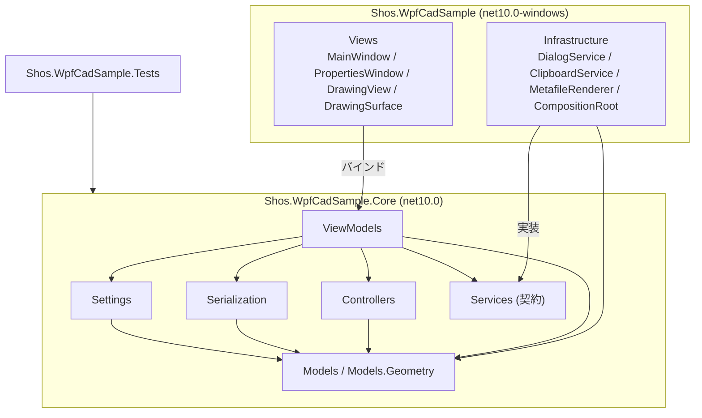

- 依存は一方向である：`Views` → `ViewModels` → `Controllers` → `Models`。`Models` は他のどれにも依存しない。
- `Controllers` は `ViewModels` に依存しない。`Controllers` が状態の変化をイベントで通知し、`ViewModels` がそれを購読して、バインド可能な状態に写す。
- `Core` は WPF のアセンブリ（`PresentationCore`、`PresentationFramework`、`WindowsBase`）を参照できない（アセンブリが `net10.0` のため、コンパイル時に強制される）。`ICommand` などの .NET 標準の型は、名前空間が `System.Windows.Input` でも使える。WPF の型（`ModifierKeys`、`Point` など）が必要な箇所は、`Core` に独自の型を定義し、`Views` で変換する。
- Material Design の型とスタイルは、`App.xaml` と `Views` の XAML／カスタムコントロールにとどめる（`Core` は参照できない）。

## 4. MVC と MVVM の役割分担

| 役割 | 担当 | 責務 |
|---|---|---|
| Model | `Models`、`Serialization`、`Settings` | 図形・属性・ドキュメントと、その規則（制約、検証、変換）。UI にも入力にも依存しない |
| View | `Views` | 表示とバインド。入力を `PointerEvent` などへ変換して `ICommand` へ渡す。アプリケーションの判断をしない |
| ViewModel | `ViewModels` | View にバインドする状態（図形の一覧、ハンドル、ビュー変換、属性、ステータス、ウィンドウの配置）とコマンド。ファイル操作の流れ（保存確認など）を扱う |
| Controller | `Controllers` | 入力の解釈（ツールごとの状態遷移）と、図形の編集の実行 |

- データの流れ（入力 → 更新 → 描画 → 永続化）：
  1. `DrawingSurface` が入力を `PointerEvent` に変換し、`DrawingViewModel` のコマンドへ渡す。
  2. `DrawingViewModel` が `EditorController` へ渡す。コントローラーは、現在のツールに応じて、入力中の状態や `Drawing` を更新する。
  3. `Drawing.Shapes`（`UndoRedoObservableCollection<Shape>`）の `CollectionChanged` で、`ItemsControl` が再描画される。コントローラーの状態（選択、入力中の図形、ステータス）の変化は、イベントで `DrawingViewModel` に伝わり、バインドされた View が更新される。確定的な変更は、`Drawing.Committed` → `EditorController`（選択の補正）→ `EditorController.Committed` → `DrawingViewModel`・`MainViewModel` の順に伝わる（5.3）。
  4. 保存時、`MainViewModel` が `DocumentStorage` へ図形の一覧を渡す。

## 5. クラス設計

### 5.1 Models（図形・属性・ドキュメント）

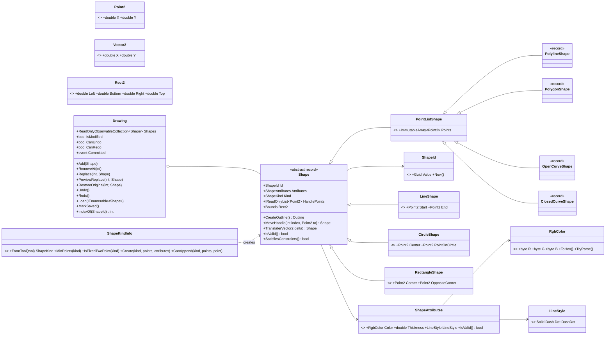

- `Shape` の抽象メソッドの責務（DD-12）：
  - `CreateOutline()`：描画の中間表現 `Outline` を返す。曲線は `SplineBezier`（5.2）、円は 4 本の 3 次ベジェ、矩形は閉じた折れ線で表す。
  - `HandlePoints`：選択ハンドルを置く点（矩形は 4 つの角、円は中心と円周上の点、ほかは定義点）。
  - `MoveHandle(index, to)`：ハンドルを動かした結果の図形を返す（仕様 5.3 の表のとおり。矩形は、動かした角の対角を固定し、円の中心は円全体を平行移動する）。
  - `Translate(delta)`：図形全体を平行移動する。
  - `SatisfiesConstraints()`：最小点数を除く仕様 6.3 の制約（隣り合う点が一致しない（最後と最初を含む種類あり）、矩形の幅・高さが 0 でない、半径 > 0、座標が有限）を満たすか。点の一致は、論理座標の完全一致で判定する（仕様 A-27）。制約の判定は、ここだけに置く。
  - `IsValid()`：最小点数を満たし、`SatisfiesConstraints()` が真で、属性が `ShapeAttributes.IsValid()` を満たすか。コンストラクターは例外を投げず、検証は `IsValid()` で行う（読み込み・貼り付け・編集で共通に使う）。
  - `Bounds`：`Outline` の外接矩形（線の太さは含めない）。
- 値の等価性：`ImmutableArray<Point2>` の `record` の等価性は参照で比較される。テストと実装は、図形の同一性を `ShapeId` で、点列の比較を `SequenceEqual` で行い、`record` の `==` に頼らない。
- `ShapeId`：保存しない（`[JsonIgnore]`）。読み込み・貼り付けで生成した図形には、新しい `ShapeId` が付く。`with` による置き換えでは引き継がれる。
- `ShapeAttributes.IsValid()`：太さが 0.5〜50（仕様 A-6）で有限、線種が定義済みの値であること。`ShapeAttributes.Default` の初期値は、黒、太さ 1.0、Solid（仕様 A-21）。
- `LineStyle` の破線のパターン（太さに対する倍率）：Dash `[4, 2]`、Dot `[1, 2]`、DashDot `[4, 2, 1, 2]`、Solid は実線（仮定 DA-5）。画面（WPF の `StrokeDashArray`）と出力（GDI+ の `DashPattern`）で、同じ倍率を使う。
- `ShapeKindInfo`：図形の種類ごとの入力規則（`Tool` から `ShapeKind` への対応、最小点数、2 点で確定する種類か）だけを持つ。制約の知識は持たない。
  - `FromTool`：`Tool` と `ShapeKind` の対応をこの 1 か所に置く。
  - `CanAppend(kind, points, point)`：1 点目は座標が有限であることだけを確かめる。2 点目以降は、点を加えた候補を `Create` で作り、`SatisfiesConstraints()` で判定する（直前の点と同じ、矩形の幅・高さが 0、閉じる図形で最後と最初が同じ位置になる点を拒否する。仕様 5.2）。入力時と読み込み時で、同じ判定を使う。
- `Drawing` の責務は、「図形の一覧と、その Undo / Redo、未保存状態を保つ」ことである。
  - 内部の一覧は、`UndoRedoObservableCollection<Shape>`（履歴の上限は 1,000。仮定 DA-1）。外部へは、読み取りと変更通知だけを持つ `ReadOnlyObservableCollection<Shape>` の `Shapes` として公開し、変更は `Drawing` の操作だけで行う（`IsModified` と `Committed` を迂回させない）。View は、この一覧にバインドする。
  - `Add` / `RemoveAt` / `Replace`：記録される変更。実行後に `IsModified = true` とし、`Committed` を発生させる。`Committed` を購読するのは `EditorController` だけとする（5.3）。
  - `PreviewReplace` / `RestoreOriginal`：`DisabledUndoScope` の内側での置き換え（記録されず、`Committed` も発生しない。DD-3）。`CollectionChanged` は発生するため、ドラッグ中の表示が更新される。
  - `Undo` / `Redo`：実行後に `IsModified = true` とし、`Committed` を発生させる（仕様 A-11）。
  - `Load`：`DisabledUndoScope` の中で一覧を入れ替え、`ClearUndo()` で履歴を消去し、`IsModified = false` とする。New も空の一覧での `Load` とする。
  - `MarkSaved`：`IsModified = false` にする。

### 5.2 Models.Geometry（座標・中間表現・スプライン・ビュー）

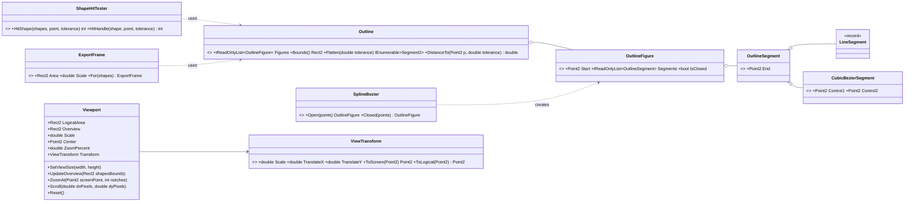

- `Outline`：直線と 3 次ベジェだけで図形を表す共通の中間表現。画面の描画（WPF のジオメトリへの変換）、ヒットテスト、EMF・画像の出力が、すべてこれを入力にする（DD-6）。
- `SplineBezier`（DD-7）：
  - `Open(points)`：自然 3 次スプライン。接線 `m` を `2·m0 + m1 = 3·(P1 − P0)`、`m(i−1) + 4·m(i) + m(i+1) = 3·(P(i+1) − P(i−1))`、`m(n−2) + 2·m(n−1) = 3·(P(n−1) − P(n−2))` の三重対角系としてトーマス法で解く。
  - `Closed(points)`：周期条件（添字は n を法とする）の巡回三重対角系を、Sherman-Morrison の公式で解く。
  - 区間 `P(i) → P(i+1)` の制御点は `C1 = P(i) + m(i)/3`、`C2 = P(i+1) − m(i+1)/3`。2 点の開いた曲線は直線になる。
  - 参照：Shos.BezierSamples の `BezierWpf/Geometry.cs`（MIT）の考え方。コードは複製せず、実装時に出典をコメントと README に記載する。
- `ShapeHitTester`：許容範囲 `tolerance` は論理座標で受け取る（`px ÷ Scale` を呼び出し側が計算する）。
  - `HitShape`：中心線からの距離が「線の太さ ÷ 2 + `tolerance`」以内なら線上とする（見えている線の上のクリックで選択できるようにする。仮定 DA-7）。距離は `Outline.DistanceTo`（ベジェは `Flatten` で折れ線へ近似。近似誤差は許容範囲より十分小さく取る。仮定 DA-2）で求める。重なる図形は最も上（後から追加した図形）を返す。内部のクリックでは選択しない（仕様 A-17）。
  - `HitHandle`：`tolerance` 以内のハンドルのうち、最も近いものの添字を返す（仕様 5.3、A-9）。
  - 判定の順序（選択中の図形のハンドル → 図形の線）は、`SelectInteraction` が決める（5.3）。
- `ExportFrame.For(shapes)`：EMF・画像の出力範囲（外接矩形に線の太さの半分を加えた範囲。仕様 A-10）と縮尺（1、または長辺が 10,000 論理単位を超える場合は `10,000 ÷ 長辺`。仕様 A-24）を求める純粋な関数。`MetafileRenderer` はこの結果だけを使って描く。
- `ViewTransform`：論理座標 → 画面座標 `(sx, sy) = (tx + s·x, ty − s·y)`（Y 反転を含む）と、その逆変換。ビュー変換は、ここに集約する（要件 §3）。
- `Viewport`（拡大縮小・スクロールの規則。仕様 5.6）：
  - `Overview`＝論理領域と全図形の外接矩形の和集合。全体図の拡大率（100%）は、`Overview` が表示領域に収まる倍率 `FitScale` である。`MinScale = FitScale`、`MaxScale = 32 × FitScale`（仕様 A-7）。
  - `ZoomAt`：1 ノッチ 1.2 倍（仕様 A-7）。カーソル位置の論理座標が動かないように `Center` を補正し、`Scale` を `[MinScale, MaxScale]` に制限する。
  - `Scroll`：画面上の移動量（50 px 単位。仕様 A-18）を論理座標へ換算して `Center` を動かす。表示範囲が `Overview` の外へ出ないよう制限する。全体図の表示中は動かない。
  - `UpdateOverview`：全体図を表示していた（`Scale = FitScale`）場合は、新しい全体図へ合わせ直す。拡大中は、`Scale` と `Center` を維持し、`MinScale` を下回る場合は `MinScale` に、`MaxScale` を上回る場合は `MaxScale` に（いずれも `Center` を維持）、表示範囲が外へ出る場合は内側に補正する（仕様 5.6）。呼び出しの契機は、`DrawingViewModel` が制御する（入力中・ドラッグ中は呼ばない）。
  - `ZoomPercent = Scale ÷ FitScale × 100`。

### 5.3 Controllers（入力の解釈と編集の実行）

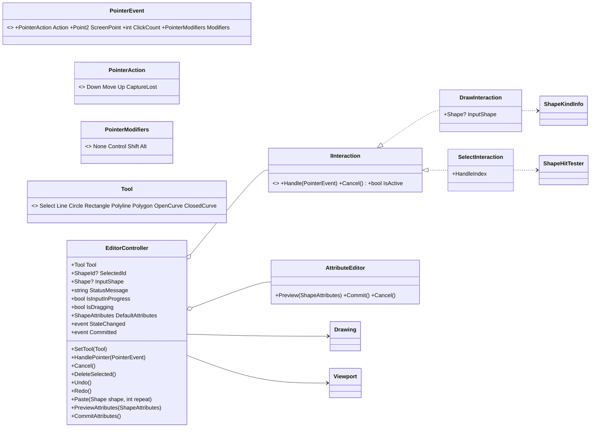

- `EditorController` の仕事は「現在のツールに応じて入力を解釈し、図形の編集を実行する」ことである。
  - 画面座標の入力を `Viewport.Transform` で論理座標へ変換し、許容範囲（画面上の px ÷ `Scale`）を論理座標へ換算してから、`DrawInteraction` または `SelectInteraction` へ渡す。
  - `SetTool` は、入力中の図形を取り消し、描画ツールへの切り替えで選択を解除する（仕様 5.10）。
  - 入力中は `Undo` / `Redo` / `Paste` を、ドラッグ中は `Undo` / `Redo` / `Paste` / `DeleteSelected` と、`MainViewModel` の Copy / Copy as Metafile / Copy as Image を実行しない（無効）。入力中の Copy as Metafile / Copy as Image は実行でき、入力中の図形を含めない（仕様 5.10）。`IsInputInProgress` / `IsDragging` を `ViewModels` が `CanExecute` に使う。
  - `Paste(shape, repeat)` は、図形に新しい `ShapeId` を付け、(X + 10·`repeat`, Y − 10·`repeat`) だけずらして配置し（仕様 5.7）、`Drawing.Add` で追加し、ツールを Select に切り替えて貼り付けた図形を選択する。`repeat`（1、2、…）の決定は `MainViewModel` の責務とする（5.4）。
  - `Drawing.Committed` を購読する唯一の型である。受けたら、選択中の `ShapeId` が存在すれば維持し、存在しなければ解除し（仕様 5.5）、その後に自身の `Committed` を発生させる。`ViewModels` は `EditorController.Committed` だけを購読するため、選択の補正が先に終わっていることが保証される。
  - 状態の変化は `StateChanged`、ドキュメントの確定的な変更は `Committed` で通知する。
- `DrawInteraction`（描画ツール）：
  - `Down`：`ShapeKindInfo.CanAppend` で許される点だけを追加する（拒否したときは、状態メッセージで伝える）。`ClickCount >= 2` の確定、または 2 点で確定する図形の 2 点目で、`ShapeKindInfo.Create` → `IsValid()` で検証し、`Drawing.Add` する。最小点数に満たなければ、追加せず取り消す。
  - `Move`：現在のマウス位置まで含めた入力中の図形（`InputShape`）を更新する（ゴムひも表示）。
  - `Cancel`（`Esc`）：点を破棄して、同じツールの入力待ちに戻る。
- `SelectInteraction`（Select ツール）：
  - `Down`：判定の順序は、選択中の図形のハンドル（`HitHandle`。最も近いもの）→ 図形の線（`HitShape`。上から順。選択中かどうかは問わない）とする（仕様 5.3、A-9）。ハンドル上 → そのハンドルのドラッグ、選択図形の線上 → 全体移動のドラッグ、未選択の図形の線上 → 選択して全体移動（仕様 A-4）、何もない場所 → 選択解除。
  - `Move`：3 px 以上動いたら、`Shape.MoveHandle` / `Translate` を適用した候補を作る。候補が `IsValid()` を満たさない場合は、直前の有効な状態を保つ（仕様 A-23）。有効なら `Drawing.PreviewReplace`（DD-3）。
  - `Up`：移動量が閾値未満ならクリックとして扱い、何も記録しない。それ以外は、`Drawing.RestoreOriginal` で元に戻してから、`Drawing.Replace` で最終の図形を 1 回だけ記録する。
  - `Cancel`（`Esc`）と `CaptureLost`（他のウィンドウへの切り替えなどによるマウスキャプチャの喪失）：ドラッグ中なら `Drawing.RestoreOriginal` で元に戻す（仕様 5.3、A-26）。ウィンドウの外でボタンを離した場合は、キャプチャ中のため通常の `Up` として確定する。
- `DrawInteraction` は `CaptureLost` を無視する（入力中の点は保つ）。
- `AttributeEditor`：選択図形の属性の編集（プレビューと確定）。スライダーなどの連続的な編集は、`Drawing.PreviewReplace` で表示し、操作の完了時に `CommitAttributes` が `RestoreOriginal` → `Replace` で 1 回だけ記録する（仕様 5.4）。

### 5.4 ViewModels

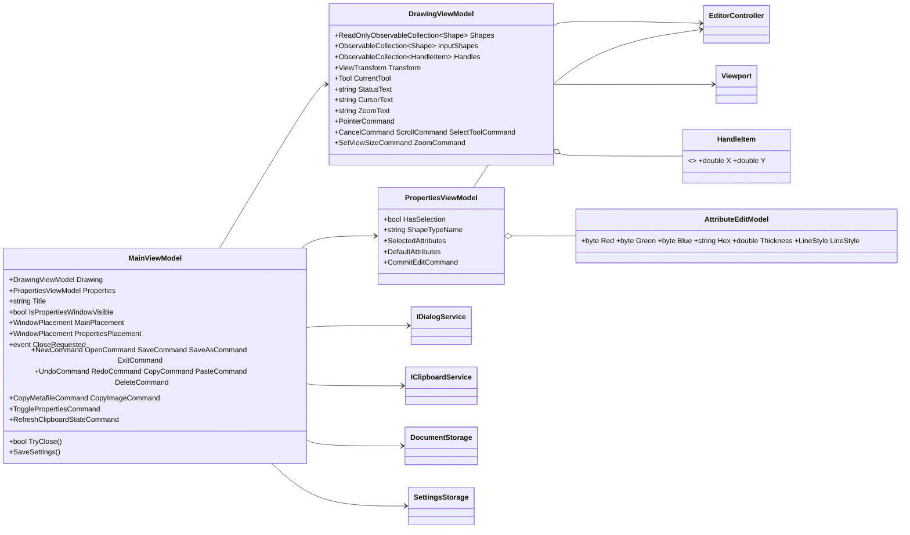

- `MainViewModel`：アプリケーション全体の状態とコマンド。ファイル操作の流れ（保存確認、Open / Save / New / Exit、エラー表示）、タイトル（`<名前>[*] - WPF CAD Sample`）、属性ウィンドウの表示状態、ウィンドウの配置、クリップボード関連のコマンドの有効状態を扱う。
  - Open / Paste の入力が不正なときは、`DocumentFormatException`（5.6）を受け取り、`IDialogService` でエラーを表示する。I/O の例外（`IOException`、`UnauthorizedAccessException`）とクリップボードの例外（`ClipboardOperationException`）も、ここで受けて表示する（仕様 7 章、8.2）。
  - ペーストのずらし量：最後に貼った独自形式のテキストと回数を持つ。貼るときにクリップボードのテキストが前回と同じなら回数を 1 増やし、異なれば 1 に戻して、`EditorController.Paste(shape, 回数)` を呼ぶ。`CopyCommand` の実行で回数を 0 に戻す（仕様 5.7）。判定に必要なクリップボードの内容を扱う `MainViewModel` に置く。
  - `RefreshClipboardStateCommand`：Paste・コピー系コマンドの有効状態を、クリップボードの内容に合わせて更新する。`Views` が、ウィンドウの再アクティブ化と Edit メニューを開いたときに呼ぶ（WPF にはクリップボードの変更通知がないため。リスク R-5）。
  - 終了の流れ（6.5）：`ExitCommand` は `CloseRequested` を発生させるだけで、保存確認はしない。`WindowClosingBehavior` が `CloseRequested` を受けてメインウィンドウを閉じ、`Closing`（タイトルバーの閉じるボタン、`Alt+F4` を含む）で `TryClose()` を呼ぶ。
  - `TryClose()`：入力中の図形を取り消し、未保存の変更があれば保存確認を行い、閉じてよいかを返す。閉じてよい場合は、続けて `SaveSettings()` を呼ぶ。
  - `SaveSettings()`：`MainPlacement`、`PropertiesPlacement`、`IsPropertiesWindowVisible`、`EditorController.DefaultAttributes` から `AppSettings` を組み立てて `SettingsStorage.Save` を呼ぶ。失敗はエラーを表示するが、終了を妨げない（仕様 7 章）。設定の組み立てと保存は、ここ 1 か所で行う。
- `DrawingViewModel`：描画領域の状態。`EditorController` と `Viewport` を保持し、バインドする `Transform`、`Handles`（画面座標のハンドル位置。選択と `Transform` の変化で再計算する）、`InputShapes`（入力中の図形。0 または 1 個）、ステータスの文言を公開する。
  - `EditorController.Committed` と、ファイルの読み込み・ウィンドウサイズの変更で、`Viewport.UpdateOverview` を呼び、`Handles` を更新する。入力中・ドラッグ中は呼ばない（仕様 5.6）。
  - ホイール・キー（`Ctrl+矢印`）・`Esc` は、コマンドで受ける。
- `PropertiesViewModel`：属性ウィンドウの状態。選択図形の属性（選択がなければ空欄・無効）と、新規図形の既定属性を、それぞれ `AttributeEditModel`（RGB のスライダー、16 進、太さ、線種。いずれかを編集すると他も連動する）で扱う。不正な入力は、直前の有効値へ戻す（仕様 5.4）。既定属性は `EditorController.DefaultAttributes` に反映し、設定に保存する対象にする。

### 5.5 Services（UI に依存する機能の契約）

| インターフェイス | 操作 | 実装 |
|---|---|---|
| `IDialogService` | `ShowOpenFileDialog()`、`ShowSaveFileDialog(suggestedName)`、`AskSaveChanges(name)`（`SaveChangesAnswer`：`Yes`（保存する）／ `No`（保存しない）／ `Cancel`。仕様 4.6）、`ShowError(title, message)`、`ShowWarning(message)` | `Infrastructure.DialogService`（`Microsoft.Win32` のダイアログと `MessageBox`。仕様 A-16） |
| `IClipboardService` | `SetShapesText(string)`、`GetShapesText()`、`ContainsShapes`、`CopyAsMetafile(IReadOnlyList<Shape>)`、`CopyAsImage(IReadOnlyList<Shape>)`。失敗はすべて `ClipboardOperationException`（`Services` に定義）で伝える | `Infrastructure.ClipboardService`（独自形式と画像は WPF の `Clipboard`、EMF は `MetafileRenderer` と Win32 の `NativeClipboard`） |

- クリップボードの独自形式の書式名は `Shos.WpfCadSample.Shapes`、データは JSON テキスト（5.6）。
- `MetafileRenderer`（DD-6）は、`Shape.CreateOutline()` を受けて `GraphicsPath`（`AddLine` / `AddBezier`）を作り、色・太さ・線種を `Pen` へ写す。Y 軸の反転（論理座標は上向き）と、`ExportFrame` の範囲への平行移動と縮尺（仕様 A-10、A-24。線の太さも同じ縮尺）を適用する。EMF は `Metafile` を作成して描画し、`GetHenhmetafile()` で得たハンドルを `NativeClipboard` が `CF_ENHMETAFILE` で渡す（成功後はクリップボードがハンドルを所有する）。画像は `Bitmap` に描いて PNG にし、`BitmapSource` として `Clipboard.SetImage` に渡す。生成と書き込みの失敗（GDI+ の `ExternalException`、大きすぎる `Bitmap` の `ArgumentException`、クリップボードの `COMException` など）は、`ClipboardService` が `ClipboardOperationException` に包んで伝え、クリップボードは変更しない（仕様 7 章）。

### 5.6 Serialization・Settings（永続化）

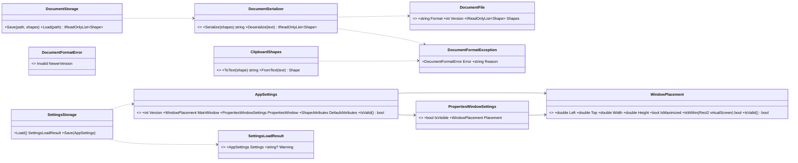

- 保存する JSON（仕様 6.4。`type` は図形の判別子）：

```json
{
  "format": "Shos.WpfCadSample.Document",
  "version": 1,
  "shapes": [
    { "type": "line", "start": { "x": 10, "y": 20 }, "end": { "x": 110, "y": 20 },
      "attributes": { "color": "#000000", "thickness": 1.0, "lineStyle": "Solid" } },
    { "type": "polyline", "points": [ { "x": 0, "y": 0 }, { "x": 10, "y": 5 } ],
      "attributes": { "color": "#FF0000", "thickness": 2.0, "lineStyle": "Dash" } }
  ]
}
```

  `type` の値：`line`、`circle`、`rectangle`、`polyline`、`polygon`、`openCurve`、`closedCurve`。
- `DocumentSerializer.Deserialize` の検証（仕様 7 章「不正とみなす条件」）：①JSON の解析（`JsonException`）、②形式の識別子とバージョン（現行より新しい場合は `DocumentFormatError.NewerVersion` を先に判定。1 未満は不正）、③未知の図形の種類・線種（判別子や列挙値の不一致は `JsonException`）、④必須項目（`required` と `[JsonRequired]`）、⑤色の形式（`RgbColor` の `JsonConverter`）、⑥各図形の `IsValid()`（座標の有限性、制約、点数、太さの範囲）。1 つでも不正なら全体を拒否し、`DocumentFormatException`（`Error`、理由）にまとめる。
- `ClipboardShapes`：独自形式のクリップボード用。同じ検証を使い、形式の識別子は `Shos.WpfCadSample.Clipboard`。図形はちょうど 1 個とし、0 個または 2 個以上は不正とする（仕様 6.6、7 章）。
- `DocumentStorage.Save`：同じフォルダーの一時ファイルへ書いてから `File.Replace`（新規は `File.Move`）で置き換える。失敗しても元のファイルを壊さない（仕様 7 章）。I/O の例外は呼び出し側（`MainViewModel`）へ伝える。
- `SettingsStorage`（`%APPDATA%\Shos.WpfCadSample\settings.json`。パスはコンストラクターで受け取る）：
  - `Load`：ファイルがなければ既定値（エラーではない）。仕様 7 章の「設定で不正とみなす条件」（JSON の解析、必須項目、バージョンが整数でない・1 未満・現行より新しい、`AppSettings.IsValid()`：既定属性が `ShapeAttributes.IsValid()` を満たし、各 `WindowPlacement.IsValid()`（位置・サイズが有限、幅・高さ > 0）を満たす）に 1 つでも該当すれば（仕様 A-28）、`settings.json.bak` へ退避（既存の退避ファイルは置き換える）して既定値を返し、`Warning` に文言を入れる。退避に失敗した場合も、その旨を `Warning` に入れて既定値を返す（仕様 7 章、A-22）。
  - `Save`：終了時に `MainViewModel.SaveSettings()` からだけ呼ぶ（A-22）。失敗（`IOException`、`UnauthorizedAccessException`）は呼び出し側で表示するが、終了を妨げない。
- `WindowPlacement.IsWithin(virtualScreen)`：保存した位置が現在のモニターに含まれるかを判定する純粋なメソッド。範囲外なら、既定の位置へ戻す（仕様 5.9）。仮想スクリーンの矩形は `Views` が渡す。

### 5.7 Views と Infrastructure

| 型 | 種類 | 責務 |
|---|---|---|
| `MainWindow` | Window（`MaterialDesignWindow`） | メニュー、ツールバー、`DrawingView`、ステータスバーの配置と、`MainViewModel` へのバインド。ショートカットは `InputBindings`（`Ctrl+Z` など）。コードビハインドは `InitializeComponent()` のみ |
| `PropertiesWindow` | Window（`MaterialDesignWindow`） | 属性ウィンドウ（モードレス）。`DataContext` は `MainViewModel` とし、内容は `Properties` にバインドする。「Selected Shape」と「Defaults for New Shapes」を Material Design のカード状の面で区切る。仕様 4.2 のショートカット（`Alt+F4` を除く）を、`MainWindow` と同じコマンドへの `InputBindings` として持つ（共有のリソースから定義し、二重に書かない）。テキストボックスは編集系キーを自身で処理する（仕様 5.4）。閉じる操作（`Alt+F4` を含む）は `WindowVisibilityBehavior` が取り消して非表示にする（仕様 4.5、A-25） |
| `DrawingView` | UserControl | 描画領域。層：①論理領域の枠（`Path`）、②図形の `ItemsControl`（`ItemsPanel` は `Canvas`、`RenderTransform` に `Transform` を適用）、③入力中の図形の `ItemsControl`（同上）、④ハンドルの `ItemsControl`（`Canvas`、画面座標）、⑤入力を受ける `DrawingSurface` |
| `DrawingSurface` | カスタムコントロール（`Themes\Generic.xaml` から、別ファイルの `Themes\DrawingSurface.xaml` を取り込む） | マウス・ホイールを `PointerEvent`（修飾キーは `PointerModifiers` へ変換）に変換して `PointerCommand`（依存関係プロパティ）へ渡す。ボタンを押したときにマウスキャプチャを取り、離したときに解放する。`Up` 以外でキャプチャを失った場合（`LostMouseCapture`）は `CaptureLost` を渡す（仕様 A-26）。`Ctrl+ホイール` はズーム用のコマンドへ。描画領域のサイズを `ViewSize`（依存関係プロパティ）として公開する。クリックで自分にフォーカスを移す。アプリケーションの判断は含まない |
| コンバーター | `ShapeToGeometryConverter`、`RgbColorToBrushConverter`、`LineStyleToDashesConverter`、`ViewTransformToMatrixConverter`、`EnumEqualsConverter` | 型の変換のみ。`ShapeToGeometryConverter` は `Shape.CreateOutline()` を、図形の `Bounds` の左下を原点とする相対座標の `StreamGeometry` へ変換する |
| ビヘイビア（添付プロパティ） | `EditCommit`、`WindowPlacementBehavior`、`WindowClosingBehavior`、`WindowVisibilityBehavior` | `EditCommit`：スライダー（ドラッグ完了・キー操作）、テキストボックス（`Enter`、フォーカス移動）、リスト選択の完了時に、確定のコマンドを呼ぶ。`WindowPlacementBehavior`：`RestoreBounds` を使った配置の保存・復元（最大化時を含む）。`WindowClosingBehavior`：`CloseRequested` でメインウィンドウを閉じ、`Closing` で `TryClose()` を呼び、偽なら閉じるのを取り消す（6.5）。`WindowVisibilityBehavior`：属性ウィンドウの表示状態とバインドし、閉じる操作を非表示に変える |
| `Infrastructure.CompositionRoot` | 起動時の組み立て | サービス、`Drawing`、`EditorController`、`Viewport`、各 ViewModel を作り、`MainViewModel` を公開する。`MainWindow` は `App.xaml` のリソースから `DataContext` を取得し、コードビハインドに起動時のコードを書かない。`StartupUri` で `MainWindow` を開く |
| `Infrastructure.DialogService`、`ClipboardService`、`MetafileRenderer`、`NativeClipboard` | `Services` の実装 | 5.5 のとおり |

- 図形の配置：`ItemContainerStyle` で `Canvas.Left="{Binding Bounds.Left}"`、`Canvas.Top="{Binding Bounds.Bottom}"` をバインドする（論理座標、Y 上向き）。層の `Transform`（Y 反転を含む）が画面座標へ変換する。`Path` の `StrokeThickness` は論理座標の太さ、`Stroke` は `RgbColorToBrushConverter`、`StrokeDashArray` は `LineStyleToDashesConverter` を使う。
- 選択ハンドルは、`Handles`（画面座標）に 8 px の四角を置く。描画領域の背景は全体を白とし、論理領域は枠線だけで示す（仕様 4.3）。拡大率に左右されない固定サイズ（仕様 A-18）。
- ツールバーのツールボタンは、`RadioButton` の `IsChecked` を `CurrentTool` と `EnumEqualsConverter` でバインドし、押すと `SelectToolCommand` を実行する。
- Material Design の適用：`App.xaml` に `materialDesign:BundledTheme`（`BaseTheme="Light"`、`PrimaryColor="Indigo"`、`SecondaryColor="Amber"`）と `MaterialDesign3.Defaults.xaml` を入れる。メニュー・ツールバー・ボタン・テキストボックス・スライダー・コンボボックス・ステータスバーには、ライブラリのスタイルを使う。使うスタイルの名前は、実装時に公式のドキュメントで確認する。自作のコントロールの外観は、テーマのブラシを `DynamicResource` で参照する。

## 6. 主要な動的フロー

### 6.1 ポリラインの入力と確定

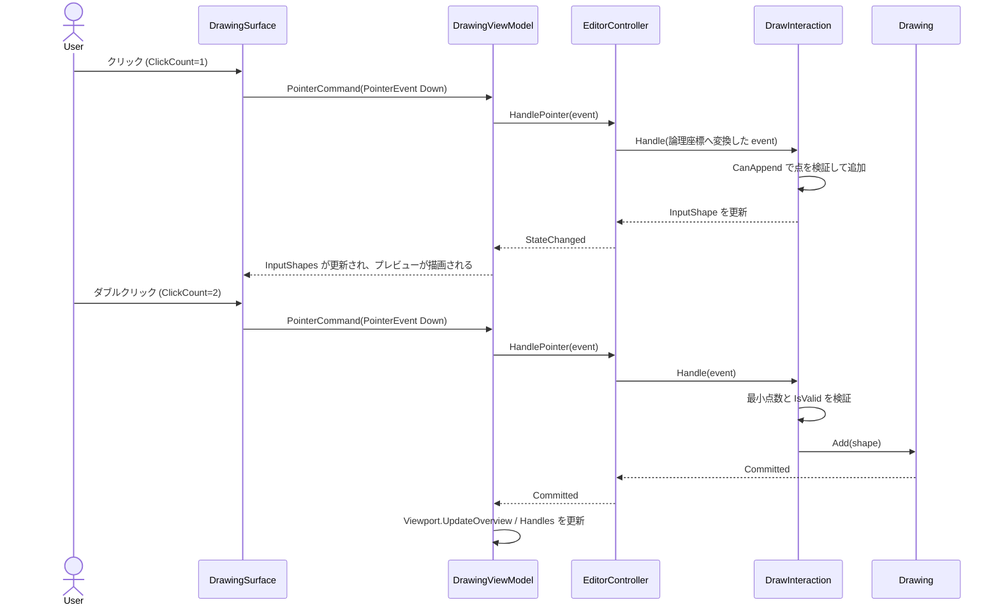

### 6.2 ドラッグによる編集（DD-3）

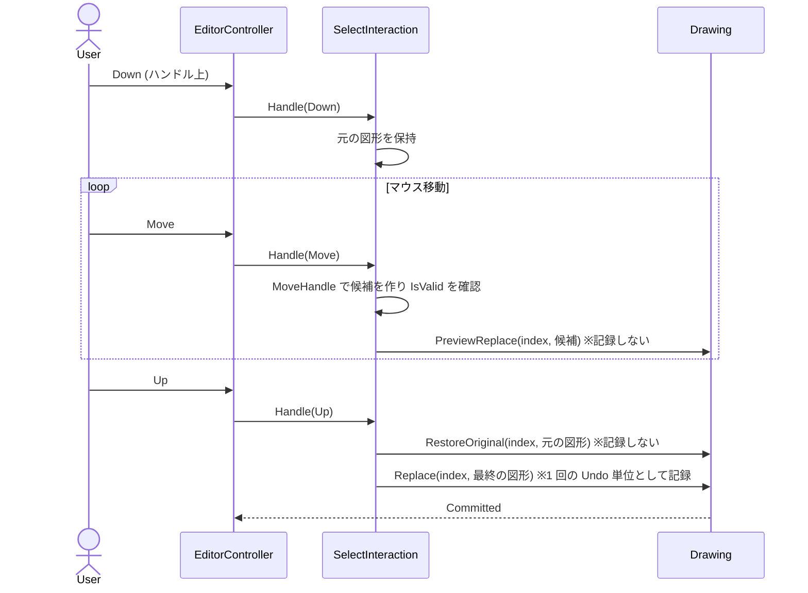

### 6.3 ツールの状態遷移

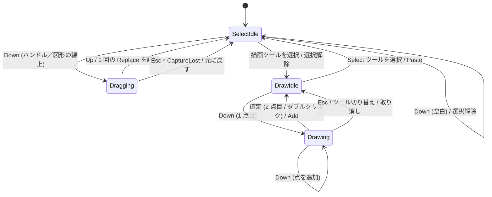

### 6.4 ファイルを開く

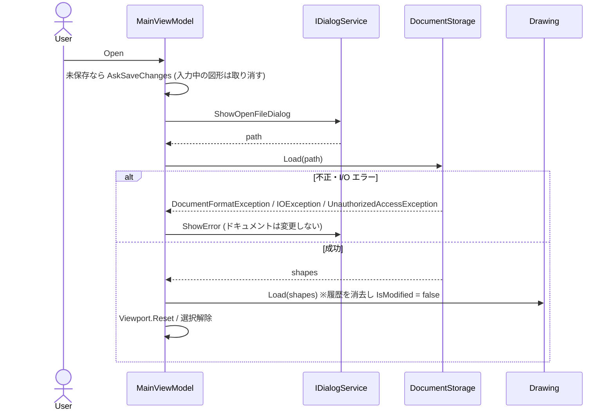

### 6.5 アプリケーションの終了

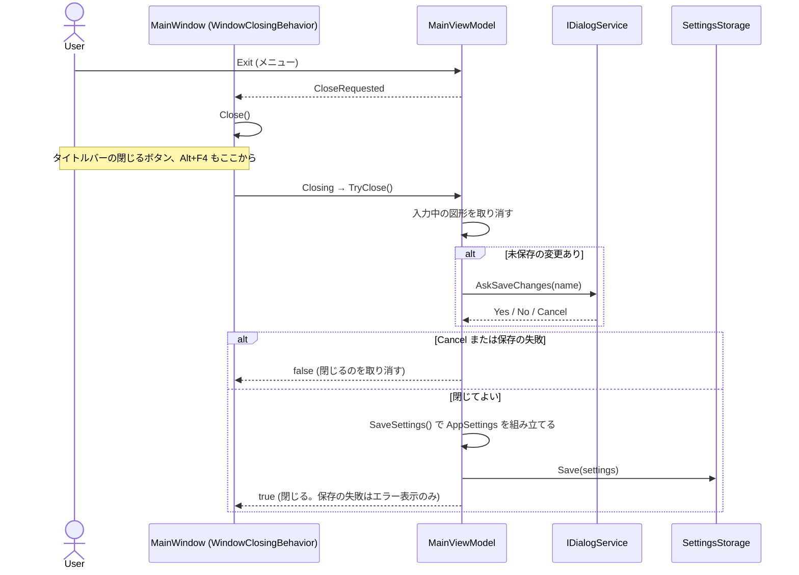

## 7. 要件・仕様から設計への対応

| ID | 要件・仕様 | 実現する設計要素 |
|---|---|---|
| F-01 | MVC + MVVM、namespace、`MainWindow` は Views | 3.2、4 章。`MainWindow` は `Views` |
| F-02 | `UserControl` 内の `ItemsControl`（Canvas）、依存関係プロパティ | `DrawingView`、`DrawingSurface`（5.7）。座標のバインドは 5.7 の「図形の配置」 |
| F-03 | 論理座標と描画座標の分離、線の太さは論理座標 | `ViewTransform`、`Viewport`（DD-4、5.2）。ハンドルとヒットテストは画面上の固定 px |
| F-04 | 7 種類の図形と入力方法 | `Shape` の 7 つの派生（5.1）、`ShapeKindInfo`、`DrawInteraction`（5.3） |
| F-05 | プレビュー、`Esc`、ダブルクリック確定、点数不足 | `DrawInteraction`、`InputShapes`（5.3、6.1） |
| F-06 | 自由線（3 次スプライン、ベジェ、周期） | `SplineBezier`（DD-7、5.2） |
| F-07 | 属性、既定属性 | `ShapeAttributes`、`PropertiesViewModel`、`AppSettings.DefaultAttributes`（5.1、5.4、5.6） |
| F-08 | 選択、ハンドル、ドラッグ、`Delete`、1 回 = 1 Undo | `SelectInteraction`、`ShapeHitTester`、`Drawing.PreviewReplace` / `Replace`（DD-3、5.3、6.2） |
| F-09 | モードレスな属性ウィンドウ、リアルタイム編集、状態の保存 | `PropertiesWindow`、`PropertiesViewModel`、`AttributeEditor`、`WindowPlacementBehavior`（5.3、5.4、5.7） |
| F-10 | Undo / Redo、選択状態との整合 | `UndoRedoObservableCollection<Shape>`、`Drawing`、`ShapeId`（DD-2、DD-11、5.1、5.3） |
| F-11 | 拡大縮小、全体図より縮小不可、スクロール | `Viewport`（5.2）、`DrawingSurface` のホイールとキーのコマンド |
| F-12 | クリップボード（独自形式、EMF、画像） | `ClipboardShapes`、`IClipboardService`、`MetafileRenderer`（DD-6、5.5、5.6） |
| F-13 | JSON 保存、バージョン、ファイル操作、保存確認 | `DocumentSerializer`、`DocumentStorage`、`MainViewModel`（5.4、5.6） |
| F-14 | 設定 JSON | `AppSettings`、`SettingsStorage`、`WindowPlacement`（5.6） |
| F-15 | テスト | 8 章。テスト計画書で具体化 |
| F-16 | 不要な機能 | 設計に含めない（印刷、複数選択、グループ化、スナップ、レイヤー、寸法線、テキスト図形、回転・拡大縮小） |
| F-17 | C# 14 / .NET 10、record、外部パッケージ | 3.1、DD-2、DD-10。`record` / `readonly record struct` を使う |
| F-18 | README、完了条件 | 実装計画書で扱う |
| F-19 | Material Design | DD-9、5.7 |
| A-17〜A-28 | 仕様の仮定 | A-17：`ShapeHitTester`。A-18：`Viewport` と `DrawingView`。A-19：`EditorController`。A-20：`Viewport.UpdateOverview`、`DrawingViewModel`。A-21：`ShapeAttributes.Default`。A-22：`SettingsStorage`、`MainViewModel.SaveSettings`。A-23：`SelectInteraction`。A-24：`ExportFrame`、`MetafileRenderer`。A-25：`PropertiesWindow`、`WindowVisibilityBehavior`。A-26：`DrawingSurface`（`CaptureLost`）、`SelectInteraction`。A-27：`Shape.SatisfiesConstraints`。A-28：`SettingsStorage.Load`、`AppSettings.IsValid` |
| 仕様 4.6、6.6 | 保存確認（Yes / No / Cancel）、独自形式の図形は 1 個 | `IDialogService.AskSaveChanges`（5.5）、`ClipboardShapes`（5.6） |

## 8. テスト容易性とエラー処理

### 8.1 テスト容易性

- `Models`、`Controllers`、`ViewModels`、`Serialization`、`Settings` は、WPF に依存しない `Core` にあり、`Tests` から直接テストできる（DD-1）。
- UI に依存する `IDialogService` と `IClipboardService` は、テストでは偽の実装に差し替える。ファイル I/O は、一時フォルダーのパスを渡して実際に確認する。
- 純粋な関数・型（`SplineBezier`、`Outline`、`ShapeHitTester`、`Viewport`、`ViewTransform`、`ExportFrame`、`Shape` の各メソッド、`ShapeKindInfo`、`DocumentSerializer`、`ClipboardShapes`、`AppSettings.IsValid`）は、入力と期待結果で検証する。
- `MainViewModel` は、偽の `IDialogService` と `IClipboardService`、一時フォルダーの `DocumentStorage`・`SettingsStorage` で、保存確認の分岐、例外の表示（読み取り専用の保存先を含む）、ペーストの回数、終了時に保存される設定を検証する。
- `EditorController` は、`PointerEvent` の列を与えて、`Drawing` の状態・`StateChanged`・`Committed` を検証する（入力中の状態遷移、ダブルクリック、`Esc`、ドラッグ 1 回 = Undo 1 回、制約違反の移動の拒否など）。
- テスト計画書で扱う最低限の項目（要件 §9）との対応：ベジェ変換 → `SplineBezier`、シリアライズの往復 → `DocumentSerializer`、移動・端点移動・ヒットテスト → `Shape` と `ShapeHitTester`、状態遷移 → `EditorController`、Undo / Redo → `Drawing` と `EditorController`、拡大率の下限 → `Viewport`。
- テストできず、実際の起動で確認する項目：描画の見た目、Material Design のスタイル、EMF・画像の他アプリケーションでの表示（AC-17）、モニターの構成、ウィンドウの復元。

### 8.2 エラー処理

| 層 | 方針 |
|---|---|
| `Models` | コンストラクターは例外を投げない。不正は `IsValid()` で表す。呼び出し側が不正な操作（制約違反）を拒否する |
| `Serialization` | 形式の不正を `DocumentFormatException`（`Invalid` / `NewerVersion`）で通知する。ファイルの I/O の例外は、そのまま伝える |
| `Settings` | 不正・破損は例外にせず、既定値と `Warning` を返す。保存の失敗は例外で伝える |
| `ViewModels` | `MainViewModel` が、`DocumentFormatException`、`IOException`、`UnauthorizedAccessException`（読み取り専用・権限なし。`IOException` の派生ではない）、`ClipboardOperationException` を受けて、`IDialogService` で英語のエラーを表示する（元のドキュメントは変更しない）。捕捉する例外はこの 4 種に限り、ほかの例外は握りつぶさない |
| `Views`／`Infrastructure` | クリップボードへの出力の生成と書き込みの失敗（他のアプリが使用中、GDI+ の失敗、大きすぎるビットマップなど）は、`ClipboardService` が `ClipboardOperationException` に包んで `MainViewModel` へ伝える（`Core` が GDI+ や COM の例外型に依存しないため） |

## 9. 仮定・リスク・トレードオフ・未決事項

### 9.1 設計上の仮定

| ID | 仮定 | 影響 |
|---|---|---|
| DA-1 | Undo 履歴の上限は 1,000 操作（ライブラリの既定は 100） | 仕様は上限を定めていない。超えると古い操作から破棄される |
| DA-2 | `Outline.Flatten` の許容誤差は、画面上 0.25 px 相当（論理座標では `0.25 ÷ Scale`）。ヒットテストの図形の線上の許容範囲（約 5 px）に比べて十分小さい | ヒットテストの精度 |
| DA-3 | 円は 4 本の 3 次ベジェ（各 90°）で近似する。半径に対する最大誤差は約 0.03% | 描画・出力 |
| DA-4 | 選択は `ShapeId` で表し、`ShapeId` は保存しない | DD-11 |
| DA-5 | 破線のパターンは、Dash `[4, 2]`、Dot `[1, 2]`、DashDot `[4, 2, 1, 2]`（太さの倍率） | 見た目。実装時に調整可能 |
| DA-6 | 画像の PNG は 8 bit の ARGB、画像の背景は白、EMF の背景は透明（仕様 A-10 のとおり） | 5.5 |
| DA-7 | 図形の線上の判定は、中心線からの距離が「線の太さ ÷ 2 + 許容範囲（約 5 px）」以内とする（仕様 A-9 の許容範囲を、見えている線の外縁から測る） | 5.2。太い線の選択の操作性 |

### 9.2 リスク

| ID | リスク | 対応 |
|---|---|---|
| R-1 | EMF を GDI+ の `Metafile` と `CF_ENHMETAFILE` で渡す方式が、Word などで期待どおりに貼り付けられない | 実装の最初に、小さな試作で確認する。実現できない場合は、本書を更新して再承認を得る |
| R-2 | `System.Drawing.Common` が WPF の WindowsDesktop フレームワークに含まれず、パッケージの追加が必要になる | 導入時に確認し、追加した場合は理由を README に記録する |
| R-3 | Material Design 3 の各スタイルの名前（例：メニュー、ツールバーのボタン）が、版によって異なる | 実装時に公式のドキュメントとソースで確認する |
| R-4 | 最大化したウィンドウの復元用の位置を、WPF の `Left` / `Top` から正しく得られない | `RestoreBounds` を使う（`WindowPlacementBehavior`） |
| R-5 | クリップボードの変更の通知が WPF にない | ウィンドウの再アクティブ化と Edit メニューを開いたときに、有効状態を更新する（5.4） |
| R-6 | `CommunityToolkit.Mvvm` のソースジェネレーターと C# 14 の組み合わせで、部分プロパティの扱いに制約がある | 導入時に確認し、問題があれば手書きのプロパティに切り替える |
| R-7 | `UndoRedoObservableCollection<T>` の `DisabledUndoScope` の内側で置き換えた要素が、履歴の添字と矛盾する | 置き換えは、同じ添字の同じ位置の要素に限る（元の図形へ戻してから記録する）。単体テストで Undo / Redo の整合を検証する |

### 9.3 トレードオフ

- 3 プロジェクトの分割は、構成が増える代わりに、依存の方向を参照関係で強制でき、UI なしで単体テストできる（DD-1）。
- 不変 record と置き換え方式は、変更のたびに図形を作り直すが、Undo / Redo の実装が単純になる（DD-2）。1,000 図形程度では問題にならない見込み（仕様 A-14）。
- `Shape` に `System.Text.Json` の属性を付けることで DTO を省いたが、保存形式の変更が `Models` に及ぶ（DD-8）。保存形式は 1 種類で、バージョンの管理は `DocumentFile` が行う。
- ドラッグ中の表示を `Drawing` への置き換えで行うため、`CollectionChanged` がマウス移動のたびに発生する。`Drawing.Committed` で確定的な変更と区別し、全体図の再計算などは `Committed` でのみ行う。

### 9.4 未決事項

| ID | 事項 | 扱い |
|---|---|---|
| U-3 | 画像・EMF の出力解像度と範囲、EMF の方式 | 2026-11-05 の本書の承認により、DD-6 と仕様 A-10 のとおり確定。出力の上限は仕様 A-24。方式の実現性は R-1 の試作で確認する |
| U-4 | Material Design 3 の配色 | 2026-11-05 の本書の承認により、DD-9 のとおり（`Indigo` と `Amber`）確定。`App.xaml` の 1 行で変更できる |

仕様書にない決定（DD-1〜DD-14、DA-1〜DA-6）は、2026-11-05 の本書のレビューで承認を得た。2026-11-06 に追加した DD-15、DA-7 と変更点は、再承認の対象とする。レビューで変更があれば、本書を更新して再承認を得る（下流の実装計画書・テスト計画書は、本書の承認後に作成した）。

## 10. 改訂履歴

| 日付 | 内容 |
|---|---|
| 2026-11-05 | 初版を作成（承認済みの仕様書に基づく） |
| 2026-11-05 | ユーザー指示により、`App` クラスだけをルート namespace 直下に置く例外を追加（3.1、DD-14）。この変更はユーザーが指示し、同時に明示的に承認した |
| 2026-11-06 | 仕様書の 2026-11-06 改訂（レビュー待ち）に伴い、状態を `レビュー待ち` に戻した |
| 2026-11-06 | [設計書のレビュー](../Reviews/20261106-cad-architecture-review.md)の指摘 1〜11 に対応：仕様の改訂の反映（保存確認 Yes / No / Cancel、`ExportFrame` による出力の上限、属性ウィンドウのショートカットと `Alt+F4`、最も近いハンドル、`CaptureLost`、`MaxScale` の補正、ドラッグ中の Copy 系の禁止、独自形式の図形 1 個、バージョン 1 未満、設定の検証）、`PointerModifiers` の導入、制約の判定の `Shape.SatisfiesConstraints()` への一本化と `ShapeKindInfo.FromTool`、捕捉する例外の明記と `ClipboardOperationException`、`Shapes` の読み取り専用での公開、ペーストの回数の持ち主（`MainViewModel`）、`Committed` の購読経路の一本化、終了の流れ（6.5、`SaveSettings`、`PropertiesWindowSettings`）、ヒットテストへの線の太さ（DA-7）、`IsValid()` への名前の統一、DD-15（ビュー変換の置き場所） |
| 2026-11-06 | ユーザーが再承認（状態を `承認済み` に更新） |
