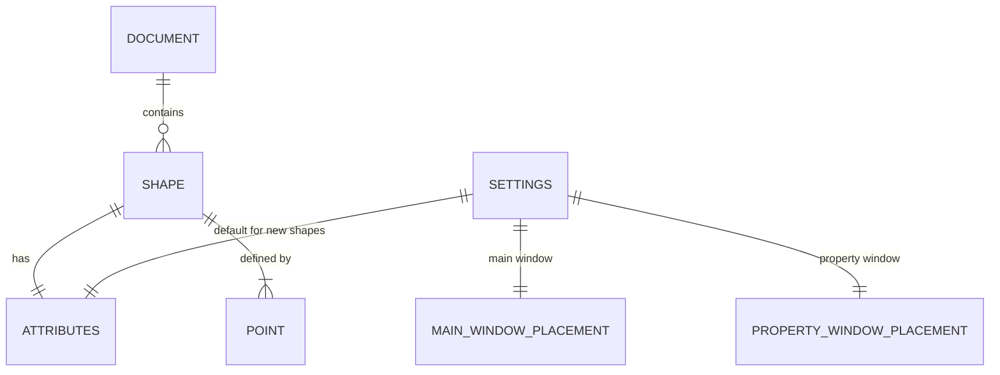

状態：レビュー待ち

# 簡易 WPF CAD 仕様書

- 作成日：2026-11-05
- 位置づけ：計画の段階1（仕様書）。次段階は `Documents\20261105-cad-architecture.md`（アーキテクチャー／クラス設計書）、その後 `Plans\` に実装計画書とテスト計画書。
- 根拠となる要件：[create-wpf-cad.prompt.md](../.github/prompts/create-wpf-cad.prompt.md)
- 作成手順：[create-cad-plan.prompt.md](../.github/prompts/create-cad-plan.prompt.md)
- 本書は「何を作るか」（機能・UI・概念データ）を定める。クラス構成・namespace・API 等の実装設計は設計書で扱う。

## 1. 目的・対象・スコープ

### 1.1 目的と利用場面

- WPF アプリケーションとして、簡易な 2D CAD を提供する。ユーザーは、線分・円・矩形・ポリライン・ポリゴン・自由線（スプライン曲線）を描き、選択・移動・削除・属性編集を行い、JSON ファイルへ保存し、他アプリケーションへ図を貼り付けられる。
- 対象ユーザー：図を手早く描きたい個人ユーザー。Windows デスクトップ上でマウスとキーボードを使う。
- 本リポジトリの目的は CAD のサンプル実装であり、商用 CAD の機能網羅は目指さない。

### 1.2 スコープ

| 区分 | 内容 |
|---|---|
| 対象 | 7 種類の図形の入力、選択・移動・端点移動・削除、属性の表示と編集（属性ウィンドウ）、Undo / Redo、拡大縮小とスクロール、クリップボード（独自形式・EMF・画像）、JSON 保存／読込、設定の保存、単体テストで検証可能な構成 |
| 対象外 | 印刷、複数選択、グループ化、スナップ、レイヤー、寸法線、テキスト図形、図形の回転・拡大縮小、塗りつぶし、グリッド表示、最近使ったファイル、多言語 UI、テーマ切り替え（ダークテーマ等）（要件にないため） |

## 2. 確定済みの方針（ユーザー回答・指示）

| ID | 事項 | 決定 |
|---|---|---|
| D-1 | 「全体図」の範囲 | 固定の論理領域を基本とし、はみ出した図形があれば外接矩形まで広げる |
| D-2 | UI の表示言語 | 英語のみ（メニュー、ボタン、メッセージ、ダイアログ） |
| D-3 | ドキュメントの拡張子 | `.json` |
| D-4 | 線の色の編集方法 | RGB スライダーと 16 進入力 |
| D-5 | UI の外観 | [Material Design in XAML Toolkit](https://github.com/MaterialDesignInXAML/MaterialDesignInXamlToolkit) を採用し、最新の版を使う。Light テーマの 1 種類とし、テーマ切り替えは行わない |

## 3. 要件トレーサビリティ

要件の出典は、すべて [create-wpf-cad.prompt.md](../.github/prompts/create-wpf-cad.prompt.md) の節番号（§）で示す。

| ID | 要件（要約） | 出典 | 仕様書での扱い |
|---|---|---|---|
| F-01 | MVC + MVVM、namespace 構成、`MainWindow` は Views | §2 | 設計書で扱う |
| F-02 | `UserControl` 内の `ItemsControl`（Canvas）で図形を描画。Dependency Property | §3 | 設計書で扱う。画面の外形は 4 章 |
| F-03 | 論理座標系と描画座標系の分離。線の太さは論理座標 | §3 | 5.1、6 章 |
| F-04 | 図形 7 種類と入力方法 | §4.1 | 5.2、6 章 |
| F-05 | 入力中のプレビュー、`Esc` 取り消し、ダブルクリック確定、点数不足は追加しない | §4.1 | 5.2 |
| F-06 | 自由線は 3 次スプライン（ベジェで実装）。開いた線は端点条件付き、閉じた線は周期 | §4.2 | 5.2（見え方）。アルゴリズムは設計書 |
| F-07 | 属性（色・太さ・線種）、既定属性を設定へ保存 | §4.3 | 5.4、6 章、5.9 |
| F-08 | 選択、ハンドル、端点／全体ドラッグ、`Delete`、ドラッグ 1 回 = Undo 1 単位 | §5.1 | 5.3、5.5、5.10 |
| F-09 | モードレスな属性ウィンドウ、リアルタイム表示・編集、表示状態・位置の保存 | §5.2 | 4.5、5.4 |
| F-10 | Undo / Redo 対象、ショートカット、選択状態との整合 | §5.3 | 5.5、5.10 |
| F-11 | `Ctrl+ホイール`で拡大縮小、全体図より縮小不可、`Ctrl+矢印`でスクロール | §6 | 5.6 |
| F-12 | クリップボード（独自形式、EMF、画像）、ペーストは Undo 対象 | §7 | 5.7 |
| F-13 | JSON 保存、バージョン番号、新規／開く／保存、変更時の保存確認 | §8 | 5.8、6 章、7 章 |
| F-14 | 設定 JSON を `%APPDATA%\Shos.WpfCadSample\settings.json` に保存 | §8 | 5.9、6 章、7 章 |
| F-15 | テストプロジェクト、最低限のテスト項目 | §9 | テスト計画書で扱う。検証可能な受け入れ条件は 8 章 |
| F-16 | 不要な機能 | §10 | 1.2 の対象外 |
| F-17 | C# 14 / .NET 10、record の活用、外部パッケージ | §1 | 設計書で扱う |
| F-18 | README、ビルド・テスト成功等の完了条件 | §11 | 実装計画書で扱う |
| F-19 | UI の外観に Material Design in XAML Toolkit を採用（アプリケーションのクローム。図形の色は図形属性） | §2.3 | D-5、4 章（4.0）。依存境界と適用方法は設計書で扱う |

## 4. 画面構成と UI デザイン

UI の表示言語は英語のみ（D-2）。

### 4.0 Material Design の適用方針

- 外観は Material Design in XAML Toolkit で構成する（D-5）。Material Design の最新の版である Material Design 3 のスタイルを使い、Light テーマの 1 種類とする（仮定 A-15）。使用するパッケージの版、リソース名、適用の手順は設計書で決める。
- 適用範囲は、アプリケーションのクローム（ウィンドウ、メニュー、ツールバー、ボタン、テキスト入力、スライダー、コンボボックス、ステータスバー、属性ウィンドウ）に限る。描画領域の図形の色・線種は図形属性で決まり、テーマには左右されない。描画領域の背景は白とする。
- ツールバーのボタンは Material Design のアイコンとし、英語のツールチップを付ける。メニュー項目は英語テキストを基本とし、必要に応じて同じアイコンを添える。
- 配色（プライマリー色・セカンダリー色）、アイコンの具体的な選択、余白などの細部は設計書で決める。仮定として、落ち着いた青系のプライマリー色と、対比のあるセカンダリー色を使う（仮定 A-15）。
- 既定の Material Design のコントロールにない見た目（描画領域、選択ハンドル）は、Material Design の配色・形に合わせて独自に作る。
- ファイルダイアログとエラー表示のメッセージボックスは OS 標準のものを使い、Material Design 固有のダイアログ・通知部品は使わない（仮定 A-16）。

### 4.1 メインウィンドウ

```text
+------------------------------------------------------------------------+
| File   Edit   View                                                     |  メニュー
+------------------------------------------------------------------------+
| [Select][Line][Circle][Rectangle][Polyline][Polygon][Open Curve]       |  ツールバー
| [Closed Curve]  |  [Undo][Redo]                                        |
+------------------------------------------------------------------------+
|                                                                        |
|                                                                        |
|                       Drawing area (描画領域)                          |
|                                                                        |
|                                                                        |
+------------------------------------------------------------------------+
| Tool: Line - Click the start point.   | X: 123.4  Y: 56.7 | Zoom: 100% |  状態表示
+------------------------------------------------------------------------+
```

- タイトルバー：`<ファイル名または Untitled>[*] - WPF CAD Sample`。未保存の変更があれば `*` を付ける。
- ウィンドウの位置・サイズ・最大化状態は設定へ保存し、次回起動時に復元する（5.9）。

### 4.2 メニューとツールバー

| メニュー | 項目 | ショートカット | 備考 |
|---|---|---|---|
| File | New | `Ctrl+N` | 保存確認後、空のドキュメントにする |
| File | Open... | `Ctrl+O` | 保存確認後、ファイルを開く |
| File | Save | `Ctrl+S` | 未保存の新規ドキュメントでは Save As と同じ |
| File | Save As... | `Ctrl+Shift+S` | |
| File | Exit | `Alt+F4` | 保存確認後に終了 |
| Edit | Undo / Redo | `Ctrl+Z` / `Ctrl+Y` | 履歴がなければ無効 |
| Edit | Copy | `Ctrl+C` | 独自形式。図形を選択しているときのみ有効 |
| Edit | Paste | `Ctrl+V` | クリップボードに独自形式があるときのみ有効 |
| Edit | Delete | `Delete` | 図形を選択しているときのみ有効 |
| Edit | Copy as Metafile | （なし） | 図形が 1 つ以上あるとき有効（EMF） |
| Edit | Copy as Image | （なし） | 図形が 1 つ以上あるとき有効（ビットマップ） |
| View | Properties Window | `F4` | 属性ウィンドウの表示／非表示（チェック付き） |

- ツールバーのツールボタン：Select、Line、Circle、Rectangle、Polyline、Polygon、Open Curve、Closed Curve。アイコンと英語のツールチップで示し、常にいずれか 1 つが選ばれた状態（排他）。選ばれたボタンは Material Design の選択状態の見た目で示す。起動時は Select。
- ツールバーの Undo / Redo ボタンは、Edit メニューと同じ有効／無効状態にする。
- 入力中・ドラッグ中のコマンドとツール切り替えの扱いは 5.10 のとおり。

### 4.3 描画領域

- 描画領域の背景は全体を白とし、論理領域（0〜1000 × 0〜700。仮定 A-1）の外形は薄い枠線だけで示す。領域外にはみ出した図形は表示し、はみ出した範囲を含めて全体図を決める（5.6）。
- 図形は追加順に重ねる（後から追加した図形が上）。
- 選択中の図形には、定義点（端点・頂点・通過点）ごとに画面上で固定サイズ（約 8 px。仮定 A-18）の四角いハンドルを表示する。
- 入力中の図形はプレビュー（確定前の仮表示）として、現在の既定属性で描く。
- カーソル：描画ツールでは十字、Select では矢印、ハンドル上では移動を示す形状にする。
- 描画領域をクリックするとキーボードフォーカスを得る（`Delete` と `Ctrl+矢印` の受け取りのため）。

### 4.4 状態表示（ステータスバー）

- 左：現在のツールと、入力中の操作案内（例：`Polyline - Click to add points. Double-click to finish. Esc to cancel.`）。
- 中央：カーソル位置の論理座標（小数 1 桁）。描画領域外では空欄。
- 右：現在の拡大率（全体図を 100% とする）。

### 4.5 属性ウィンドウ（プロパティウィンドウ）

- メインウィンドウとは別のウィンドウで、モードレス（開いたままメインウィンドウを操作できる）。メインウィンドウの前面に表示される。「Selected Shape」と「Defaults for New Shapes」の各区画は、Material Design のカード状の面で区切る。
- `View > Properties Window` または `F4` で表示／非表示を切り替える。タイトルバーの閉じるボタンは非表示とする（破棄しない）。
- 属性ウィンドウがアクティブなときの `Alt+F4` は、アプリケーションを終了せず、属性ウィンドウを非表示にする（`F4` と同じ）。
- 属性ウィンドウがアクティブなときも、4.2 の表のショートカット（`Alt+F4` を除く）は、メインウィンドウと同じコマンドとして働く。ただし、テキスト入力部品にフォーカスがあるときは 5.4 のとおりその部品が処理する（仮定 A-25）。

```text
+-- Properties ----------------------+
| Selected Shape                     |
|   Type:        Circle              |
|   Color:       [■]  #RRGGBB        |
|                R [-----|----]  255 |
|                G [--|--------]   0 |
|                B [-----|----]   0  |
|   Thickness:   [ 2.0      ]        |
|   Line style:  [ Solid         v ] |
|------------------------------------|
| Defaults for New Shapes            |
|   Color / Thickness / Line style   |
|   （上と同じ編集部品）             |
+------------------------------------+
```

| 区画 | 表示内容 | 有効状態 |
|---|---|---|
| Selected Shape | 選択中の図形の種類と属性（色、太さ、線種） | 図形を選択しているときのみ編集可能。選択がなければ空欄で無効 |
| Defaults for New Shapes | 新規図形に適用する既定属性 | 常に編集可能。ドキュメントの内容や Undo の対象ではない |

- 色は RGB スライダー（各 0〜255）、16 進入力（`#RRGGBB`）、色見本で表す。いずれかを編集すると他も即時に連動する（D-4）。入力部品は Material Design のテキストボックス（ヒント付き）、スライダー、コンボボックスのスタイルを使う。
- 太さは数値入力（論理座標の単位、範囲は仮定 A-6）。
- 線種は選択式（Solid、Dash、Dot、Dash-Dot）。

### 4.6 ダイアログとメッセージ

- Save As / Open：標準のファイルダイアログ。フィルター `CAD documents (*.json)`。
- 保存確認：`Save changes to "<name>"?`、ボタンは Yes（保存する）／ No（保存しない）／ Cancel（操作を中止する）。OS 標準のメッセージボックスの範囲で実現する（仮定 A-16）。New、Open、Exit の前に、未保存の変更があるときに表示する。
- エラー表示：メッセージボックス（エラーアイコン）に、操作名、原因、対象ファイルを示す英語の文を表示する。詳細は 7 章。

## 5. ユーザー操作と画面応答

### 5.1 座標系

- 図形は論理座標（X は右向き、Y は上向き、単位は実数の論理単位）で持つ。画面の座標へ変換して描くが、ユーザーの入力座標は画面座標から論理座標に変換して記録する。
- 線の太さは論理座標系の値で、拡大縮小に応じて画面上の太さが変わる。
- 選択ハンドルの大きさと、クリック判定の許容範囲は画面上の固定ピクセルとし、拡大率に左右されない（ハンドル判定 約 6 px、図形線上の判定 約 5 px。仮定 A-9）。
- 図形の内部は塗りつぶさない（要件にないため）。選択のクリック判定は図形の線上のみで、内部のクリックでは選択しない（仮定 A-17、未決事項 U-5）。

### 5.2 図形の入力

描画ツールを選ぶと、描画領域のクリックで図形を入力する。入力中は確定前の図形をプレビュー表示する（マウス位置まで追従する）。

| ツール | 入力操作 | 確定 | 最小点数 |
|---|---|---|---|
| Line | クリック 1 回目＝開始点、2 回目＝終了点 | 2 回目のクリック | 2 |
| Circle | 1 回目＝中心点、2 回目＝円周上の 1 点 | 2 回目のクリック | 2 |
| Rectangle | 1 回目＝1 点、2 回目＝対角の点（傾きなし） | 2 回目のクリック | 2 |
| Polyline | クリックごとに端点を追加 | ダブルクリック | 2 |
| Polygon | クリックごとに頂点を追加（最後の点と最初の点を結んで閉じる） | ダブルクリック | 3 |
| Open Curve | クリックごとに通過点を追加。通過点を滑らかに結ぶ 3 次スプライン曲線 | ダブルクリック | 2 |
| Closed Curve | クリックごとに通過点を追加。始点と終点がつながる閉じた滑らかな曲線 | ダブルクリック | 3 |

- ダブルクリックの確定：ダブルクリックの 1 回目のクリックで点を追加し、2 回目では点を追加せず確定する（同じ位置に余分な点が増えない）。
- 点数が最小点数に満たない場合は確定時に図形を追加せず、入力を取り消す（状態表示にその旨を表示する）。
- 図形の制約（6.3）に違反する点（直前の点と同じ位置、矩形で幅または高さが 0 になる位置など。Polygon・Closed Curve では、最後の点と最初の点が同じ位置になる場合も含む）のクリックは、点として追加せず、入力を継続する（状態表示にその旨を表示する）。
- `Esc`：入力中の図形（それまでの点とプレビュー）をすべて取り消し、同じツールの入力待ちに戻る。
- 確定後：図形は現在の既定属性で追加され、ツールは変わらない（続けて同じ図形を描ける）。追加した図形は選択しない（仮定 A-3）。
- 入力中の拡大縮小・スクロールは可能で、入力を取り消さない。
- 開いた自由線は両端でスプラインが終わり、閉じた自由線は始点と終点が滑らかにつながる。いずれも指定した通過点を必ず通る。2 点の開いた自由線は直線になる。

### 5.3 選択と編集（Select ツール）

- 図形の線上をクリックすると選択する。複数の図形が重なる場合は、最も上の図形を選ぶ。
- クリック判定の優先順位：(1) 選択中の図形のハンドル（複数が該当する場合は、最も近いハンドル）、(2) 図形の線（上にある図形から順。選択中かどうかは問わない）。ハンドルは、他の図形と重なっていても優先する（仮定 A-9）。何もない場所をクリックすると選択を解除する。同時に選択できる図形は 1 つ。
- 選択された図形にハンドルを表示する（4.3）。

| 図形 | ハンドル（定義点） | 端点ハンドルのドラッグ |
|---|---|---|
| Line | 開始点、終了点 | その点だけを移動 |
| Circle | 中心点、円周上の点 | 中心点：円全体を移動（半径は不変）。円周上の点：半径を変更 |
| Rectangle | 4 つの角 | ドラッグした角を移動し、対角は固定（矩形は傾かない） |
| Polyline / Polygon | 各頂点 | その頂点だけを移動 |
| Open / Closed Curve | 各通過点 | その通過点だけを移動（曲線は追従して再計算） |

- 端点ハンドルのドラッグ結果が図形の制約（6.3）に違反する位置になるときは、その位置へは移動しない。ドラッグ中、違反する位置にカーソルがある間は、図形は直前の有効な状態を保つ（仮定 A-23）。図形全体の移動は、制約に影響しない。

- ハンドル以外の、選択した図形の線上をドラッグすると、図形全体を移動する。未選択の図形の線上でドラッグを始めた場合は、その図形を選択して、そのまま移動する（仮定 A-4）。
- ドラッグ中は図形の表示を即座に更新する。マウスを離した時点で 1 回の Undo 単位として記録する。ドラッグの移動量がほぼゼロ（約 3 px 未満でマウスを離す）ときは、クリックとして扱い、変更として記録しない。ドラッグ中に `Esc` を押すと、ドラッグを取り消して元の位置に戻す。
- ドラッグ中にカーソルが描画領域やウィンドウの外へ出ても、ドラッグは続き、そこでマウスを離すと通常どおり確定する。他のウィンドウへの切り替え（`Alt+Tab` など）でマウスの操作が途切れた場合は、`Esc` と同じくドラッグを取り消す（仮定 A-26）。
- `Delete`：選択中の図形を削除し、選択を解除する。
- 図形を移動しても、論理領域の外への移動を禁止しない（5.6 の全体図が広がる）。
- 描画ツール使用中は、既存の図形のクリックでは選択しない。

### 5.4 属性の表示と編集

- 図形を選択すると、属性ウィンドウの「Selected Shape」へ、その図形の種類・色・太さ・線種を即座に表示する。選択を変えると表示を更新し、選択を解除すると空欄・無効にする。
- 「Selected Shape」で属性を編集すると、その場で図形の表示に反映する。連続的な入力（スライダーのドラッグ、テキスト入力）は、操作が完了した時点（スライダーを離す、`Enter` またはフォーカス移動、リスト選択）で 1 回の Undo 単位として記録する。
- 「Defaults for New Shapes」を編集すると、以降に追加する図形へ適用する。既存の図形は変えない。変更は設定ファイルに保存する（5.9）。
- 不正な入力（数値でない、範囲外、`#RRGGBB` でない色）は反映せず、入力部品を無効状態の見た目で示し、フォーカスを離れたときに直前の有効値へ戻す。
- テキスト入力部品（テキストボックスなど）にフォーカスがあるとき、`Ctrl+C` / `Ctrl+V` / `Ctrl+Z` / `Ctrl+Y` / `Ctrl+A` / `Delete` などの編集系キーは、図形ではなくその部品に作用する。

### 5.5 Undo / Redo

- 対象：図形の追加、削除、移動（全体・端点）、属性の変更（選択中図形）、ペースト。
- 対象外：ツールの切り替え、選択の変更、拡大率・スクロール位置、既定属性の変更、ファイル操作。
- `Ctrl+Z`（Undo）、`Ctrl+Y`（Redo）、メニュー、ツールバーから操作する。
- Undo / Redo 後、選択中の図形が存在しなくなった場合は選択を解除する。存在する場合は選択を維持し、属性ウィンドウの表示を現在の値に合わせる。
- New / Open で履歴を消去する。Save では履歴を維持する。

### 5.6 拡大縮小とスクロール

- 「全体図」：論理領域と、すべての図形の外接矩形との和集合（線の太さは含めない）を、描画領域に収まるよう中央に表示する状態。拡大率 100% とする（D-1）。
- 全体図の再計算：ウィンドウサイズの変更、図形の追加・削除・移動の確定・ペースト、Undo / Redo、New / Open で行う。入力中とドラッグ中は再計算せず、確定または取り消しの時点で行う（仮定 A-20）。
- 全体図が変わったとき：全体図を表示していた（100%）場合は、新しい全体図に合わせて表示し直す。拡大中は、表示の縮尺（1 論理単位あたりの画面上の大きさ）と表示の中心を維持する。ただし、縮尺が新しい全体図の縮尺を下回る場合は全体図の縮尺にし、拡大の上限（新しい全体図の 32 倍。仮定 A-7）を超える場合は上限の縮尺にする（いずれも表示の中心を維持する）。表示範囲が全体図の外へ出る場合は内側へ寄せる。拡大率の表示は、新しい全体図に対する比で更新する。
- `Ctrl+マウスホイール`：カーソル位置の論理座標が動かないよう拡大縮小する。1 ノッチごとに約 1.2 倍、または 1/1.2 倍（仮定 A-7）。
- 全体図（100%）より小さくは縮小できない。拡大の上限は仮定 A-7。
- 全体図の表示中は、画面全体が見えているのでスクロールできない。
- 拡大中は `Ctrl+矢印`（上下左右）で一定量（約 50 px。仮定 A-18）スクロールする。表示範囲は全体図の外側へは移動できない。
- スクロールバーは表示しない（仮定 A-8）。`Ctrl` なしのホイールは何もしない。
- 拡大率とスクロール位置は、ドキュメントには保存しない。New / Open で全体図に戻す。

### 5.7 クリップボード

| 操作 | 内容 | 条件 |
|---|---|---|
| Copy（`Ctrl+C`） | 選択中の図形を独自形式（JSON テキスト）でコピー | 図形を選択しているときのみ |
| Paste（`Ctrl+V`） | 独自形式の図形を追加。元の位置から (X + 10, Y − 10)（右下）だけずらして配置する（仮定 A-18）。同じクリップボードの内容を続けて貼ると、ずれ幅が累積する（10、20、…）。新たに Copy すると、1 回目に戻る | 独自形式がクリップボードにあるとき |
| Copy as Metafile | 描画内容を拡張メタファイル（EMF）としてクリップボードへ格納 | 図形が 1 つ以上 |
| Copy as Image | 描画内容を画像（ビットマップ）としてクリップボードへ格納 | 図形が 1 つ以上 |

- Copy as Metafile / Image の範囲：図形を選択していればその図形、なければドキュメント全体。出力範囲は対象図形の外接矩形（線の太さの半分を加える）とする。EMF の背景は透明、画像の背景は白（仮定 A-10）。出力に含めるのは図形だけで、選択ハンドル、入力中のプレビュー、論理領域の枠線は含めない。
- 画像の解像度は、1 論理単位 = 1 ピクセル（96 DPI）を既定とする（仮定 A-10。設計書で確定）。
- 出力の大きさの上限：出力範囲の長辺が 10,000 論理単位を超える場合は、長辺が 10,000 ピクセル（EMF では同じ縮尺）になるよう、縦横比を保って全体（線の太さを含む）を縮小して出力する（仮定 A-24）。出力の生成に失敗した場合はエラーを表示し、クリップボードは変更しない（7 章）。
- ペーストした図形は、1 回の Undo 単位として記録される。貼り付け後は、ツールが Select に切り替わり、貼り付けた図形が選択された状態になる（5.10）。
- 他アプリケーション（例：Word）に貼り付けたとき、EMF／画像として表示できること。

### 5.8 ファイル操作

- **New**：未保存の変更があれば保存確認を行い、空のドキュメント、未保存状態（Untitled）、全体図表示にする。
- **Open**：保存確認後、ファイルダイアログで選んだ JSON を読み込む。成功すると、現在のドキュメントを置き換え、履歴を消去し、全体図表示にする。失敗した場合は現在のドキュメントを変更しない。
- **Save**：現在のファイルへ上書き保存する。保存先が未決定のときは Save As と同じ。
- **Save As**：ファイルダイアログで保存先を選び保存し、以後の保存先とする。拡張子が `.json` でなければ補う。
- **変更状態**：図形・属性の変更（Undo / Redo を含む）で「変更あり」にし、Save / Save As / New / Open で解除する（仮定 A-11）。
- **Exit**：未保存の変更があれば保存確認を行う。Cancel を選ぶと終了しない。

### 5.9 設定

- 設定は `%APPDATA%\Shos.WpfCadSample\settings.json` に保存する。フォルダーがなければ作成する。
- 保存する項目：メインウィンドウの位置・サイズ・最大化状態、属性ウィンドウの表示状態と位置・サイズ、既定属性（色・太さ・線種）。
- 起動時に読み込む。ファイルがない場合は既定値を使う（初回起動。エラーではない）。保存した位置が現在のモニターに含まれない場合は、既定の位置に戻す。
- 設定は、アプリケーションの終了時に保存する（異常終了時の保存は保証しない。仮定 A-22）。

### 5.10 入力中・ドラッグ中の状態遷移

- 「入力中」は、描画ツールで 1 点以上を入力し、まだ確定していない状態。「ドラッグ中」は、マウスボタンを押したまま図形やハンドルを動かしている状態。
- ツールを切り替えると、入力中の図形は取り消される。描画ツールに切り替えたときは、選択が解除される（属性ウィンドウの「Selected Shape」は空欄・無効になる）。Select ツールに戻したとき、選択は復元しない。
- 入力中は、Undo / Redo と Paste を実行できない（メニュー、ツールバー、ショートカットのいずれからも無効）。Copy と Delete は、選択がないため実行できない。Copy as Metafile と Copy as Image は実行でき、入力中の図形を含めずにドキュメント全体を出力する。
- ドラッグ中は、Undo / Redo、Delete、Copy、Copy as Metafile、Copy as Image、Paste、ツールの切り替えを実行できない。`Esc` でドラッグを取り消せる。操作が途切れた場合の扱いは 5.3 のとおり。
- New、Open、Exit を実行すると、入力中の図形は取り消され、その後に保存確認を行う。Save と Save As は、入力中の図形を含めずに保存する。
- Paste は、入力中・ドラッグ中を除き、どのツールでも実行できる。貼り付けた後は、ツールを Select に切り替え、貼り付けた図形を選択する（仮定 A-19）。

## 6. 概念データ構造

実装クラスや API ではなく、保持する概念・情報・関連・制約を示す。



### 6.1 論理座標（POINT）

- X、Y の 2 つの実数。単位は論理単位。X は右向き、Y は上向きを正とする。

### 6.2 図形属性（ATTRIBUTES）

| 項目 | 内容 | 制約 |
|---|---|---|
| 線の色 | RGB（不透明） | 各 0〜255。ファイルでは `#RRGGBB` |
| 線の太さ | 論理単位の実数 | 範囲は 0.5〜50（仮定 A-6）。下限は、全体図の表示で識別できる太さとして定める |
| 線種 | Solid、Dash、Dot、DashDot のいずれか | 破線の間隔は太さに比例して変わる（仮定 A-6） |

- 既定属性（新規図形に適用する属性）の初期値は、色 `#000000`（黒）、太さ 1.0、線種 Solid とする（仮定 A-21）。

### 6.3 図形（SHAPE）

すべての図形は「種類」「定義点」「属性」を持つ。図形に塗りつぶしはない。

| 種類 | 定義点 | 最小点数 | 備考 |
|---|---|---|---|
| Line | 開始点、終了点 | 2 | 2 点は一致しない |
| Circle | 中心点、円周上の点 | 2 | 半径 = 2 点間の距離。半径 > 0 |
| Rectangle | 1 点、対角の点 | 2 | 辺は軸に平行。幅と高さがともに 0 より大きい（2 点の X 座標も Y 座標も一致しない） |
| Polyline | 順序付きの端点列 | 2 | 開いた折れ線。隣り合う点は一致しない |
| Polygon | 順序付きの頂点列 | 3 | 最後と最初が暗黙に結ばれる。隣り合う頂点（最後と最初を含む）は一致しない |
| Open Curve | 順序付きの通過点列 | 2 | 通過点を結ぶ開いた 3 次スプライン。隣り合う点は一致しない |
| Closed Curve | 順序付きの通過点列 | 3 | 通過点を結ぶ閉じた 3 次スプライン。隣り合う点（最後と最初を含む）は一致しない |

- すべての座標は有限の実数とする（NaN、無限大を許さない）。
- 「点が一致する」は、論理座標の X と Y がともに完全に等しいことをいう（許容誤差は設けない）。わずかでも異なる点は一致しない。入力（5.2）、編集（5.3）、読み込みとペースト（7 章）で同じ判定を使う（仮定 A-27）。
- 曲線の形状（ベジェの制御点）は定義点から導出し、保存しない。
- 図形の追加順（描画順）をドキュメントで保持する。
- 上記の制約は、入力（5.2）、編集（5.3）、ファイルの読み込みとペースト（7 章）に共通して適用する。

### 6.4 ドキュメント（DOCUMENT）

| 項目 | 内容 |
|---|---|
| 形式の識別子 | このアプリケーションの形式であることを示す文字列（拡張子が汎用の `.json` のため、他の JSON と区別する） |
| 形式のバージョン | 整数。現行は 1 |
| 図形の列 | 追加順の図形の並び。0 個を許す |

- 論理領域の大きさ、拡大率、スクロール位置、選択状態、Undo 履歴は保存しない。

### 6.5 設定（SETTINGS / MAIN_WINDOW_PLACEMENT / PROPERTY_WINDOW_PLACEMENT）

| 項目 | 内容 |
|---|---|
| 形式のバージョン | 整数。現行は 1 |
| メインウィンドウの配置（MAIN_WINDOW_PLACEMENT） | 位置（左・上）、サイズ（幅・高さ）、最大化状態 |
| 属性ウィンドウの配置（PROPERTY_WINDOW_PLACEMENT） | 表示状態、位置、サイズ |
| 既定属性 | 6.2 の属性一式（初期値は 6.2） |

### 6.6 クリップボードの独自形式

- 選択した図形を、6.3 の図形と同じ表現で持つ JSON テキスト。形式のバージョンを持つ。ドキュメント全体は含まない。
- 含む図形は、ちょうど 1 個とする（複数選択がないため）。0 個または 2 個以上の図形を含むものは不正とする（7 章）。

## 7. 入力検証・エラー表示・保存／読込時の振る舞い

エラーは握りつぶさず、ユーザーに分かる形で表示する。メッセージは英語（D-2）。

| 状況 | 振る舞い |
|---|---|
| 図形入力の点数不足、同一点 | 5.2 のとおり。図形を追加せず、状態表示で伝える |
| 属性の不正入力 | 5.4 のとおり。反映せず、直前の有効値へ戻す |
| Open：ファイルが存在しない／読み取り不可 | エラーダイアログ（ファイル名と原因）。現在のドキュメントは変更しない |
| Open：ファイルの内容が不正（下の「不正とみなす条件」に該当） | エラーダイアログ（`The file is not a valid CAD document.` と、判明した範囲の理由）。現在のドキュメントは変更しない |
| Open：現行より新しいバージョン | エラーダイアログ（`This file was created by a newer version and cannot be opened.`）。現在のドキュメントは変更しない |
| Save：書き込み失敗（読み取り専用、ディスク満杯、権限なし等） | エラーダイアログ（ファイル名と原因）。変更あり状態を維持し、元のファイルを壊さない |
| Paste：独自形式が不正（下の「不正とみなす条件」に該当） | エラーダイアログ。ドキュメントは変更しない |
| クリップボードへの出力の生成または書き込みの失敗（他アプリが使用中、メモリー不足等） | エラーダイアログ。ドキュメントとクリップボードの内容は変更しない |
| 設定の読み込み失敗（下の「設定で不正とみなす条件」に該当） | 破損したファイルを `settings.json.bak` に退避（既存の退避ファイルは置き換える）してから、既定値で起動し、`Settings could not be loaded. Default settings are used. The damaged file was saved as settings.json.bak.` を表示する。退避に失敗したときは、その旨を表示して既定値で起動し、破損したファイルは終了時の保存で置き換えられる（仮定 A-22） |
| 設定の保存失敗 | エラーダイアログを表示するが、アプリケーションの終了や編集は妨げない |

**不正とみなす条件**（Open と、Paste の独自形式に共通。1 つでも該当すれば全体を不正とする。Paste では、形式の識別子とバージョンは独自形式の種類として扱う）

- JSON として解析できない。形式の識別子が一致しない。必須項目がない。
- 形式のバージョンが整数でない、または 1 未満である。
- 未知の図形の種類、または未知の線種がある。
- 色が `#RRGGBB` の形式でない。太さが範囲（6.2）の外にある。
- 座標が数値でない、または有限でない（NaN、無限大）。
- 定義点の数が最小点数に満たない、または図形の制約（6.3）に違反する。
- Paste の独自形式では、図形がちょうど 1 個でない（6.6）。

現行より新しいバージョンは、上記とは別に、専用のメッセージで拒否する。

**設定で不正とみなす条件**（1 つでも該当すれば設定全体を不正とし、上の表の「設定の読み込み失敗」として扱う。仮定 A-28）

- JSON として解析できない。必須項目がない。
- 形式のバージョンが整数でない、1 未満である、または現行より新しい（設定は退避されるため、内容は `settings.json.bak` に残る）。
- 既定属性が 6.2 の制約に違反する（色の形式、太さの範囲、未知の線種）。
- ウィンドウの位置・サイズが有限の数値でない、または幅・高さが 0 以下である。

保存した位置が現在のモニターに含まれないことは不正ではなく、5.9 のとおり既定の位置に戻す。

- 保存は、ファイルの一部だけが書かれた状態を残さない（失敗時に元のファイルを破壊しない）。
- 読込は、1 件でも不正があれば全体を読み込まない（一部の図形だけが欠けた状態で開かない）。

## 8. 受け入れ条件

各条件は、実際の起動での操作、または単体テストで確認できる。

| ID | 条件 | 関連 |
|---|---|---|
| AC-01 | 7 種類のすべての図形を、5.2 の操作で入力でき、既定属性で追加される | F-04, F-07 |
| AC-02 | 入力中にプレビューが表示され、`Esc` で入力が取り消される | F-05 |
| AC-03 | ダブルクリックで確定し、余分な点が増えない。点数不足なら追加されない | F-05 |
| AC-04 | 開いた／閉じた自由線は、指定した通過点を通り、通過点で曲線が滑らか（3 次スプラインとして、1 階・2 階微分が連続）である。閉じた線では、始点でも同様に滑らかにつながる。判定の許容誤差は、テスト計画書で定める | F-06 |
| AC-05 | 図形の線上のクリックで選択でき、空白のクリックで解除できる。クリック判定の許容範囲は、拡大率によらず、仮定 A-9 の画面上のピクセル値（図形の線上 約 5 px）である。判定の優先順位は 5.3 のとおり（選択中の図形のハンドルが、上に重なる図形の線より優先される） | F-03, F-08 |
| AC-06 | 端点ドラッグで端点だけが動き、線上ドラッグで図形全体が動く。各図形の端点の動作は 5.3 の表のとおり | F-08 |
| AC-07 | `Delete` で選択図形が削除される | F-08 |
| AC-08 | ドラッグ 1 回が 1 回の Undo で元に戻り、Redo で再適用される | F-08, F-10 |
| AC-09 | 追加・削除・移動・属性変更・ペーストが Undo / Redo の対象である。Undo / Redo 後も、選択状態と属性ウィンドウの表示が矛盾しない | F-10 |
| AC-10 | 属性ウィンドウを表示／非表示でき、開いたままメインウィンドウを操作できる | F-09 |
| AC-11 | 図形を選択すると、属性ウィンドウに属性が即座に表示され、その場で編集できる。選択がなければ編集できない | F-09 |
| AC-12 | 新規図形に既定属性が適用される（初期値は黒、太さ 1.0、Solid）。既定属性を変更してアプリケーションを終了すると、次回起動時に復元される | F-07, F-14 |
| AC-13 | `Ctrl+ホイール` でカーソル位置を中心に拡大縮小できる。全体図より小さくならない | F-11 |
| AC-14 | 拡大中は `Ctrl+矢印` でスクロールでき、全体図の外へは動かない | F-11 |
| AC-15 | 固定領域外に図形があると、全体図がその図形を含むように広がる | F-11, D-1 |
| AC-16 | 独自形式でコピー＆ペーストでき、ずらした位置に貼られる。ペーストは Undo できる | F-12 |
| AC-17 | EMF と画像をコピーでき、他アプリケーション（例：Word）に貼り付けて図形が表示される | F-12 |
| AC-18 | 保存した JSON を読み込むと、図形・属性・描画順が往復で一致する | F-13 |
| AC-19 | 不正・破損・新しいバージョンのファイルを開くと、エラーが表示され、現在のドキュメントは変わらない | F-13 |
| AC-20 | 変更後に New / Open / Exit すると保存確認（Yes / No / Cancel）が表示され、Yes で保存してから、No で保存せずに操作を続け、Cancel で中止できる | F-13 |
| AC-21 | メインウィンドウと属性ウィンドウの位置・サイズ・表示状態が次回起動時に復元される | F-09, F-14 |
| AC-22 | 印刷など、対象外の機能が、メニュー、ツールバー、ショートカットに存在しない | F-16 |
| AC-23 | ウィンドウ、メニュー、ツールバー、属性ウィンドウ、ステータスバーが Material Design のスタイルで表示される。描画領域の図形は、図形属性の色・線種で表示される | F-19, D-5 |
| AC-24 | ファイルの保存に失敗しても、元のファイルが壊れず、変更あり状態が維持され、エラーが表示される | F-13 |
| AC-25 | 設定ファイルが破損している、または 7 章の「設定で不正とみなす条件」に該当していてもアプリケーションが起動し、既定値が使われ、元のファイルが `settings.json.bak` に退避される | F-14 |
| AC-26 | ドラッグ中に `Esc` を押すか、他のウィンドウへの切り替えで操作が途切れると、ドラッグが取り消され、図形が元の位置に戻り、Undo 履歴に追加されない。ウィンドウの外でマウスを離した場合は確定する | F-08, F-10 |
| AC-27 | 未保存の変更があるとき、ウィンドウのタイトルに `*` が表示され、保存または New / Open で消える | F-13 |
| AC-28 | 端点ドラッグで図形の制約（6.3）に違反する位置へは移動できない（半径 0 の円、同一点の線分、幅または高さが 0 の矩形が作れない） | F-08 |
| AC-29 | 入力中・ドラッグ中は、5.10 のコマンドが実行できない（入力中の Copy as Metafile / Copy as Image は実行でき、入力中の図形を含まない）。ツールを切り替えると入力中の図形が取り消され、描画ツールへの切り替えで選択が解除される | F-05, F-08, F-10 |
| AC-30 | 全体図が変わっても（図形を領域外へ移動して確定、削除、Undo など）、拡大中の表示が 5.6 のとおり維持または補正され、全体図より小さくならず、拡大の上限を超えない | F-11, D-1 |
| AC-31 | 属性値の範囲外、未知の図形の種類・線種、非有限の座標、制約違反、1 未満のバージョンを含むファイルまたは独自形式と、図形がちょうど 1 個でない独自形式は、拒否され、ドキュメントが変更されない | F-13, F-12 |
| AC-32 | 出力範囲の長辺が 10,000 論理単位を超えるドキュメントでも、Copy as Metafile / Copy as Image が停止せず、長辺 10,000 ピクセルに縮小して出力される。出力に失敗した場合はエラーが表示され、クリップボードは変更されない | F-12 |
| AC-33 | 属性ウィンドウがアクティブなとき、`Alt+F4` で属性ウィンドウだけが非表示になり（アプリケーションは終了しない）、`F4`、`Ctrl+Z`、`Ctrl+Y`、`Ctrl+S` などの 4.2 のショートカットがメインウィンドウと同じに働く（テキスト入力部品にフォーカスがある場合を除く） | F-09 |

## 9. 仮定と未決事項

### 9.1 計画上の仮定

要件に明記がなく、仕様として仮に決めた事項。承認時に変更を求めることができる。

| ID | 仮定 | 影響 |
|---|---|---|
| A-1 | 論理領域は 0〜1000 × 0〜700（Y 上向き、原点は左下）で固定とする。設定やファイルでは変更できない（コード上の定数）。ファイルには保存しない | 全体図の初期表示、拡大率の基準 |
| A-2 | 属性ウィンドウは、選択図形の編集と新規図形の既定属性の編集を 1 つのウィンドウの 2 区画で提供する。選択がないときに、既定属性を編集できるようにするため | 4.5 の UI。要件 §5.2「選択がないときは編集不可」は「Selected Shape」区画に適用 |
| A-3 | 図形を追加した後も、ツールは変わらず、追加した図形は選択しない | 5.2。連続入力の操作性 |
| A-4 | Select ツールで未選択の図形の線上をドラッグすると、選択して同時に移動する | 5.3 の操作 |
| A-5 | 最小点数：Polyline 2、Polygon 3、Open Curve 2、Closed Curve 3 | 5.2、6.3 |
| A-6 | 太さの範囲 0.5〜50。破線の間隔は太さに比例する（WPF の破線パターンの標準的な扱い） | 属性の検証、見た目 |
| A-7 | ホイール 1 ノッチあたり約 1.2 倍。拡大の上限は全体図の 32 倍 | 5.6 |
| A-8 | スクロールバーは表示せず、`Ctrl` なしのホイールは何もしない | 5.6 |
| A-9 | クリック判定の許容範囲：ハンドル約 6 px、図形の線上約 5 px。ドラッグと判定する移動量は約 3 px 以上。判定は、選択中の図形のハンドル（最も近いもの）、図形の線（上にある図形から順）の順に行う | 5.3 |
| A-10 | EMF の背景は透明、画像の背景は白。画像は 1 論理単位 = 1 ピクセル（96 DPI）。出力範囲は対象図形の外接矩形に線の太さの半分を足した範囲 | 5.7（設計書で確定） |
| A-11 | Undo / Redo も「変更あり」とする。保存済みの状態に Undo で戻っても、変更なしには戻らない | 5.8 |
| A-12 | ステータスバーを設け、ツールの操作案内、カーソルの論理座標、拡大率を表示する（要件にはないが入力操作の案内に必要） | 4.4。不要なら削除可能 |
| A-13 | 要件 §8 の設定項目の例のうち「最近使ったファイル」は、対応するメニューが要件にないため、含めない | 6.5 |
| A-14 | 1,000 図形程度のドキュメントで、図形の追加・選択・ドラッグ・拡大縮小の応答が 100 ms 以内であること（目安。測定方法はテスト計画書で定める） | 設計・テスト |
| A-15 | ユーザー指示「最新のものを使う」に従い、Material Design の最新の版（Material Design 3）と、そのパッケージの最新の安定版を使う。Light テーマのみ。配色は、落ち着いた青系のプライマリー色と対比のあるセカンダリー色とし、具体色、使用する版、リソース名は設計書で決める | 4.0 |
| A-16 | ファイルダイアログ、保存確認とエラーのメッセージボックスは OS 標準を使い、Material Design 固有のダイアログ・通知部品は導入しない（要件にない機能のため）。保存確認のボタンは、OS 標準のメッセージボックスで使える Yes / No / Cancel とする | 4.6、7 章、AC-20 |
| A-17 | 図形は塗りつぶさず、クリックによる選択は図形の線上のみとする（図形の内部のクリックでは選択しない） | 5.1、5.3、AC-05。U-5 で確認 |
| A-18 | 数値の目安：ハンドルの大きさ約 8 px、`Ctrl+矢印` のスクロール量約 50 px、ペーストのずらし量は (X + 10, Y − 10) | 4.3、5.6、5.7 |
| A-19 | 入力中・ドラッグ中のコマンドと、ツール切り替え、貼り付け後の選択は 5.10 のとおりとする | 5.10、AC-29 |
| A-20 | 全体図の再計算の契機と、全体図が変わったときの表示の維持・補正は、5.6 のとおりとする | 5.6、AC-30 |
| A-21 | 既定属性の初期値は、色 `#000000`、太さ 1.0、線種 Solid とする | 6.2、AC-12 |
| A-22 | 設定はアプリケーションの終了時にだけ保存する。破損した設定は `settings.json.bak` に退避して既定値で起動する | 5.9、7 章、AC-25 |
| A-23 | 端点ドラッグの結果が図形の制約（6.3）に違反する場合は、その位置へ移動させない | 5.3、AC-28 |
| A-24 | EMF・画像の出力範囲の長辺が 10,000 論理単位を超える場合は、長辺 10,000 ピクセル相当に縮小して出力する（巨大なビットマップによるメモリー不足を防ぐため） | 5.7、AC-32 |
| A-25 | 属性ウィンドウがアクティブなときの `Alt+F4` は属性ウィンドウを非表示にし、4.2 のその他のショートカットはメインウィンドウと同じに働く | 4.5、AC-33 |
| A-26 | ドラッグ中にウィンドウの外でマウスを離した場合は確定し、他のウィンドウへの切り替えなどで操作が途切れた場合は取り消す | 5.3、5.10、AC-26 |
| A-27 | 点の一致は、論理座標の完全一致で判定する（許容誤差なし） | 5.2、5.3、6.3、7 章 |
| A-28 | 設定は、7 章の「設定で不正とみなす条件」に 1 つでも該当すれば全体を不正とし、退避して既定値で起動する。現行より新しいバージョンの設定も同じに扱う | 6.5、7 章、AC-25 |

### 9.2 未決事項

| ID | 事項 | 影響 | 扱い |
|---|---|---|---|
| U-1 | 論理領域の大きさ（A-1）、太さの範囲（A-6）、拡大の上限（A-7）の具体値 | 数値のみ。構造には影響しない | 仮定のまま設計に進み、実装時に定数として調整可能 |
| U-2 | 属性ウィンドウの構成（A-2）。2 区画案でよいか | 4.5、5.4 の UI | 2026-11-05 の仕様書の承認により、2 区画案で確定 |
| U-3 | 画像・EMF の出力解像度と範囲（A-10） | 5.7 | 2026-11-05 の設計書の承認により、A-10 のとおり確定（設計書 DD-6）。出力の大きさの上限は A-24 |
| U-4 | Material Design 3 の配色（A-15） | 4.0 の見た目のみ。機能には影響しない | 2026-11-05 の設計書の承認により確定（設計書 DD-9） |
| U-5 | 図形の内部をクリックしても選択できるようにするか（A-17） | 5.1、5.3、AC-05 の操作性 | 2026-11-05 の仕様書の承認により、線上のみ（A-17）で確定 |

要件に未記載の事項は、上記の仮定と未決事項で扱う。U-1 は仮定のまま実装時に調整でき、U-2〜U-5 は承認により確定した。レビューで変更があれば、本書を更新して再承認を得る。

## 10. 改訂履歴

| 日付 | 内容 |
|---|---|
| 2026-11-05 | 初版を作成 |
| 2026-11-05 | [仕様書のレビュー](../Reviews/20261105-cad-specification-review.md)の指摘 1〜12 に対応：制約違反の編集（5.3、6.3）、全体図の変化時の表示（5.6）、入力中・ドラッグ中の状態遷移（5.10）、既定属性の初期値と太さの範囲（6.2）、読み込み時の検証条件（7 章）、仮定 A-17〜A-23 と未決事項 U-5 の追加、実装詳細の除去（4 章）、クリップボードと設定の細部、受け入れ条件 AC-24〜AC-31 の追加、ER 図と A-1・A-14 の整合 |
| 2026-11-05 | ユーザーが承認（状態を `承認済み` に更新） |
| 2026-11-06 | [仕様書の再レビュー](../Reviews/20261106-cad-specification-review.md)の指摘 1〜12 に対応：保存確認のボタン（4.6、A-16）、出力の大きさの上限（5.7、A-24）、属性ウィンドウのキー操作（4.5、A-25）、クリック判定の優先順位（5.3、A-9）、ドラッグの途切れ（5.3、5.10、A-26）、拡大の上限の補正（5.6）、点の一致の判定（6.3、A-27）、独自形式の図形数（6.6、7 章）、設定とバージョンの検証（7 章、A-28）、入力中の Copy as Metafile / Image（5.10）、描画領域の背景（4.3）、未決事項の確定状況（9.2）。AC-32、AC-33 を追加し、AC-05、AC-20、AC-25、AC-26、AC-29〜AC-31 を更新。状態を `レビュー待ち` に戻した |
