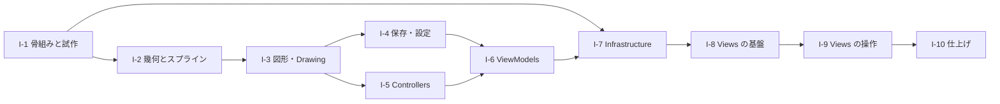

状態：承認済み

# 簡易 WPF CAD 実装計画書

- 作成日：2026-11-05
- 位置づけ：計画の段階3（実装計画書）。[テスト計画書](./20261105-cad-test-plan.md)と一組で、同時にレビューへ提示する。
- 前提とする承認済み文書：
  - [20261105-cad-specification.md](../Documents/20261105-cad-specification.md)（仕様書。唯一の要件の文書）
  - [20261105-cad-architecture.md](../Documents/20261105-cad-architecture.md)（アーキテクチャー／クラス設計書。2026-11-06 改訂・再承認済み）
- 進捗の記録先：[Progress\20261105-cad-progress.md](../Progress/20261105-cad-progress.md)
- 本書は「いつ、何を、どの順で作るか」を定める。仕様・設計は再定義しない。実装の詳細で設計と食い違う場合は、9 章の手順に従う。

## 1. 目的・スコープ・前提

### 1.1 目的

承認済みの仕様書と設計書に基づき、簡易 WPF CAD を、既存のソリューション `Source\Shos.WpfCadSample\Shos.WpfCadSample.slnx` 内に実装する。段階ごとにビルドとテストを成功させ、段階の終わりごとに動作を確認できる状態を保つ。

### 1.2 スコープと対象外

| 区分 | 内容 |
|---|---|
| 対象 | 設計書 3.1 の 3 プロジェクト（`Shos.WpfCadSample.Core`、`Shos.WpfCadSample`、`Shos.WpfCadSample.Tests`）の作成と、仕様書の全機能（F-01〜F-19、AC-01〜AC-35）の実装。`Source\README.md` の作成 |
| 対象外 | 仕様書 1.2 の対象外の機能（印刷、複数選択、グループ化、スナップ、レイヤー、寸法線、テキスト図形、回転・拡大縮小、塗りつぶし、グリッド、最近使ったファイル、多言語、テーマ切り替え）。UI の自動化テスト（テスト計画書 2 章）。CI の構築 |

### 1.3 現状（2026-11-06 時点）

- I-1 の途中まで進んでいる。3 プロジェクト（`Shos.WpfCadSample.Core`、`Shos.WpfCadSample`、`Shos.WpfCadSample.Tests`）を `Source\Shos.WpfCadSample\Shos.WpfCadSample.slnx` に登録し、`Directory.Build.props`、設計書 3.2 のフォルダー、T-ARC-01・02・04、`Source\README.md` の骨子を作成済み。2026-11-06 に Windows の `dotnet` でビルド（警告・エラーなし）とテスト（3 件成功）を確認した。
- I-1 の残り（試作 R-1、R-2、R-6、パッケージの版の確認 P-1、README へのテスト用付随パッケージの理由の追記）と、各段階の実施状況は、[進捗記録](../Progress/20261105-cad-progress.md)を正とする。作成済みの骨組みは作り直さない。
- 開発環境：Windows 側の .NET SDK 10.0.403、`Microsoft.WindowsDesktop.App` 10.0.14 のランタイムを確認済み（2026-11-05）。WPF のプロジェクトは Linux の `dotnet` ではビルド・テストできないため、ビルドとテストは Windows の `dotnet` で行う（3.2）。

## 2. 段階の一覧と依存関係

設計書の層の順（`Models` → `Controllers` → `ViewModels` → `Views`）に沿って、10 段階で進める。



| 段階 | 名称 | 前提 | 主な成果物（配置先） | 対応するテスト群（テスト計画書） |
|---|---|---|---|---|
| I-1 | 骨組みと試作 | なし | 3 プロジェクト、`Directory.Build.props`、README の骨子、試作と確認の結果（R-1、R-2、R-6、R-8） | T-ARC |
| I-2 | 幾何とスプライン | I-1 | `Models.Geometry`（点・矩形・`Outline`・`SplineBezier`・`ViewTransform`・`Viewport`） | T-GEO、T-SPL、T-OUT、T-VPT |
| I-3 | 図形・属性・Drawing | I-2 | `Models`（`Shape` 7 種、属性、`ShapeKindInfo`、`Drawing`）、`ShapeHitTester`、`ExportFrame` | T-SHP、T-ATT、T-HIT、T-DRW、T-EXP |
| I-4 | 保存・設定 | I-3 | `Serialization`、`Settings` | T-SER、T-STO、T-SET |
| I-5 | Controllers | I-3 | `Controllers`（`EditorController`、各 Interaction、`AttributeEditor`） | T-EDC |
| I-6 | ViewModels と契約 | I-4、I-5 | `ViewModels`、`Services`（契約） | T-VM |
| I-7 | Infrastructure | I-1、I-6 | `Infrastructure`（ダイアログ、クリップボード、EMF・画像の出力、Win32 呼び出し） | ビルドのみ（手動の M-12〜M-14 は I-9 で実施） |
| I-8 | Views の基盤 | I-7 | `App.xaml`（Material Design 3）、`CompositionRoot`、`MainWindow`、`DrawingView`、コンバーター、図形の描画 | 手動（M-01、M-02） |
| I-9 | Views の操作 | I-8 | `DrawingSurface`、入力とキー、カーソルの形、`PropertiesWindow`、ビヘイビア | T-EDC-38、T-VM-29、手動（M-03〜M-20） |
| I-10 | 仕上げ | I-9 | `Source\README.md`、警告ゼロ、構造の確認、スモークテスト | T-ARC、手動（M-21 ほか全項目） |

- I-4 と I-5 は、どちらも I-3 の後に着手できる（互いに依存しない）。ただし、進め方は、一度に 1 段階を完了させる（9 章）。
- 段階の順序を変える場合、または段階を統合・分割する場合は、本書を更新して再承認を得る。

## 3. 各段階の共通の進め方と完了条件

### 3.1 共通の手順

1. **開始時**：仕様書・設計書・実装計画書・テスト計画書の先頭行がすべて `状態：承認済み` で、相互に整合していることを確認する。不足・未承認・矛盾があれば実装せず、該当文書の作成または更新へ戻る。承認済みの仕様書と設計書を唯一の詳細仕様として扱う。[進捗記録](../Progress/20261105-cad-progress.md)に、その段階の開始と前提の確認を記録する。スキルを使う前に、リポジトリ指示に従って `.github\skills\` と `.claude\skills\` の複製を比較し、差があれば報告する。`.github\skills\sustainable-code-jp\SKILL.md` と、作業に応じた `references\` を読む（新機能は `testing.md` の「テストファースト」ほか、設計の判断を伴う箇所は `object-design.md`、`simplicity.md`）。
   - その段階のテスト対象のプロジェクトがまだない場合は、まずテスト可能な骨組みを用意する。
2. **テストファースト**：Red（失敗するテスト）→ Green（最小の実装）→ Refactor の順で進める。バグの修正は、まず再現テストを追加して Red を確認する。
3. **小さく刻む**：意味のある一手ごとに、関連するテストを実行する。壊れた状態で次の一手へ進まない。
4. **段階の終わり**：次の完了条件をすべて確認する。

### 3.2 全段階に共通の完了条件

| # | 条件 | 確認方法 |
|---|---|---|
| C-1 | ビルドが警告・エラーなしで成功する | `dotnet build Source/Shos.WpfCadSample/Shos.WpfCadSample.slnx`（リポジトリルートから） |
| C-2 | テストがすべて成功する（理由を記録していない `Skip` はない） | `dotnet test Source/Shos.WpfCadSample/Shos.WpfCadSample.slnx`（リポジトリルートから） |
| C-3 | その段階のテスト群（2 章の表）の全テストケースが実装され、成功している | 進捗記録の「実装の進捗」にある、テスト群ごとの実装状況の表（I-1 で追加する）で確認 |
| C-4 | セルフチェック（`sustainable-code-jp` SKILL.md 末尾）に回答できる。範囲外の気づきは、臭いの名前で記録する | 進捗記録に記載 |
| C-5 | 要件にない機能・抽象・備えを足していない（YAGNI） | 差分の確認 |
| C-6 | 進捗記録に、実行したコマンドと結果、未解決の課題、次の段階を記録した | 進捗記録 |

- C-1・C-2 のコマンドは、Windows のシェルと bash のどちらでも通るよう `/` 区切りで書き、Windows の `dotnet` で実行する（WSL からは `dotnet.exe`。リポジトリ指示の「Build and test」）。Windows の `dotnet` を使えない環境では、確認できなかったことと理由を進捗記録に書き、完了とはしない。
- `dotnet build` の警告ゼロは、`Directory.Build.props` の `TreatWarningsAsErrors`（I-1 で設定）で強制する。
- UI を含む段階（I-7〜I-10）は、C-1〜C-2 に加えて、テスト計画書の手動テストの該当項目を実施し、結果（合否と所見）を進捗記録に記録する。エージェントがアプリの画面を操作できない場合は、手動テストの手順をユーザーに示して実施を依頼し、結果を進捗記録に記録する。実施していない項目を合格としない。
- コミットは、ユーザーが依頼したときだけ行う。

## 4. 使用する技術・ライブラリ

| 区分 | 技術・ライブラリ | 使用するプロジェクト | 備考 |
|---|---|---|---|
| 言語・実行環境 | C# 14、.NET 10（Core と Tests は `net10.0`、WPF アプリは `net10.0-windows`） | すべて | Nullable 参照型を有効にし、警告はゼロにする |
| Undo / Redo | `Shos.UndoRedoList`（`UndoRedoObservableCollection<T>`） | Core | 確認時点の最新の安定版は 1.0.8（net10.0 対応を確認済み） |
| MVVM 補助 | `CommunityToolkit.Mvvm` | Core | 確認時点の最新の安定版は 8.4.2（DD-10、R-6） |
| UI の外観 | `MaterialDesignThemes`（Material Design 3、Light） | WPF アプリのみ | 確認時点の最新の安定版は 5.4.0（`net10.0-windows` 対応を確認済み）。プレリリースと CI 版は使わない |
| GDI+（EMF・画像） | `System.Drawing.Common`（フレームワークに含まれる場合は不要） | WPF アプリ | 確認時点のパッケージは 10.0.14。要否は I-1 で確認（R-2） |
| JSON | `System.Text.Json`（標準ライブラリ） | Core | 追加のパッケージは不要 |
| テスト | `xunit` と、`dotnet test`（VSTest）で動作する互換のランナー・`Microsoft.NET.Test.Sdk` | Tests | 確認時点の最新の安定版は xunit 2.9.3。実績のある v2 系の組み合わせで、`slnx` 全体の `dotnet test` を確実に動かすため、v2 系を使う（v3 も `xunit.runner.visualstudio` 3.x で `dotnet test` から実行できるが、移行は要件外）。I-1 で動作を確認する（R-8、P-2） |

- 版は、パッケージの導入時に NuGet で確認して固定し、`Source\README.md` に記録する。上表の版は確認時点のもので、導入時に最新の安定版を再確認する。
- 上記以外のパッケージを追加する場合は、追加の理由を README に記録する。要件にない機能のためのパッケージは追加しない。

## 5. 段階ごとの作業

### I-1 骨組みと試作

- **作業**
  1. `Source\Shos.WpfCadSample\` に、`Shos.WpfCadSample.Core`（クラスライブラリ、`net10.0`）、`Shos.WpfCadSample`（WPF、`net10.0-windows`）、`Shos.WpfCadSample.Tests`（xUnit、`net10.0`）を作成し、`Shos.WpfCadSample.slnx` に追加する（別のソリューションは作らない）。参照関係は設計書 3.1 のとおり（WPF → Core、Tests → Core）。
  2. `Source\Shos.WpfCadSample\Directory.Build.props` に、共通の設定（`Nullable=enable`、`TreatWarningsAsErrors=true`、`RootNamespace=Shos.WpfCadSample`）を置く。各プロジェクトにフォルダー（`Models`、`Models\Geometry`、`Controllers`、`ViewModels`、`Serialization`、`Settings`、`Services`／`Views`、`Infrastructure`）を設計書 3.2 のとおり作る。`Core` と `Tests` のルート直下には型を置かない（WPF アプリの `App` だけは、設計書 DD-14 の例外としてルート直下に置く）。
  3. パッケージ（4 章）を導入し、版を確認する。
  4. `Source\README.md` の骨子（概要、フォルダー／namespace の構成、使用パッケージと版）を作る。`xunit.runner.visualstudio` と `Microsoft.NET.Test.Sdk` は、仕様 3.2 の xUnit を `dotnet test` で実行するための付随パッケージとして、用途と理由を README に書く（4 章）。
  5. 進捗記録の「実装の進捗」に、テスト群（テスト計画書の T-ARC〜T-VM）ごとの実装状況の表を追加する（C-3 の確認先）。
  6. **試作（使い捨ての確認。成果は結果の記録のみ）**：
     - R-1：GDI+ の `Metafile` に直線とベジェを描き、`GetHenhmetafile()` のハンドルを `SetClipboardData(CF_ENHMETAFILE)` で渡し、Word（または EMF を貼り付けられる Office アプリ）へ貼り付けて表示されることを確認する（WordPad は Windows 11 24H2 以降で提供されていない）。
     - R-2：`System.Drawing.Common` が WPF プロジェクトで追加のパッケージなしに使えるかを確認する。
     - R-6：`CommunityToolkit.Mvvm` の `[ObservableProperty]` などが、C# 14 / .NET 10 でビルドできるかを確認する。
     - 試作のコードは、成果物に残さない（R-1 の方式を採るときの本実装は I-7 で、テストファーストで行う）。
- **前提**：なし。
- **成果物**：3 プロジェクトと `Directory.Build.props`、`Source\README.md` の骨子、試作の結果（進捗記録）。
- **完了条件**：C-1、C-2（空に近いテストプロジェクトでも、少なくとも 1 件のテストが実行・成功する）、C-6 に加えて、次を満たす。
  - 3 プロジェクトが `slnx` に含まれ、`dotnet build` / `dotnet test` がリポジトリルートから成功する。
  - R-1、R-2、R-6、R-8（`slnx` 全体の `dotnet test` で 1 件以上のテストが実行される）の結果が記録されている。R-1 で EMF の方式が成立しない場合は、**実装を進めずに** 9 章の手順で設計書の DD-6 を更新して再承認を得る。
- **対応するテスト**：T-ARC（Core のルート namespace と参照の確認の枠組み）。

### I-2 幾何とスプライン

- **作業**：`Models.Geometry` に、`Point2`（座標の範囲の判定 `IsWithinLimits()`：有限かつ絶対値 1,000,000 以下。設計書 5.1、仕様 A-29）、`Vector2`、`Rect2`（`readonly record struct`）、`Outline`（`OutlineFigure`、`LineSegment`、`CubicBezierSegment`）、`SplineBezier`（`Open`、`Closed`）、`ViewTransform`、`Viewport` を、テストファーストで実装する（設計書 5.2）。
  - `SplineBezier` は、Shos.BezierSamples の `BezierWpf/Geometry.cs` の考え方（接線の三重対角系、閉曲線は Sherman-Morrison）に基づく。コードは複製せず、出典（リポジトリとファイル、MIT）をコメントと README に記載する。
  - `Viewport` は、全体図（`Overview`）、`FitScale`、`MinScale`、32 倍の上限（`MaxScale`）、1 ノッチ 1.2 倍のズーム、50 px のスクロール、全体図が変わったときの維持と、下限・上限の両方の補正（仕様 5.6。設計書 5.2）を持つ。
- **前提**：I-1。
- **成果物**：`Models\Geometry\*.cs` と、対応する `Tests\Models\Geometry\*Tests.cs`。
- **完了条件**：共通の完了条件に加えて、T-GEO、T-SPL、T-OUT、T-VPT の全ケースが成功する。
- **対応する要件**：F-03、F-06、F-11（AC-04、AC-13、AC-14、AC-15、AC-30、AC-35 の座標の範囲の判定）。

### I-3 図形・属性・Drawing

- **作業**：`Models` に、`ShapeId`、`RgbColor`、`LineStyle`、`ShapeAttributes`、`ShapeKind`、`Tool`（設計書 5.1。`ShapeKindInfo.FromTool` が使う）、`Shape`（抽象）と 7 種の図形（`LineShape`、`CircleShape`、`RectangleShape`、`PolylineShape`、`PolygonShape`、`OpenCurveShape`、`ClosedCurveShape`）、`ShapeKindInfo`、`Drawing` を実装し、`Models.Geometry` に `ShapeHitTester` を実装する（設計書 5.1、5.2）。
  - 図形は不変な `record`。`CreateOutline`、`HandlePoints`、`MoveHandle`、`Translate`、`SatisfiesConstraints`、`IsValid`、`Bounds` を `Shape` の多態で実装する（DD-12）。制約の判定（点の完全一致を含む。仕様 A-27）は `SatisfiesConstraints()` の 1 か所に置き、`IsValid()` は最小点数・`SatisfiesConstraints()`・`ShapeAttributes.IsValid()` を組み合わせる（設計書 5.1）。
  - `ShapeKindInfo` は、入力の規則（`FromTool`、`MinPoints`、`IsFixedTwoPoint`、`Create`）と、候補の図形を作って `SatisfiesConstraints()` で判定する `CanAppend` を持つ。制約の知識は持たない。
  - `Drawing` は、内部に `UndoRedoObservableCollection<Shape>` を持ち（履歴の上限 1,000。DA-1）、外部へは `ReadOnlyObservableCollection<Shape>` の `Shapes` として公開する。`Add` / `RemoveAt` / `Replace`（記録）、`PreviewReplace` / `RestoreOriginal`（`DisabledUndoScope`、記録なし）、`CommitPreview`（元へ戻してから 1 回だけ記録。R-7）、`Undo` / `Redo`（実行後に `IsModified = true` と `Committed`。仕様 A-11）、`CanUndo` / `CanRedo`、`Committed`、`IsModified`、`Load`、`MarkSaved`、`IndexOf` を実装する。
  - `ShapeHitTester`：`HitShape` は中心線からの距離が「線の太さ ÷ 2 + 許容範囲」以内を線上とし（DA-7）、`HitHandle` は許容範囲内で最も近いハンドルを返す（仕様 5.3、A-9）。
  - `ExportFrame`：EMF・画像の出力範囲と縮尺（整数ピクセルに切り上げた各辺が 10,000 以下、画素数が 4,000,000 以下となるよう、縦横比を保って縮小する。仕様 A-10、A-24）を求める純粋な関数（設計書 5.2）。
  - `System.Text.Json` の多態性の属性（`[JsonPolymorphic]`、`[JsonDerivedType]`）は I-4 で付ける（シリアライズのテストと一緒に行う）。
- **前提**：I-2。
- **成果物**：`Models\*.cs`、`Models\Geometry\ShapeHitTester.cs`、`Models\Geometry\ExportFrame.cs`、対応するテスト。
- **完了条件**：共通の完了条件に加えて、T-SHP、T-ATT、T-HIT、T-DRW、T-EXP の全ケースが成功する。特に、「`PreviewReplace` → `CommitPreview` の 1 回が、Undo 1 回で元に戻る」（R-7）ことを確認する。
- **対応する要件**：F-04、F-07、F-08、F-10、F-12（AC-05〜AC-09、AC-28、AC-32 の出力範囲と縮尺、AC-35 の座標範囲の検証）。

### I-4 保存・設定

- **作業**：
  - `Serialization`：`DocumentFile`、`DocumentSerializer`、`ClipboardShapes`、`DocumentStorage`、`DocumentFormatException`（`DocumentFormatError`）、`RgbColor` の `JsonConverter`。`Shape` に `[JsonPolymorphic]`（判別子 `type`）と `[JsonDerivedType]`（`line`、`circle`、`rectangle`、`polyline`、`polygon`、`openCurve`、`closedCurve`）を付ける。`ShapeId` は保存しない。検証は仕様 7 章の「不正とみなす条件」のとおり（バージョン 1 未満を含む）。`ClipboardShapes` は図形をちょうど 1 個だけ扱い（`ToText(shape)`、`FromText(text)`）、0 個または 2 個以上は不正とする（仕様 6.6）。
  - `Settings`：`AppSettings`（`IsValid`）、`WindowPlacement`（`IsWithin`、`IsValid`）、`PropertiesWindowSettings`、`SettingsStorage`（`Load` / `Save`、`SettingsLoadResult`）。`Load` は、仕様 7 章の「設定で不正とみなす条件」（バージョンが整数でない・1 未満・現行より新しい、既定属性の範囲外、位置・サイズの不正。仕様 A-28）に該当すれば、`settings.json.bak` へ退避して既定値を返す。
  - 保存は、一時ファイルへ書いてから置き換える（失敗しても元のファイルを壊さない）。
- **前提**：I-3。
- **成果物**：`Serialization\*.cs`、`Settings\*.cs`、対応するテスト。
- **完了条件**：共通の完了条件に加えて、T-SER、T-STO、T-SET の全ケースが成功する。
- **対応する要件**：F-12（独自形式）、F-13、F-14（AC-12、AC-16、AC-18、AC-19、AC-21、AC-24、AC-25、AC-31、AC-35 の読み込み時の検証）。

### I-5 Controllers

- **作業**：`Controllers` に、`PointerEvent`（`PointerAction`：`Down`、`Move`、`Up`、`CaptureLost`。修飾キーは WPF に依存しない `PointerModifiers`）、`IInteraction`、`DrawInteraction`、`SelectInteraction`、`AttributeEditor`、`EditorController` を実装する（設計書 5.3、6.1〜6.3）。
  - 画面座標の入力を `Viewport.Transform` で論理座標へ変換し、許容範囲を（画面上の px ÷ `Scale`）で換算する。
  - 仕様 5.10 の、入力中・ドラッグ中のコマンドの無効化（ドラッグ中の Copy 系を含む。入力中の Copy as Metafile / Image は可）、ツール切り替え時の取り消しと選択解除、貼り付け後のツール切り替えと選択を実装する。
  - `SelectInteraction`：判定の順序（選択中の図形のハンドル → 図形の線）、`Esc` と `CaptureLost` によるドラッグの取り消し（仕様 5.3、A-26）。`DrawInteraction` は `CaptureLost` を無視する。
  - `Paste(shape, repeat)`：(X + 10·`repeat`, Y − 10·`repeat`) のずらしと再検証。違反なら追加せず `false` を返す。`repeat` の決定（累積と Copy によるリセット）は I-6 の `MainViewModel` で実装する（設計書 5.3、5.4）。
  - `Drawing.Committed` を購読し、選択の `ShapeId` による維持・解除（仕様 5.5）の後に、自身の `Committed` を発生させる（`ViewModels` はこちらだけを購読する。設計書 5.3）。
  - `Reset()`：入力中の図形とドラッグの取り消しと、選択の解除（Open・New の後。設計書 5.3）。
  - `SelectedShape`：選択中の図形（`ShapeId` から添字への変換を `EditorController` の 1 か所に置く。`ViewModels` はこれを使う。設計書 5.3、5.4）。ドラッグと属性の編集の確定は、`Drawing.CommitPreview` で行う（設計書 5.1）。
- **前提**：I-3（`Viewport` は I-2）。
- **成果物**：`Controllers\*.cs`、対応するテスト。
- **完了条件**：共通の完了条件に加えて、T-EDC の全ケースが成功する。
- **対応する要件**：F-04〜F-08、F-10、F-12（AC-01〜AC-03、AC-05〜AC-09、AC-16、AC-26、AC-28、AC-29、AC-35 の入力・編集・ペースト時の検証）。

### I-6 ViewModels と契約

- **作業**：
  - `Services`：`IDialogService`（`AskSaveChanges` は `SaveChangesAnswer`：Yes / No / Cancel）、`IClipboardService`、`ClipboardOperationException`（設計書 5.5）。
  - `ViewModels`：`MainViewModel`、`DrawingViewModel`、`PropertiesViewModel`、`HandleItem`、`AttributeEditModel`（設計書 5.4）。`CommunityToolkit.Mvvm` の `ObservableObject` / `RelayCommand` を使う。
  - `MainViewModel`：New / Open / Save / Save As / Exit の流れ（保存確認、エラー表示）、捕捉する 4 種の例外（`DocumentFormatException`、`IOException`、`UnauthorizedAccessException`、`ClipboardOperationException`。設計書 8.2）、タイトルと `*`、属性ウィンドウの表示状態と配置（`PropertiesPlacement`）、設定の読み込み、`RefreshClipboardStateCommand`、ペーストの回数（前回と同じテキストなら累積、異なれば 1、`CopyCommand` で 0 に戻す。仕様 5.7）と、`Paste` が `false` のときのエラー表示。New・Open では、保存確認の前に `DrawingViewModel.CancelInput()`、成功後に `DrawingViewModel.ResetForNewDocument()` を呼ぶ（設計書 5.4、6.4）。
  - 終了の流れ（設計書 6.5）：`ExitCommand` は `CloseRequested` を発生させるだけとし、`TryClose()`（入力中の図形の取り消し、保存確認）と、閉じてよい場合の `SaveSettings()`（`AppSettings` の組み立てと保存。失敗は表示のみ）を実装する。
  - `DrawingViewModel`：`Handles`、`Transform`、`StatusText`、`CursorText`、`ZoomText`、コマンド。`EditorController.Committed` / ウィンドウサイズの変更で `Viewport.UpdateOverview` を呼ぶ（入力中・ドラッグ中は呼ばない）。`CancelInput()` と `ResetForNewDocument()`（選択解除と全体図の表示。仕様 5.8）。
  - `PropertiesViewModel`：RGB・16 進・太さ・線種の連動と、不正入力の直前の値への復帰。
  - テストでは、偽の `IDialogService` と `IClipboardService`、一時フォルダーを使う。
- **前提**：I-4、I-5。
- **成果物**：`Services\*.cs`、`ViewModels\*.cs`、`Tests\Support\`（偽のサービス、一時フォルダー、図形の組み立て補助）、対応するテスト。
- **完了条件**：共通の完了条件に加えて、T-VM の全ケースが成功する。
- **対応する要件**：F-07、F-09、F-10、F-12、F-13、F-14（AC-09〜AC-12、AC-16、AC-19、AC-20、AC-24、AC-27、AC-29、AC-30、AC-32 のエラー表示、AC-34、AC-35 のペースト時のエラー表示）。

### I-7 Infrastructure

- **作業**：WPF アプリの `Infrastructure` に、`DialogService`（`Microsoft.Win32` のダイアログと `MessageBox`。保存確認は `MessageBoxButton.YesNoCancel`）、`ClipboardService`（独自形式と画像は WPF の `Clipboard`、EMF は `MetafileRenderer` と `NativeClipboard`）を実装する（設計書 5.5）。
  - `MetafileRenderer`：`Shape.CreateOutline()` から `GraphicsPath` を作り、色・太さ・線種を `Pen` に写す。Y 軸の反転と、`ExportFrame` の範囲と縮尺（仕様 A-10、A-24）を適用し、EMF（背景透明）と PNG 画像（背景白）を作る。
  - I-1 の試作で成立した方式を、実装として作り直す（試作のコードは流用しない）。
  - 出力の生成と書き込みの失敗（他のアプリが使用中、GDI+ の失敗、大きすぎるビットマップなど）は、`ClipboardOperationException` に包んで呼び出し側へ伝え、クリップボードは変更しない（設計書 5.5、8.2）。
- **前提**：I-1（試作）、I-6（`Services` の契約）。
- **成果物**：`Infrastructure\*.cs`。
- **完了条件**：共通の完了条件（C-1、C-2 ほか）。`Infrastructure` は `Tests`（net10.0）から参照できず、画面もまだないため、この段階では手動テストを行わない。EMF・画像の貼り付け（M-13、M-14）と独自形式のコピー＆ペースト（M-12）は、画面から実行できる I-9 で確認する。方式の実現性は I-1 の試作（R-1）で確認済みであることを前提とする。
- **対応する要件**：F-12（AC-16、AC-17、AC-32。確認は I-9）。

### I-8 Views の基盤

- **作業**：
  - `App.xaml`：`App` クラスは、WPF アプリのルート namespace 直下（`Shos.WpfCadSample.App`。設計書 DD-14 の例外）に置き、`x:Class` をその名前にする。`materialDesign:BundledTheme`（`BaseTheme="Light"`、`PrimaryColor="Indigo"`、`SecondaryColor="Amber"`）と `MaterialDesign3.Defaults.xaml` を `MergedDictionaries` に追加し、`MainWindow` と `PropertiesWindow` に `MaterialDesignWindow` スタイルを適用する。使うスタイルの名前（メニュー、ツールバーのボタン、スライダー、テキストボックスなど）は、公式のドキュメントとソースで確認する（R-3）。
  - `Infrastructure.CompositionRoot`：サービスと ViewModel の組み立て。`MainWindow` の `DataContext` は `App.xaml` のリソースから取得し、コードビハインドに起動時のコードを書かない。
  - `MainWindow`：メニュー（仕様 4.2 の項目とショートカット。File メニューの New / Open / Save / Save As / Exit は、この段階で `MainViewModel` のコマンドにバインドし、M-02 でファイルを開けるようにする）、ツールバー（ツールの `RadioButton`、Undo / Redo）、`DrawingView`、ステータスバー。
  - `DrawingView`（UserControl）：描画領域の背景は全体を白とし、論理領域は枠線だけで示す（仕様 4.3）。論理領域の枠、図形の `ItemsControl`（`ItemsPanel` は `Canvas`、`RenderTransform` に `Transform`、`Canvas.Left` / `Canvas.Top` を `Bounds` にバインド。図形の種類ごとの `DataTemplate` を 7 種用意し、いずれも `Path` と `ShapeToGeometryConverter` で描く。設計書 5.7）、入力中の図形の `ItemsControl`、ハンドルの `ItemsControl`。
  - コンバーター：`ShapeToGeometryConverter`、`RgbColorToBrushConverter`、`LineStyleToDashesConverter`、`ViewTransformToMatrixConverter`、`EnumEqualsConverter`。
  - コードビハインド（`*.xaml.cs`）は `InitializeComponent()` のみ。
- **前提**：I-7。
- **成果物**：`App.xaml`、`Views\*`（`MainWindow`、`DrawingView`、`Converters`）、`Infrastructure\CompositionRoot.cs`。
- **完了条件**：共通の完了条件に加えて、アプリが起動し、Material Design 3 のスタイルで画面が表示される（M-01）。ファイルを開く操作などで、読み込んだ図形が、色・太さ・線種どおりに表示される（M-02）。性能の測定（M-20）は、操作を実装した I-9 で行う。
- **対応する要件**：F-01、F-02、F-03、F-19（AC-23）。

### I-9 Views の操作

- **作業**：
  - `DrawingSurface`（カスタムコントロール。`Themes\Generic.xaml` から別ファイル `Themes\DrawingSurface.xaml` を取り込む）：マウス・ホイールを `PointerEvent`（修飾キーは `PointerModifiers` へ変換）に変換して `PointerCommand` に渡す。ボタンを押したときにマウスキャプチャを取り、離したときに解放し、`Up` 以外でキャプチャを失った場合（`LostMouseCapture`）は `CaptureLost` を渡す（仕様 A-26）。`ViewSize` を公開する。クリックでフォーカスを得る。アプリケーションの判断は含まない。
  - カーソルの形（仕様 4.3）：`EditorController.IsOverHandle` と `DrawingViewModel.Cursor`（`PointerCursor`）を、テスト T-EDC-38、T-VM-29 を先に書いて実装し、`DrawingSurface` の `Cursor` に `PointerCursorToCursorConverter` でバインドする（設計書 5.3、5.4、5.7）。
  - キー操作：`Delete`、`Esc`、`Ctrl+矢印`、`Ctrl+ホイール`、メニューのショートカット（`Ctrl+Z`、`Ctrl+Y`、`Ctrl+C`、`Ctrl+V`、`Ctrl+N`、`Ctrl+O`、`Ctrl+S`、`Ctrl+Shift+S`、`F4`）を、`InputBindings` とコマンドで定義する。テキスト入力部品にフォーカスがあるときは、その部品が編集系キーを処理する（仕様 5.4）。
  - `PropertiesWindow`：`DataContext` は `MainViewModel`。「Selected Shape」と「Defaults for New Shapes」の 2 区画（Material Design のカード状の面）、RGB スライダー・16 進・太さ・線種。仕様 4.2 のショートカット（`Alt+F4` を除く）を、`MainWindow` と共有のリソースから `InputBindings` として定義する。`Alt+F4` を含む閉じる操作は非表示に変える（仕様 4.5、A-25）。
  - ビヘイビア：`EditCommit`（スライダーのドラッグ完了、`Enter`、フォーカス移動、リスト選択で確定）、`WindowPlacementBehavior`（`RestoreBounds` を使った配置の保存・復元）、`WindowClosingBehavior`（`CloseRequested` でメインウィンドウを閉じ、`Closing` で `TryClose()` を呼び、偽なら閉じるのを取り消す。設計書 6.5）、`WindowVisibilityBehavior`（属性ウィンドウの表示状態と、閉じる操作の非表示への変換）。
  - クリップボード操作（Edit メニュー）と、設定の保存・復元（`WindowPlacementBehavior` など）を、画面から実行できるようにする。ファイル操作のメニューは I-8 でバインド済みで、この段階では M-18 などで動作を確認する。
- **前提**：I-8。
- **成果物**：`Views\*`（`DrawingSurface`、`PropertiesWindow`、`Behaviors`、`Themes`）。Core の `EditorController.IsOverHandle`、`DrawingViewModel.Cursor`、`PointerCursor` と、そのテスト。
- **完了条件**：共通の完了条件に加えて、手動テスト M-03〜M-20（I-7 から移した M-12〜M-14 と、I-8 から移した性能の M-20 を含む）を実施し、合格する。M-20 で応答が目安（仕様 A-14）を超える場合は、R-10 の対応を取る。
- **対応する要件**：F-02、F-04〜F-14（AC-01〜AC-03、AC-05〜AC-11、AC-13〜AC-17、AC-20、AC-21、AC-26〜AC-30、AC-32〜AC-35）。

### I-10 仕上げ

- **作業**：
  - `Source\README.md` を完成させる：概要、フォルダー／namespace の構成、使用パッケージと版、操作方法（ショートカット一覧）、設計判断（座標系、EMF の方式、Material Design の版・配色と適用範囲、参照した資料と出典）。
  - 完了条件（仕様 3.7）の確認：コードビハインドに `InitializeComponent()` 以外のロジックがない（`MainWindow` を含む）こと、ルート namespace 直下に `App` 以外の型がないこと、警告ゼロ。
  - 全体のセルフレビュー（七箇条と、臭いの名前での点検）と、範囲外の気づきの記録。
  - スモークテスト（図形追加 → 選択 → 移動 → Undo / Redo → 保存 → 読込）と、テスト計画書の全手動テストの実施。
- **前提**：I-9。
- **成果物**：`Source\README.md`、進捗記録（最終の結果）。
- **完了条件**：仕様 3.7 の完了条件をすべて満たす。
  - `dotnet build Source/Shos.WpfCadSample/Shos.WpfCadSample.slnx` が警告・エラーなしで成功する（Windows の `dotnet` で実行。3.2）。
  - `dotnet test Source/Shos.WpfCadSample/Shos.WpfCadSample.slnx` がすべて成功する。
  - コードビハインドに `InitializeComponent()` 以外のロジックがない（T-ARC の確認手順）。
  - ルート namespace 直下に `App` 以外の型がない（T-ARC、S-01）。
  - 仕様書の受け入れ条件 AC-01〜AC-35 が、テスト計画書の対応表のとおり確認され、合格している。
  - 起動したアプリで、要件のすべての図形・編集・拡大縮小・クリップボード・保存の機能が動作する。

## 6. 要件・仕様の受け入れ条件と段階の対応

| 受け入れ条件・要件 | 実装する段階 | 確認する段階（テスト計画書の ID は、対応表を参照） |
|---|---|---|
| AC-04（自由線） | I-2 | I-2 |
| AC-13〜AC-15、AC-30（拡大縮小、全体図） | I-2、I-6、I-9 | I-2、I-6、I-9 |
| AC-05〜AC-09、AC-28（選択・編集・Undo / Redo） | I-3、I-5 | I-3、I-5、I-9 |
| AC-01〜AC-03、AC-26、AC-29（入力） | I-5 | I-5、I-9 |
| AC-18、AC-19、AC-24、AC-31（保存・読込・検証） | I-4、I-6 | I-4、I-6、I-9 |
| AC-12、AC-21、AC-25（設定） | I-4、I-6 | I-4、I-6、I-9 |
| AC-10、AC-11、AC-20、AC-27（画面の状態） | I-6、I-9 | I-6、I-9 |
| AC-16、AC-17（クリップボード） | I-4、I-5、I-6、I-7 | I-4、I-5、I-6、I-9 |
| AC-32（出力の大きさの上限、出力の失敗） | I-3、I-6、I-7 | I-3、I-6、I-9 |
| AC-33（属性ウィンドウのキー操作） | I-9 | I-9 |
| AC-34（保存確認の後の保存失敗・キャンセル） | I-6 | I-6、I-9 |
| AC-35（座標の範囲） | I-2、I-3、I-4、I-5、I-6 | I-2〜I-6、I-9 |
| AC-22、AC-23（対象外の機能がない、Material Design） | I-8、I-9、I-10 | I-10 |

## 7. リスクと対応

| ID | リスク | 影響 | 対応 | 確認する段階 |
|---|---|---|---|---|
| R-1 | EMF の方式（GDI+ の `Metafile` と `CF_ENHMETAFILE`）が、Word などで期待どおりに表示されない | I-7 の方式が成立しない | I-1 で試作して確認する。成立しない場合は、設計書の DD-6 を更新して再承認を得る | I-1 |
| R-2 | `System.Drawing.Common` が追加のパッケージなしでは使えない | 依存の追加 | I-1 で確認し、追加したときは理由を README に記録する | I-1 |
| R-3 | Material Design 3 のスタイル名が版によって異なる | I-8 の手戻り | 導入時に公式のドキュメントとソースで確認し、使うスタイルを README に記録する | I-8 |
| R-4 | 最大化したウィンドウの復元用の位置を、`Left` / `Top` から得られない | 配置の復元の不具合 | `RestoreBounds` を使う（`WindowPlacementBehavior`） | I-9 |
| R-5 | クリップボードの変更通知が WPF にない | Paste の有効状態が古くなる | ウィンドウの再アクティブ化と Edit メニューを開いたときに更新する | I-6、I-9 |
| R-6 | `CommunityToolkit.Mvvm` のソースジェネレーターと C# 14 の組み合わせの制約 | I-6 の手戻り | I-1 で確認する。問題があれば、手書きのプロパティに切り替える | I-1 |
| R-7 | `DisabledUndoScope` の置き換えと履歴の添字が矛盾する | Undo / Redo の不整合 | T-DRW で、置き換えの組み合わせと Undo / Redo の整合を検証する | I-3 |
| R-8 | `xunit` のランナーと SDK 10 の組み合わせで、`slnx` 全体の `dotnet test` が失敗する | 完了条件の確認ができない | I-1 で、1 件のテストが `dotnet test` で実行されることを確認する。問題があれば、版を調整し、README に理由を記録する | I-1 |
| R-9 | UI を自動テストしないため、画面の不具合が、段階の終わりまで見つからない | 手戻り | UI 段階（I-7〜I-9）の各完了時に、手動テストの該当項目を実施する。入力の解釈は、`Controllers` のテストで検証する | I-7〜I-9 |
| R-10 | 1,000 図形の規模で、描画・操作の応答が 100 ms を超える（仕様 A-14） | 操作性の低下 | 操作を実装した I-9 の手動テスト M-20 で測定する。超える場合は、原因（描画か計算か）を特定して設計書の更新を提案する | I-9 |

## 8. 変更するファイル・配置のまとめ

```text
Source\
├─ README.md                               … I-1 に骨子、I-10 に完成
└─ Shos.WpfCadSample\
   ├─ Shos.WpfCadSample.slnx               … I-1 で 3 プロジェクトを登録
   ├─ Directory.Build.props                … I-1
   ├─ Shos.WpfCadSample.Core\              … I-2〜I-6
   │   ├─ Models\ Models\Geometry\ Controllers\ ViewModels\ Serialization\ Settings\ Services\
   ├─ Shos.WpfCadSample\                   … I-7〜I-9
   │   ├─ App.xaml  Views\ (Themes\, Converters\, Behaviors\)  Infrastructure\
   └─ Shos.WpfCadSample.Tests\             … I-1〜I-6（Models\ Controllers\ ViewModels\ Serialization\ Settings\ Architecture\ Support\）
```

- `Progress\20261105-cad-progress.md`：各段階の開始時と完了時に更新する。
- `Documents\`、`.github\`：本計画の範囲では、設計・仕様の承認された内容を変更しない（9 章の手順による場合を除く）。

## 9. 設計・計画から逸脱する際の承認手順

1. 承認済みの仕様書・設計書・本書・テスト計画書と異なる実装が必要になったら、**実装を止める**。
2. 理由、影響する文書・段階、代替案を、ユーザーに示す（軽微な表記の修正を除く）。
3. 影響する文書を更新し、その文書の状態行を `状態：レビュー待ち` に戻す。その文書に依存する下流の文書も、レビュー待ちに戻す。
4. ユーザーが明確に承認した後にのみ、状態行を `状態：承認済み` に戻し、実装を再開する。
5. 進捗記録に、変更の理由と、承認の結果を記録する。

- 次のものは、承認を要する逸脱である：段階の順序・分割の変更、プロジェクト構成・namespace・主要なクラスの責務の変更、保存形式の変更、EMF などの方式の変更、仕様の動作の変更、要件にない機能の追加。
- 要件に書かれていない機能は追加しない（YAGNI。C-5）。
- 次のものは、承認を要しない（設計の範囲内の実装の詳細）。承認済み文書で決まっていない実装の詳細は、この範囲に限り、合理的な既定値を選んで `Source\README.md` の「設計判断」節に理由を記録する：非公開のメソッド・補助クラスの追加、定数の調整（仮定 A-1、A-6、A-7、A-18、DA-5 の数値など。ただし、変更した値は README の設計判断に記録する）、テストの追加。

## 10. 未決事項

| ID | 事項 | 扱い |
|---|---|---|
| P-1 | パッケージの版 | 導入時に NuGet で最新の安定版を確認して固定し、README に記録する（4 章） |
| P-2 | `xunit` のランナーの版 | I-1 で、`slnx` 全体の `dotnet test` が動作する組み合わせを確認して決める（R-8） |

上記以外の未決事項はない。仕様書の未決事項 U-2〜U-5 と設計書の未決事項 U-3、U-4 は、確定している（仕様書 9.2、設計書 9.4。2026-11-06 の再承認で確認）。U-1 の数値は、9 章のとおり実装時に定数として調整できる。EMF の方式の実現性は I-1 の試作で確認する。

## 11. 改訂履歴

| 日付 | 内容 |
|---|---|
| 2026-11-05 | 初版を作成（承認済みの仕様書・設計書に基づく） |
| 2026-11-05 | ユーザー指示により、`App` クラスのルート namespace 直下への配置（設計書 DD-14）を反映（I-1、I-8、I-10）。この変更はユーザーが指示し、同時に明示的に承認した |
| 2026-11-06 | 仕様書の 2026-11-06 改訂に伴い、状態を `レビュー待ち` に戻した |
| 2026-11-06 | [実装計画書のレビュー](../Reviews/20261106-cad-implementation-plan-review.md)の指摘 1〜7 に対応：仕様書・設計書の 2026-11-06 改訂の反映（I-2〜I-9、AC-32・AC-33、6 章）、ビルド・テストのコマンドの `/` 区切りと Windows の `dotnet` での実行（3.2、I-10）、C-3 の確認先と I-1 での表の追加、M-20 と R-10 の I-9 への移動、I-7 の手動確認の I-9 への移動、xUnit v2 を選ぶ理由の修正、1.3 と 10 章の更新 |
| 2026-11-06 | ユーザーがテスト計画書と一組で再承認（状態を `承認済み` に更新） |
| 2026-11-06 | 設計書 5.7 への「図形の種類ごとの `DataTemplate`」の追記に合わせ、I-8 の `DrawingView` の作業に追記。状態を `レビュー待ち` に戻した |
| 2026-11-06 | ユーザーが再承認（状態を `承認済み` に更新） |
| 2026-11-06 | [要件の一本化](../Plans/20261106-requirements-consolidation-plan.md)に伴い、`create-wpf-cad.prompt.md` への参照を仕様書へ置き換え（冒頭、2 章、I-10）、同プロンプトの作業方針（§0）のうち未記載のもの（4 文書の承認と整合の確認、承認済み文書を唯一の詳細仕様とすること、スキルの複製の比較、テスト対象がない場合の骨組み、画面を操作できない場合の手動テストの依頼、YAGNI と README への記録）を 3.1、3.2、9 章に追記。状態を `レビュー待ち` に戻した |
| 2026-11-06 | 要件一本化後の仕様書レビュー指摘 1〜3 に伴い、実装対象の受け入れ条件を AC-35 までに更新（保存確認後の保存失敗時の中止、出力画素数上限、座標範囲の検証）。状態は `レビュー待ち` のまま |
| 2026-11-06 | [対応の確認](../Reviews/20261106-cad-specification-fix-check-review.md)の指摘 1、2 に対応：6 章の対応表に AC-34、AC-35 の行を追加し、I-3〜I-6、I-9 の「対応する要件」に追記。I-3 の `ExportFrame` の説明に画素数の上限を追記。状態は `レビュー待ち` のまま |
| 2026-11-06 | [設計書のレビュー（要件一本化・仕様変更の反映後）](../Reviews/20261106-cad-architecture-review-2.md)への設計書の修正に合わせ、I-5 に `EditorController.Reset()` と `Paste` の戻り値、I-6 に `CancelInput()`・`ResetForNewDocument()` と Paste の違反の表示を追記。状態は `レビュー待ち` のまま |
| 2026-11-06 | [実装計画書のレビュー（要件一本化・仕様と設計の再承認後）](../Reviews/20261106-cad-implementation-plan-review-2.md)の指摘 1〜7 に対応：1.3 を I-1 の途中の現状に更新（作成済みの骨組みは作り直さない）、R-1 の確認先を Word に、I-1 に README へのテスト用付随パッケージの理由と R-8 の結果の記録を追加、I-2 に `Point2.IsWithinLimits()`、I-3 の `Drawing` の操作の列挙を補完、AC-35 の段階に I-2・I-6 を追加、File メニューのバインドを I-8 に明記し I-9 の作業を絞った。状態は `レビュー待ち` のまま |
| 2026-11-06 | ユーザーが再承認（状態を `承認済み` に更新） |
| 2026-11-06 | [テスト計画書のレビュー（要件一本化・仕様／設計／実装計画の再承認後）](../Reviews/20261106-cad-test-plan-review-2.md)の指摘 2 に対応：I-3 のテスト群（2 章の表、完了条件）に、テスト計画書と同じく T-EXP を加えた。状態を `レビュー待ち` に戻した |
| 2026-11-06 | ユーザーが実装計画書とテスト計画書を一組で承認（状態を `承認済み` に更新） |
| 2026-11-07 | 設計書の変更（`Tool` を `Controllers` から `Models` へ移す。ユーザーの選択）に合わせ、`Tool` の実装を I-5 から I-3 へ移した。状態を `レビュー待ち` に戻した |
| 2026-11-07 | ユーザーが再承認（状態を `承認済み` に更新） |
| 2026-11-07 | 設計書の変更（I-9 の開始時。カーソルの形。ユーザーの選択）に合わせ、I-9 の作業・成果物・テスト群に、`EditorController.IsOverHandle`、`DrawingViewModel.Cursor` と T-EDC-38、T-VM-29 を追加した。状態を `レビュー待ち` に戻した |
| 2026-11-07 | ユーザーが実装計画書・テスト計画書を、設計書とともに再承認（状態を `承認済み` に更新） |
| 2026-11-08 | 設計書の変更（[ソースコード全体レビュー](../Reviews/20261107-source-code-review-2.md)の指摘 3、6）に合わせ、I-3 に `Drawing.CommitPreview`、I-5 に `EditorController.SelectedShape` を加えた。全段階の完了後の保守の変更として実施する（テストは T-DRW-05、T-DRW-07、T-EDC-39）。状態を `レビュー待ち` に戻した |
