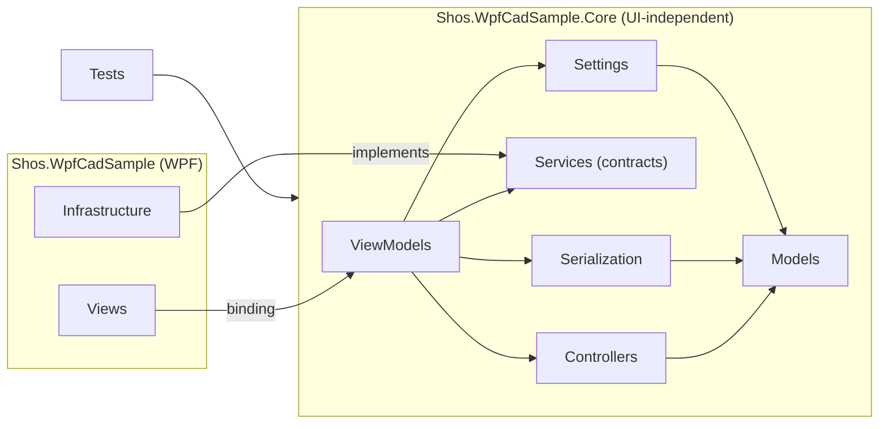
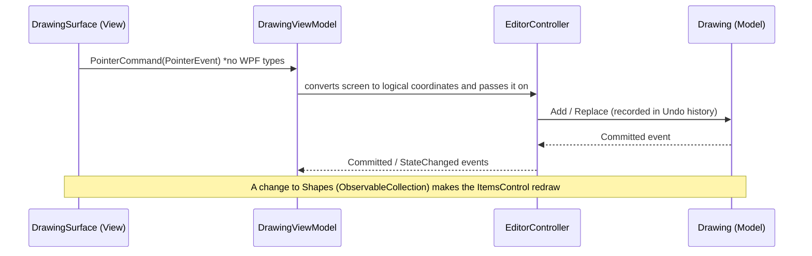
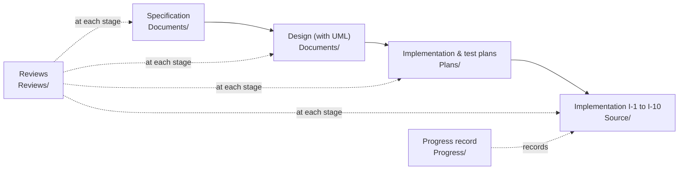

# Shos.WpfCadSample

[日本語](README.md) | **English**

**A simple 2D CAD sample built with C# 14 / .NET 10 / WPF, using an MVC + MVVM architecture.**

Draw shapes, select them, move them, save them. As CAD goes, it is a small application, but it takes on, in earnest, the problems you actually run into in a WPF desktop app: separating UI from logic, Undo / Redo, coordinate transforms, state transitions for mouse input, the clipboard, saving files, and testing.

It is meant as study material for intermediate C# / .NET / WPF programmers who want to learn "what comes after textbook MVVM". The code explains its design reasons (the *why*) in comments, and the specification and design documents those comments refer to are included in the repository.

> Note: the code comments and the project documents (specification, design, plans, reviews) are written in Japanese. Comment references such as "（仕様 5.2）" (spec 5.2) and "（設計書 DD-3）" (design doc DD-3) point to sections and decision IDs in those documents.

---

## Contents

1. [What you can learn from this sample](#1-what-you-can-learn-from-this-sample)
2. [Features](#2-features)
3. [Try it out](#3-try-it-out)
4. [The big picture: 3 projects and 4 roles](#4-the-big-picture-3-projects-and-4-roles)
5. [Suggested reading order](#5-suggested-reading-order)
6. [Design points (read through the code)](#6-design-points-read-through-the-code)
7. [Tests](#7-tests)
8. [Development process: from specification to implementation](#8-development-process-from-specification-to-implementation)
9. [Repository layout](#9-repository-layout)
10. [References and license](#10-references-and-license)

---

## 1. What you can learn from this sample

| Topic | How this sample answers it | Main code |
|---|---|---|
| **UI-independent logic** | Models / Controllers / ViewModels live in a separate `net10.0` project (Core) that cannot reference WPF. The compiler, not a convention, keeps them apart | `Shos.WpfCadSample.Core` |
| **Combining MVC and MVVM** | Interpreting mouse input (state transitions) belongs to a Controller; screen state and commands belong to ViewModels | `Controllers/EditorController.cs`, `ViewModels/DrawingViewModel.cs` |
| **Undo / Redo** | Shapes are immutable `record`s and a change is "replacing an element". History is left to `UndoRedoObservableCollection<T>` | `Models/Drawing.cs` |
| **One drag = one Undo** | During a drag, only the display is replaced without recording history; one record is made on release | `Controllers/SelectInteraction.cs` |
| **Consistent drawing and export** | Every shape becomes an intermediate representation, `Outline`, made only of lines and cubic Béziers. Screen rendering, click detection, and EMF / PNG export all use it | `Models/Geometry/Outline.cs` |
| **Coordinate transforms** | Shapes are kept in logical coordinates (Y up); zoom, scrolling, and the Y flip are applied to the whole layer as one matrix | `Models/Geometry/Viewport.cs`, `ViewTransform.cs` |
| **Empty code-behind** | Mouse input goes through a custom control; events are bridged to commands with attached properties (behaviors) | `Views/DrawingSurface.cs`, `Views/Behaviors/` |
| **Testable boundaries** | Only the two UI-dependent spots (dialogs, clipboard) are interfaces, replaced with fakes in tests | `Services/`, `Tests/Support/` |
| **Safe persistence** | Saved with `System.Text.Json` polymorphic serialization and fully validated on load. Saving goes through a temporary file, so a failure never corrupts the original | `Serialization/` |
| **Modern C#** | `record`s, primary constructors, collection expressions, pattern matching, partial properties with `CommunityToolkit.Mvvm` (`[ObservableProperty]`), and more | Throughout |

---

## 2. Features

- **7 shape types**: Line, Circle, Rectangle, Polyline, Polygon, Open Curve, Closed Curve. The free curves pass smoothly through the clicked points as a cubic spline.
- **Selection and editing**: click to select, drag a handle to move a point, drag the line to move the whole shape, `Delete` to delete.
- **Attributes**: edit color, line thickness, and line style (Solid / Dash / Dot / Dash-Dot) in place in a modeless properties window (`F4`).
- **Undo / Redo** (`Ctrl+Z` / `Ctrl+Y`), **zoom** (`Ctrl+mouse wheel`), and **scrolling** (`Ctrl+arrow keys`).
- **Clipboard**: copy and paste shapes (a custom format), plus EMF and image output you can paste into other apps (such as Word).
- **Files**: save and open in JSON format, with a prompt when there are unsaved changes.
- **Settings**: saves window positions and sizes and the default attributes for new shapes.
- The look is Material Design 3 (Light) from [Material Design in XAML Toolkit](https://github.com/MaterialDesignInXAML/MaterialDesignInXamlToolkit). The UI text is in English.

For operating details (how each tool confirms a shape, the full list of shortcuts, and so on), see "操作方法" (How to use) in [Source/README.md](Source/README.md#操作方法) (Japanese).

---

## 3. Try it out

### Requirements

- Windows (it is a WPF app)
- [.NET 10 SDK](https://dotnet.microsoft.com/download)
- A version of Visual Studio that supports `.slnx` solutions, or just the command line

### Build, run, and test

From the repository root, run the following (from WSL, use `dotnet.exe`; WPF cannot be built with the Linux `dotnet`):

```shell
dotnet build Source/Shos.WpfCadSample/Shos.WpfCadSample.slnx
dotnet run --project Source/Shos.WpfCadSample/Shos.WpfCadSample/Shos.WpfCadSample.csproj
dotnet test Source/Shos.WpfCadSample/Shos.WpfCadSample.slnx
```

### Things to try first

1. Pick **Polyline** on the toolbar, click a few points, then double-click to confirm.
2. With the **Select** tool, click the line and drag a handle (a small square) to reshape it.
3. Press `Ctrl+Z`. Notice that **the whole drag is undone in one step** (→ [6.3](#63-one-drag--one-undo-preview-replacement)).
4. Change the color or thickness in the properties window (`F4`). Notice that moving the slider does not add Undo history while you drag it.
5. Zoom with `Ctrl+mouse wheel`. Notice that **line thickness scales with the zoom, but handle size does not** (→ [6.5](#65-logical-coordinates-and-the-view-transform)).
6. Use Edit → Copy as Metafile and paste the shapes into Word or a similar app (→ [6.4](#64-the-outline-intermediate-representation-one-definition-for-drawing-hit-testing-and-export)).

---

## 4. The big picture: 3 projects and 4 roles

### Projects

```text
Source/Shos.WpfCadSample/
├─ Shos.WpfCadSample.slnx
├─ Shos.WpfCadSample.Core/    net10.0          Everything that does not depend on the UI (Models / Controllers / ViewModels and more)
├─ Shos.WpfCadSample/         net10.0-windows  WPF: App, Views (XAML, controls, behaviors, converters), Infrastructure
└─ Shos.WpfCadSample.Tests/   net10.0          xUnit. References Core only
```

The key point is that **the ViewModels are also in Core (`net10.0`)**. Core cannot reference WPF assemblies, so writing `System.Windows.Point` or `Visibility` in a ViewModel is a compile error. The MVVM principle "a ViewModel does not know its View" is enforced by the build, not by convention. The test project also references only Core, so tests never need to start the UI.

### Dependency direction



Dependencies go one way (`Views` → `ViewModels` → `Controllers` → `Models`), and `Models` depends on nothing. When a lower layer needs to tell a higher one something (such as "the selection changed"), it raises an event.

### The 4 roles (MVC + MVVM)

| Role | Namespace | Responsibility | Examples |
|---|---|---|---|
| **Model** | `Models`, `Models.Geometry`, `Serialization`, `Settings` | Shapes, attributes, the document, and their rules (constraints, validation, geometry, file format) | `Shape`, `Drawing`, `Outline`, `SplineBezier` |
| **Controller** | `Controllers` | Interpreting mouse input (per-tool state transitions) and performing shape edits | `EditorController`, `DrawInteraction`, `SelectInteraction` |
| **ViewModel** | `ViewModels` | State and commands for the View to bind to; file-operation flows (such as the save prompt) | `MainViewModel`, `DrawingViewModel`, `PropertiesViewModel` |
| **View** | `Views` | Display and binding. Only converts input into a WPF-independent form and passes it to commands | `MainWindow.xaml`, `DrawingView.xaml`, `DrawingSurface` |

**Why is there a Controller, not just MVVM?** CAD input is a stateful dialog: "click the first point → move the mouse to see a preview → confirm on the second point", or "press Esc during a drag to cancel". If that lived in the ViewModel, the ViewModel would carry two jobs: exposing screen state, and running an input state machine. So input interpretation is split out into a Controller, and the ViewModel focuses on mapping the Controller's results into a form for the screen.

### How one click reaches the screen



---

## 5. Suggested reading order

There are not many files (about 120 C# files), but where you start makes a big difference. Reading **from the inside (Model) out (View)** is recommended.

| Step | What to read | What to take away |
|---|---|---|
| 1 | `Core/Models/Shape.cs`, `LineShape.cs`, `CircleShape.cs` | Shapes are immutable `record`s; per-type differences are expressed with polymorphism |
| 2 | `Core/Models/Drawing.cs` | Document = an undoable list of shapes; this is the only entry point for changes |
| 3 | `Core/Models/Geometry/Outline.cs`, `SplineBezier.cs` | The intermediate representation that reduces every shape to lines and cubic Béziers, and the spline for free curves |
| 4 | `Core/Models/Geometry/Viewport.cs`, `ViewTransform.cs` | Logical ⇔ screen coordinates, and the rules for zoom and scrolling |
| 5 | `Core/Controllers/EditorController.cs` → `DrawInteraction.cs` → `SelectInteraction.cs` | Input state transitions; the active `IInteraction` is switched per tool |
| 6 | `Core/ViewModels/DrawingViewModel.cs` → `MainViewModel.cs` | Mapping Controller events into bindable state and commands |
| 7 | `WPF/Views/DrawingView.xaml`, `DrawingSurface.cs`, `Converters/` | How shapes are drawn (`DataTemplate` + `Path`) and how input is received |
| 8 | `WPF/Views/Behaviors/` | How events and window behavior are wired to XAML without code-behind |
| 9 | `WPF/Infrastructure/` | The `IDialogService` / `IClipboardService` implementations, EMF generation, and Win32 calls |
| 10 | `Tests/` | How each layer above is verified without the UI |

The references in comments, such as "（仕様 5.2）" and "（設計書 DD-3）", are section and decision numbers in the [specification](Documents/20261105-cad-specification.md) and the [architecture / class design](Documents/20261105-cad-architecture.md) (both in Japanese). When you want to know more about why something was written a certain way, look the number up in the document.

---

## 6. Design points (read through the code)

### 6.1 Split Core from WPF, and let the compiler enforce it

The Core project targets `net10.0` (without `-windows`). Wherever a WPF type would be needed, Core defines its own type, and the View converts between them.

| WPF type | Replacement in Core |
|---|---|
| `System.Windows.Point` | `Models.Geometry.Point2` (a `record struct`) |
| `MouseEventArgs`, `ModifierKeys` | `Controllers.PointerEvent`, `PointerModifiers` |
| `Size` | `ViewModels.ViewSize` |
| `Cursor` | `ViewModels.PointerCursor` (an enum; a View converter maps it to `Cursors.*`) |
| `Color` / `Brush` | `Models.RgbColor` |

The structure itself is also tested (`Tests/Architecture/ArchitectureTests.cs`). Every `dotnet test` run confirms that Core does not reference WPF assemblies and that types live in the designed namespaces.

```csharp
// T-ARC-02
[Fact]
public void CoreAssembly_DoesNotReferenceWpf()
{
    var referencedNames = CoreAssembly.GetReferencedAssemblies().Select(name => name.Name ?? "");

    Assert.DoesNotContain(referencedNames, name => wpfAssemblyNames.Contains(name));
}
```

### 6.2 Immutable shapes and Undo / Redo

Shapes are immutable `record`s. To "change" a shape, you create a new one with a `with` expression and replace the element in the list.

```csharp
// Models/LineShape.cs: moving a handle just returns a new shape
public override Shape MoveHandle(int index, Point2 to)
{
    ThrowIfNotHandleIndex(index, 2);
    return index == 0 ? this with { Start = to } : this with { End = to };
}
```

The list is an `UndoRedoObservableCollection<T>` from [Shos.UndoRedoList](https://github.com/Fujiwo/Shos.UndoRedoList), which records additions, removals, and indexer replacements in its history automatically. Because shapes are immutable, no separate mechanism is needed to save "the value before the change"; recording replacements is enough for Undo / Redo to work.

```csharp
// Models/Drawing.cs
public void Replace(int index, Shape shape)
{
    ArgumentNullException.ThrowIfNull(shape);
    shapes[index] = shape;      // this replacement is recorded as one Undo step
    OnCommitted();
}
```

One more idea is `ShapeId`. A replaced shape is a different instance, so if the selected shape were held by reference, every Undo would drop the selection. Each shape therefore carries an identifier, `ShapeId`, that is not saved to file, and the selection is held by ID (design doc DD-11).

### 6.3 One drag = one Undo (preview replacement)

During a drag, the shape is replaced on every mouse move to update the display. Recording all of those would make you press Undo dozens of times. So `Drawing` offers **replacements that are not recorded**.

```csharp
// Models/Drawing.cs
public void PreviewReplace(int index, Shape shape) => ReplaceWithoutRecording(index, shape);
public void RestoreOriginal(int index, Shape original) => ReplaceWithoutRecording(index, original);

public void CommitPreview(int index, Shape original, Shape final)
{
    RestoreOriginal(index, original);   // not recorded
    Replace(index, final);              // recorded once
}

void ReplaceWithoutRecording(int index, Shape shape)
{
    using (new UndoRedoList<Shape, ObservableCollection<Shape>>.DisabledUndoScope(shapes))
        shapes[index] = shape;
}
```

On release, the shape is **first restored to the original (not recorded), then replaced once with the final shape (recorded)**. That leaves exactly one operation in history: "original shape → final shape". Getting this order wrong would break the Undo unit, so it lives in one place, `Drawing.CommitPreview`, and the callers (dragging and attribute editing) just say "commit".

```csharp
// Controllers/SelectInteraction.cs
void Finish()
{
    var finished = drag;
    drag = null;
    if (finished is { HasChanged: true })
        drawing.CommitPreview(finished.Index, finished.Original, finished.Current);
}
```

An alternative is to draw on a separate "preview layer" and hide the original shape, but that means two rendering paths. This approach keeps a single one. The slider in the properties window uses the same mechanism: nothing is recorded while you move it, and one record is made when you release it (design doc DD-3).

### 6.4 The Outline intermediate representation: one definition for drawing, hit testing, and export

All 7 shape types produce, via `CreateOutline()`, an **`Outline` made only of lines and cubic Béziers** (a circle is 4 Béziers; a free curve is Béziers computed from the spline).

```text
                 ┌→ Screen rendering  ShapeToGeometryConverter → StreamGeometry (WPF)
Shape ─→ Outline ┼→ Hit testing       ShapeHitTester (approximates with a polyline and measures distance)
                 └→ EMF / image export MetafileRenderer (GDI+)
```

If the screen and the export each interpreted shapes on their own, you would get mismatches like "it is a curve on screen, but a different shape when pasted into Word". A shared intermediate representation rules that out structurally. And since `Outline` is pure, UI-independent data, the geometry can be unit-tested in detail (design doc DD-6, DD-7).

Free curves are converted to cubic Béziers by solving for the tangent at each pass-through point as a tridiagonal system of equations (closed curves solve a cyclic tridiagonal system with the Sherman–Morrison formula) (`Models/Geometry/SplineBezier.cs`).

### 6.5 Logical coordinates and the view transform

Shapes are kept in **logical coordinates** (Y axis points up, as in math; the logical area is 1000 × 700). The conversion to screen coordinates (zoom, translation, Y flip) is gathered into a single matrix, `ViewTransform`, and applied in one place as the `RenderTransform` of the whole shape layer (a `Canvas`).

```xml
<!-- Views/DrawingView.xaml: apply the view transform to the whole logical-coordinate layer (design doc DD-4) -->
<ItemsPanelTemplate x:Key="LogicalLayerPanel">
    <Canvas RenderTransform="{Binding Transform, Converter={StaticResource ViewTransformToMatrix}}" />
</ItemsPanelTemplate>
```

This has two benefits:

- Zooming does not require recomputing the coordinates of every shape.
- Line thickness is also a logical value, so lines look thicker when zoomed in (natural behavior for CAD).

Selection handles and the click tolerance, on the other hand, should stay **a constant size on screen** regardless of zoom. So handles are placed on a separate layer in screen coordinates, and the click tolerance is converted from screen pixels into a logical length before testing. The zoom and scroll state is owned by the ViewModel, but the transform rules (`Viewport`, `ViewTransform`) live in `Models.Geometry` because Controllers use them too (design doc DD-15).

### 6.6 Empty code-behind: a custom control and attached behaviors

Every `*.xaml.cs` contains only `InitializeComponent()`. So where are mouse and window events handled?

- **Mouse input**: the custom control `DrawingSurface` converts `MouseDown` and friends into a WPF-independent `PointerEvent` and executes an `ICommand`. It makes no decisions; it only converts (design doc DD-5).
- **Window events and behavior**: attached properties in `Views/Behaviors/` wire them up declaratively from XAML.

| Behavior | Role |
|---|---|
| `CommandEvents` | Runs a command when the window is activated or a menu opens (refreshing whether Paste is enabled, in place of the clipboard change notification WPF lacks) |
| `WindowClosingBehavior` | Asks the ViewModel about unsaved changes before closing |
| `WindowPlacementBehavior` | Restores the saved position and size before showing, and writes them back to the ViewModel whenever they change |
| `WindowVisibilityBehavior` | Manages showing the modeless properties window and its owner |
| `Shortcuts` | Builds `KeyBinding`s for each window from shortcut definitions (data) |
| `ToolSelection` | Sets a tool button's `CommandParameter` and `IsChecked` from a single setting |
| `EditCommit` | Commits an edit when a slider is released, or on `Enter` / focus change in a text box (making it one Undo step) |

The policy in this sample is: "when you feel like writing an event handler, ask whether it could be an attached property instead."

### 6.7 Interfaces only for the "two places tests need to replace"

Of the UI-dependent features, only **dialogs** and the **clipboard** cannot be used for real in tests. So only `IDialogService` and `IClipboardService` are interfaces, and tests replace them with fakes from `Tests/Support/` (`FakeDialogService`, `FakeClipboardService`).

File saving and settings I/O, by contrast, are concrete classes that take a path as an argument; tests run the real thing against a temporary folder. The decision is "do not create an interface that has only one implementation" (design doc DD-13). Read it as an example of asking "does this really need to be replaceable?" before making everything an interface.

### 6.8 Saving: polymorphic serialization, strict validation, and non-destructive writes

- **Polymorphic serialization**: `Shape` carries `[JsonPolymorphic]` and `[JsonDerivedType]`, and the shape type is saved as a discriminator such as `"type": "line"`. No separate DTOs; the `record`s are saved as they are.
- **Strict validation**: on load, every property is required, and types, shape constraints, and coordinate ranges are validated. Shape constructors never throw; correctness is decided by `IsValid()`, so loading, pasting, and editing share the same validation.
- **Non-destructive writes**: saving writes to a temporary file in the same folder and then swaps it in with `File.Replace` (`Serialization/SafeFile.cs`). If writing fails partway, the original file is left intact.

### 6.9 EMF (metafile) clipboard output

WPF has no standard way to put a drawing on the clipboard as EMF. This sample builds an EMF from the `Outline` with GDI+ (`System.Drawing.Imaging.Metafile`) and hands it to Win32's `SetClipboardData` as `CF_ENHMETAFILE` (`Infrastructure/MetafileRenderer.cs`, `NativeClipboard.cs`). Coordinates are transformed in double precision before being passed to GDI+, avoiding single-precision error at large coordinates. It also serves as a real-world example of P/Invoke for when you need to step outside WPF.

---

## 7. Tests

`Shos.WpfCadSample.Tests` uses xUnit; `dotnet test` runs **669 tests** (including data-driven cases). None of them start the UI.

| Folder | Target | Worth a look |
|---|---|---|
| `Architecture/` | Structure | Core does not reference WPF; types live in the designed namespaces |
| `Models/Geometry/` | Geometry | Splines pass through their points with continuous tangents, view transforms round-trip, export size limits |
| `Models/` | Shapes and document | Shape constraints, handle movement, Undo / Redo, and drag previews |
| `Controllers/` | Input interpretation | Click, double-click, drag, and Esc state transitions, reproduced from fake input sequences |
| `ViewModels/` | Screen flows | Save prompts, error display, attribute editing, command enabled / disabled state |
| `Serialization/`, `Settings/` | Persistence | Rejecting invalid files; the original file surviving a failed save |

Test names and comments carry case IDs from the [test plan](Plans/20261105-cad-test-plan.md) (Japanese), such as `T-EDC-04`. Comments also explain where the expected values come from (boundary values, tolerances, what the numbers mean), so the tests read as "executable examples of the specification". The Controller tests are especially helpful for understanding how mouse operations are specified.

---

## 8. Development process: from specification to implementation

This repository is a sample not only of code but of **how the development was run**. AI agents (GitHub Copilot, Claude Code) and a human worked together, writing, reviewing, and approving the following documents in order before any implementation began.



| Document (Japanese) | Contents |
|---|---|
| [Specification](Documents/20261105-cad-specification.md) | The single requirements document: features, screens, operations, data structures, acceptance criteria |
| [Architecture / class design](Documents/20261105-cad-architecture.md) | Structure, design decisions (DD-1 to DD-15) and rejected alternatives, class diagrams, sequence diagrams |
| [Implementation plan](Plans/20261105-cad-implementation-plan.md) | Work and completion criteria for each stage (I-1 to I-10) |
| [Test plan](Plans/20261105-cad-test-plan.md) | Test cases (T-xxx) and their mapping to the acceptance criteria |
| [Reviews/](Reviews/) | Review reports for each document and for the source code |
| [Progress record](Progress/20261105-cad-progress.md) | Approval status, decisions, history |

For learning, the most recommended part is the "**2. 設計判断**" (design decisions) table in the design document. For each decision, it lists "the option taken" next to "the options rejected and their trade-offs", which tells you why the code was *not* written another way—something the code alone cannot show.

The instructions for the agents are in [.github/copilot-instructions.md](.github/copilot-instructions.md) (Claude Code loads it via [CLAUDE.md](CLAUDE.md)). For code-level judgment, the skill in `.github/skills/sustainable-code-jp/` is used (naming, single responsibility, testability, YAGNI, and so on).

---

## 9. Repository layout

```text
.
├─ README.md                 … Japanese README (entry point for learners)
├─ README.en.md              … This file (English)
├─ Source/
│   ├─ README.md             … How to use, packages and versions, list of detailed implementation decisions (Japanese)
│   └─ Shos.WpfCadSample/    … The solution and its 3 projects
├─ Documents/                … Specification, architecture / class design
├─ Plans/                    … Implementation plan, test plan, change plans
├─ Reviews/                  … Review reports
├─ Progress/                 … Progress record
├─ .github/                  … Agent instructions, prompts, skills
└─ .claude/skills/           … Skills for Claude Code (a mirror of .github/skills/)
```

### Packages used

| Package | Purpose |
|---|---|
| [Shos.UndoRedoList](https://github.com/Fujiwo/Shos.UndoRedoList) | Undo / Redo (`UndoRedoObservableCollection<T>`) |
| [CommunityToolkit.Mvvm](https://learn.microsoft.com/dotnet/communitytoolkit/mvvm/) | `ObservableObject`, `[ObservableProperty]`, `[RelayCommand]` |
| [MaterialDesignThemes](https://github.com/MaterialDesignInXAML/MaterialDesignInXamlToolkit) | UI look (only `App.xaml` and `Views` depend on it) |
| xunit / xunit.runner.visualstudio / Microsoft.NET.Test.Sdk | Testing |

Versions and the reasons for choosing each package are in [Source/README.md](Source/README.md#使用するパッケージと版) (Japanese). The same file's "設計判断" (design decisions) section also lists how about 50 implementation details not settled by the specification or design were decided, and why.

---

## 10. References and license

- The spline conversion for free curves is based on the ideas in [Shos.BezierSamples](https://github.com/Fujiwo/Shos.BezierSamples) (MIT License); no code was copied.
- [Material Design in XAML Toolkit](https://github.com/MaterialDesignInXAML/MaterialDesignInXamlToolkit)
- [Shos.UndoRedoList](https://github.com/Fujiwo/Shos.UndoRedoList)

Licensed under the [MIT License](LICENSE).
