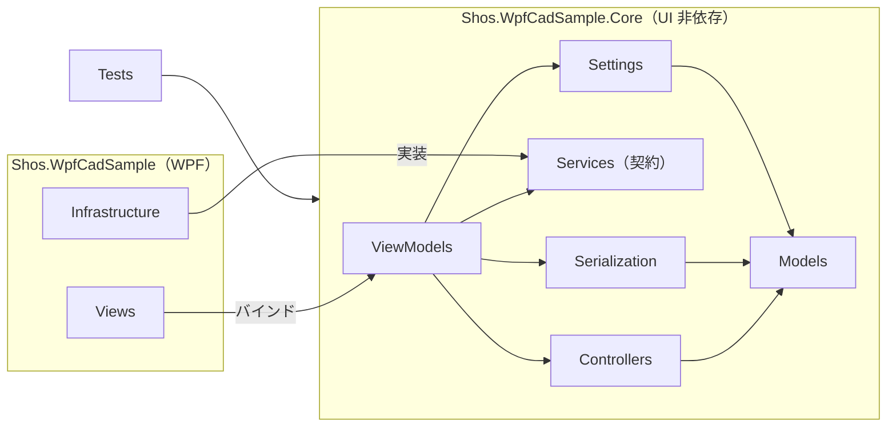
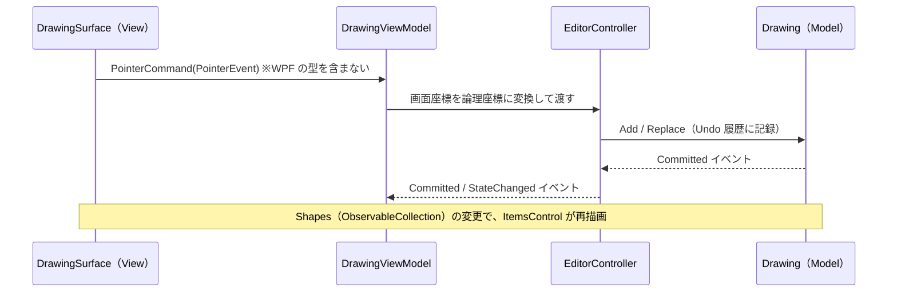
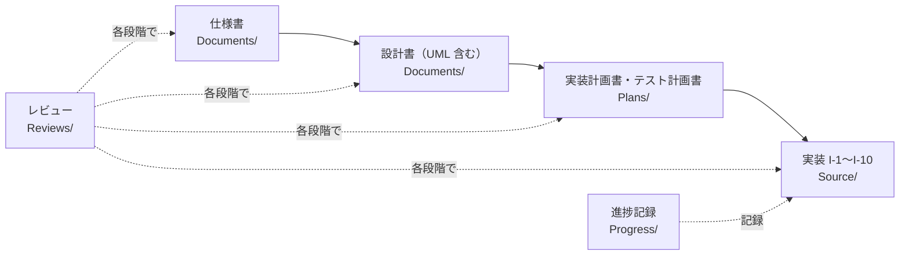

# Shos.WpfCadSample

**日本語** | [English](README.en.md)

**C# 14 / .NET 10 / WPF で作った、MVC + MVVM 構成の簡易 2D CAD のサンプル**です。

図形を描いて、選んで、動かして、保存する。CAD としては小さなアプリケーションですが、WPF のデスクトップアプリで実際にぶつかる課題（UI とロジックの分離、Undo / Redo、座標変換、マウス操作の状態遷移、クリップボード、ファイルの保存、テスト）を、一通り本気で解いています。

中級の C# / .NET / WPF プログラマーが「教科書的な MVVM の次」を学ぶための題材として読めるように、コードには設計の理由（Why）を日本語のコメントで書き、その根拠となる仕様書・設計書もリポジトリに含めています。

---

## 目次

1. [このサンプルで学べること](#1-このサンプルで学べること)
2. [アプリケーションの機能](#2-アプリケーションの機能)
3. [動かしてみる](#3-動かしてみる)
4. [全体像：3 つのプロジェクトと 4 つの役割](#4-全体像3-つのプロジェクトと-4-つの役割)
5. [おすすめの読み進め方](#5-おすすめの読み進め方)
6. [設計のポイント（コードで読む）](#6-設計のポイントコードで読む)
7. [テスト](#7-テスト)
8. [仕様書から実装までの開発プロセス](#8-仕様書から実装までの開発プロセス)
9. [リポジトリの構成](#9-リポジトリの構成)
10. [参考資料とライセンス](#10-参考資料とライセンス)

---

## 1. このサンプルで学べること

| テーマ | このサンプルでの答え | 主なコード |
|---|---|---|
| **UI に依存しないロジック** | Models / Controllers / ViewModels を `net10.0` の別プロジェクト（Core）に置き、WPF を参照できなくする。規約ではなくコンパイラーが分離を守る | `Shos.WpfCadSample.Core` |
| **MVC と MVVM の併用** | マウス入力の解釈（状態遷移）は Controller、画面の状態とコマンドは ViewModel に分ける | `Controllers/EditorController.cs`、`ViewModels/DrawingViewModel.cs` |
| **Undo / Redo** | 図形を不変の `record` にし、変更を「要素の置き換え」で表す。履歴は `UndoRedoObservableCollection<T>` に任せる | `Models/Drawing.cs` |
| **ドラッグ 1 回 = Undo 1 回** | ドラッグ中は履歴に記録せずに表示だけ置き換え、離したときに 1 回だけ記録する | `Controllers/SelectInteraction.cs` |
| **描画と出力の一貫性** | 全図形を「直線と 3 次ベジェ」だけの中間表現 `Outline` にし、画面表示・クリック判定・EMF / PNG 出力が同じものを使う | `Models/Geometry/Outline.cs` |
| **座標変換** | 論理座標（Y 上向き）で図形を持ち、拡大・スクロール・Y 反転は 1 つの行列で層全体に掛ける | `Models/Geometry/Viewport.cs`、`ViewTransform.cs` |
| **コードビハインドを空にする** | マウス入力はカスタムコントロール、イベント → コマンドは添付プロパティ（ビヘイビア）で橋渡しする | `Views/DrawingSurface.cs`、`Views/Behaviors/` |
| **テストしやすい境界** | UI に依存する 2 か所（ダイアログ、クリップボード）だけをインターフェイスにして、テストで偽物に差し替える | `Services/`、`Tests/Support/` |
| **安全な永続化** | `System.Text.Json` の多態シリアライズで保存し、読み込み時に全項目を検証する。保存は一時ファイル経由で、失敗しても元のファイルを壊さない | `Serialization/` |
| **モダンな C#** | `record`、プライマリコンストラクター、コレクション式、パターンマッチング、`CommunityToolkit.Mvvm` の部分プロパティ（`[ObservableProperty]`）など | 全体 |

---

## 2. アプリケーションの機能

- **7 種類の図形**：Line、Circle、Rectangle、Polyline、Polygon、Open Curve、Closed Curve。自由線（Curve）は、クリックした通過点を滑らかに結ぶ 3 次スプラインです。
- **選択と編集**：クリックで選択し、ハンドルのドラッグで点を移動、線のドラッグで図形全体を移動、`Delete` で削除します。
- **属性**：色・線の太さ・線種（Solid / Dash / Dot / Dash-Dot）を、モードレスの属性ウィンドウ（`F4`）でその場で編集できます。
- **Undo / Redo**（`Ctrl+Z` / `Ctrl+Y`）、**拡大縮小**（`Ctrl+ホイール`）と**スクロール**（`Ctrl+矢印`）。
- **クリップボード**：図形のコピー＆ペースト（独自形式）と、他のアプリ（Word など）へ貼れる EMF・画像の出力。
- **ファイル**：JSON 形式での保存と読み込み、未保存時の確認。
- **設定**：ウィンドウの位置・大きさと、新しい図形の既定の属性を保存します。
- 外観は [Material Design in XAML Toolkit](https://github.com/MaterialDesignInXAML/MaterialDesignInXamlToolkit) の Material Design 3（Light）、UI の表記は英語です。

操作方法の詳細（ツールごとの確定方法、ショートカットの一覧など）は [Source/README.md の「操作方法」](Source/README.md#操作方法)を参照してください。

---

## 3. 動かしてみる

### 必要なもの

- Windows（WPF アプリのため）
- [.NET 10 SDK](https://dotnet.microsoft.com/download)
- `.slnx` 形式のソリューションに対応した Visual Studio など（コマンドラインだけでも可）

### ビルド・実行・テスト

リポジトリのルートで、次を実行します（WSL からは `dotnet.exe` を使ってください。WPF は Linux の `dotnet` ではビルドできません）。

```shell
dotnet build Source/Shos.WpfCadSample/Shos.WpfCadSample.slnx
dotnet run --project Source/Shos.WpfCadSample/Shos.WpfCadSample/Shos.WpfCadSample.csproj
dotnet test Source/Shos.WpfCadSample/Shos.WpfCadSample.slnx
```

### 最初に試すとよい操作

1. ツールバーで **Polyline** を選び、何点かクリックしてからダブルクリックで確定する。
2. **Select** ツールで線をクリックし、ハンドル（四角）をドラッグして形を変える。
3. `Ctrl+Z` を押す。**ドラッグ全体が 1 回で戻る**ことを確かめる（→ [6.3](#63-ドラッグ-1-回--undo-1-回プレビューの置き換え)）。
4. `F4` の属性ウィンドウで色や太さを変える。スライダーを動かしている間は Undo 履歴が増えないことも確かめる。
5. `Ctrl+ホイール` で拡大しても、**線の太さは拡大に追従し、ハンドルの大きさは変わらない**ことを見る（→ [6.5](#65-論理座標とビュー変換)）。
6. Edit → Copy as Metafile で、Word などに図形を貼り付ける（→ [6.4](#64-中間表現-outline描画クリック判定出力を-1-つの定義で)）。

---

## 4. 全体像：3 つのプロジェクトと 4 つの役割

### プロジェクト

```text
Source/Shos.WpfCadSample/
├─ Shos.WpfCadSample.slnx
├─ Shos.WpfCadSample.Core/    net10.0          UI に依存しない部分すべて（Models / Controllers / ViewModels ほか）
├─ Shos.WpfCadSample/         net10.0-windows  WPF：App、Views（XAML・コントロール・ビヘイビア・コンバーター）、Infrastructure
└─ Shos.WpfCadSample.Tests/   net10.0          xUnit。Core だけを参照する
```

ポイントは、**ViewModels も Core（`net10.0`）にある**ことです。Core は WPF のアセンブリを参照できないので、ViewModel に `System.Windows.Point` や `Visibility` を書こうとすると、コンパイルエラーになります。「ViewModel は View を知らない」という MVVM の原則が、規約ではなくビルドによって守られます。テストプロジェクトも Core だけを参照するので、テストで UI を起動する必要がありません。

### 依存の向き



依存は一方向（`Views` → `ViewModels` → `Controllers` → `Models`）で、`Models` は何にも依存しません。下の層から上の層へ伝えたいこと（「選択が変わった」など）は、イベントで通知します。

### 4 つの役割（MVC + MVVM）

| 役割 | namespace | 責務 | 例 |
|---|---|---|---|
| **Model** | `Models`、`Models.Geometry`、`Serialization`、`Settings` | 図形・属性・ドキュメントと、その規則（制約・検証・幾何計算・保存形式） | `Shape`、`Drawing`、`Outline`、`SplineBezier` |
| **Controller** | `Controllers` | マウス入力の解釈（ツールごとの状態遷移）と、図形の編集の実行 | `EditorController`、`DrawInteraction`、`SelectInteraction` |
| **ViewModel** | `ViewModels` | View にバインドする状態とコマンド。ファイル操作の流れ（保存確認など） | `MainViewModel`、`DrawingViewModel`、`PropertiesViewModel` |
| **View** | `Views` | 表示とバインド。入力を WPF 非依存の形に変換してコマンドへ渡すだけ | `MainWindow.xaml`、`DrawingView.xaml`、`DrawingSurface` |

**なぜ MVVM だけでなく Controller があるのか**：CAD の入力は「1 点目をクリック → マウスを動かすとプレビュー → 2 点目で確定」「ドラッグ中に Esc で取り消し」のように、状態を持った対話です。これを ViewModel に書くと、ViewModel が「画面の状態の公開」と「入力の状態機械」の 2 つの仕事を抱えます。そこで入力の解釈を Controller に分け、ViewModel は Controller の結果を画面向けの形に写すことに専念させています。

### 1 回のクリックが画面に届くまで



---

## 5. おすすめの読み進め方

ファイル数は多くありませんが（C# 約 120 ファイル）、どこから読むかで理解の速さが変わります。**内側（Model）から外側（View）へ**読むのがおすすめです。

| 順 | 読むもの | ここで掴むこと |
|---|---|---|
| 1 | `Core/Models/Shape.cs`、`LineShape.cs`、`CircleShape.cs` | 図形は不変の `record`。種類ごとの違いは多態で表す |
| 2 | `Core/Models/Drawing.cs` | ドキュメント = Undo できる図形の一覧。変更の入口はここだけ |
| 3 | `Core/Models/Geometry/Outline.cs`、`SplineBezier.cs` | 全図形を直線と 3 次ベジェに落とす中間表現と、自由線のスプライン |
| 4 | `Core/Models/Geometry/Viewport.cs`、`ViewTransform.cs` | 論理座標 ⇔ 画面座標、拡大・スクロールの規則 |
| 5 | `Core/Controllers/EditorController.cs` → `DrawInteraction.cs` → `SelectInteraction.cs` | 入力の状態遷移。ツールごとに `IInteraction` を切り替える |
| 6 | `Core/ViewModels/DrawingViewModel.cs` → `MainViewModel.cs` | Controller のイベントを、バインドできる状態とコマンドに写す |
| 7 | `WPF/Views/DrawingView.xaml`、`DrawingSurface.cs`、`Converters/` | 図形の描き方（`DataTemplate` + `Path`）と入力の受け方 |
| 8 | `WPF/Views/Behaviors/` | コードビハインドを使わずに、イベントやウィンドウの振る舞いを XAML につなぐ方法 |
| 9 | `WPF/Infrastructure/` | `IDialogService` / `IClipboardService` の実装、EMF の生成と Win32 の呼び出し |
| 10 | `Tests/` | 上で読んだ各層が、UI なしでどう検証されているか |

コメント中の「（仕様 5.2）」「（設計書 DD-3）」は、[仕様書](Documents/20261105-cad-specification.md)と[アーキテクチャー／クラス設計書](Documents/20261105-cad-architecture.md)の節や設計判断の番号です。「なぜこう書いたのか」をさらに知りたくなったら、その番号で文書を引いてください。

---

## 6. 設計のポイント（コードで読む）

### 6.1 Core と WPF を分け、分離をコンパイラーに守らせる

Core のプロジェクトは `net10.0`（`-windows` なし）なので、WPF の型が必要な箇所は Core に独自の型を定義し、View 側で変換します。

| WPF の型 | Core での代わり |
|---|---|
| `System.Windows.Point` | `Models.Geometry.Point2`（`record struct`） |
| `MouseEventArgs`、`ModifierKeys` | `Controllers.PointerEvent`、`PointerModifiers` |
| `Size` | `ViewModels.ViewSize` |
| `Cursor` | `ViewModels.PointerCursor`（列挙型。View のコンバーターが `Cursors.*` に変換） |
| `Color` / `Brush` | `Models.RgbColor` |

さらに、この構造そのものをテストしています（`Tests/Architecture/ArchitectureTests.cs`）。「Core が WPF のアセンブリを参照していない」「型が設計どおりの namespace にある」ことを、毎回の `dotnet test` で確かめます。

```csharp
// T-ARC-02
[Fact]
public void CoreAssembly_DoesNotReferenceWpf()
{
    var referencedNames = CoreAssembly.GetReferencedAssemblies().Select(name => name.Name ?? "");

    Assert.DoesNotContain(referencedNames, name => wpfAssemblyNames.Contains(name));
}
```

### 6.2 不変の図形と Undo / Redo

図形は不変の `record` です。図形を「変更」するときは、`with` 式で新しい図形を作り、一覧の要素を置き換えます。

```csharp
// Models/LineShape.cs：ハンドルの移動は、新しい図形を返すだけ
public override Shape MoveHandle(int index, Point2 to)
{
    ThrowIfNotHandleIndex(index, 2);
    return index == 0 ? this with { Start = to } : this with { End = to };
}
```

一覧は [Shos.UndoRedoList](https://github.com/Fujiwo/Shos.UndoRedoList) の `UndoRedoObservableCollection<T>` で、追加・削除・インデクサーでの置き換えを自動的に履歴に記録します。図形が不変なので、「変更前の値」を別に保存する仕組みは要りません。置き換えの記録だけで Undo / Redo が成り立ちます。

```csharp
// Models/Drawing.cs
public void Replace(int index, Shape shape)
{
    ArgumentNullException.ThrowIfNull(shape);
    shapes[index] = shape;      // この置き換えが、Undo 1 回分として記録される
    OnCommitted();
}
```

もう 1 つの工夫が `ShapeId` です。置き換えると図形は別のインスタンスになるため、「選択中の図形」を参照で持つと、Undo のたびに選択が外れてしまいます。そこで各図形に保存しない識別子 `ShapeId` を持たせ、選択は ID で表します（設計書 DD-11）。

### 6.3 ドラッグ 1 回 = Undo 1 回（プレビューの置き換え）

ドラッグ中はマウスが動くたびに図形を置き換えて表示しますが、それを全部記録すると、Undo を何十回も押す羽目になります。そこで `Drawing` は、**記録しない置き換え**を用意しています。

```csharp
// Models/Drawing.cs
public void PreviewReplace(int index, Shape shape) => ReplaceWithoutRecording(index, shape);
public void RestoreOriginal(int index, Shape original) => ReplaceWithoutRecording(index, original);

public void CommitPreview(int index, Shape original, Shape final)
{
    RestoreOriginal(index, original);   // 記録しない
    Replace(index, final);              // 1 回だけ記録する
}

void ReplaceWithoutRecording(int index, Shape shape)
{
    using (new UndoRedoList<Shape, ObservableCollection<Shape>>.DisabledUndoScope(shapes))
        shapes[index] = shape;
}
```

マウスを離したときは、**いったん元の図形に戻してから（記録しない）、最終の図形で 1 回だけ置き換えます（記録する）**。こうすると、履歴には「元の図形 → 最終の図形」の 1 操作だけが残ります。この順序を誤ると Undo の単位が壊れるため、`Drawing.CommitPreview` の 1 か所にまとめ、呼び出し側（ドラッグと属性の編集）は「確定する」とだけ書きます。

```csharp
// Controllers/SelectInteraction.cs
void Finish()
{
    var finished = drag;
    drag = null;
    if (finished is { HasChanged: true })
        drawing.CommitPreview(finished.Index, finished.Original, finished.Current);
}
```

別の「プレビュー用の層」に描いて元の図形を隠す方法もありますが、描画の仕組みが 2 系統になります。この方法なら描画は 1 系統のままです。属性ウィンドウのスライダー操作も同じ仕組みで、動かしている間は記録せず、離したときに 1 回だけ記録します（設計書 DD-3）。

### 6.4 中間表現 Outline：描画・クリック判定・出力を 1 つの定義で

7 種類の図形は、どれも `CreateOutline()` で **直線と 3 次ベジェだけからなる `Outline`** を作ります（円は 4 本のベジェ、自由線はスプラインから求めたベジェ）。

```text
                 ┌→ 画面の描画      ShapeToGeometryConverter → StreamGeometry（WPF）
Shape ─→ Outline ┼→ クリック判定    ShapeHitTester（折れ線に近似して距離を測る）
                 └→ EMF・画像の出力 MetafileRenderer（GDI+）
```

画面と出力が別々に図形を解釈すると、「画面では曲線なのに、Word に貼ると形が違う」といった食い違いが起きます。共通の中間表現を挟むことで、それが構造的に起きなくなります。また、`Outline` は UI に依存しない純粋なデータなので、幾何計算を単体テストで細かく検証できます（設計書 DD-6、DD-7）。

自由線は、通過点の各点での接線を三重対角の連立方程式として解き（閉じた曲線は巡回三重対角を Sherman-Morrison の公式で解く）、3 次ベジェに変換しています（`Models/Geometry/SplineBezier.cs`）。

### 6.5 論理座標とビュー変換

図形は**論理座標**（数学と同じく Y 軸が上向き。論理領域は 1000 × 700）で持ちます。画面座標への変換（拡大率、平行移動、Y の反転）は `ViewTransform` という 1 つの行列にまとめ、図形の層（`Canvas`）全体の `RenderTransform` として 1 か所で掛けます。

```xml
<!-- Views/DrawingView.xaml：論理座標の層全体にビュー変換を掛ける（設計書 DD-4） -->
<ItemsPanelTemplate x:Key="LogicalLayerPanel">
    <Canvas RenderTransform="{Binding Transform, Converter={StaticResource ViewTransformToMatrix}}" />
</ItemsPanelTemplate>
```

この方法には、次の利点があります。

- 拡大縮小のたびに全図形の座標を計算し直す必要がない。
- 線の太さも論理座標の値なので、拡大すると太く見える（CAD として自然な振る舞い）。

一方、選択ハンドルやクリックの許容範囲は、拡大率によらず**画面上で一定の大きさ**であるべきです。そこでハンドルは別の層に画面座標で置き、クリックの許容範囲は「画面上の px」を論理座標の長さに換算して判定します。拡大率とスクロール位置の状態は ViewModel が持ちますが、変換の規則（`Viewport`、`ViewTransform`）は Controller も使うため、`Models.Geometry` に置いています（設計書 DD-15）。

### 6.6 コードビハインドを空にする：カスタムコントロールと添付ビヘイビア

すべての `*.xaml.cs` は `InitializeComponent()` だけです。では、マウスイベントやウィンドウのイベントはどこで扱うのでしょうか。

- **マウス入力**：カスタムコントロール `DrawingSurface` が、`MouseDown` などを WPF に依存しない `PointerEvent` に変換して、`ICommand` を実行します。判断は一切せず、変換だけを行います（設計書 DD-5）。
- **ウィンドウのイベントや振る舞い**：`Views/Behaviors/` の添付プロパティで、XAML から宣言的につなぎます。

| ビヘイビア | 役割 |
|---|---|
| `CommandEvents` | ウィンドウのアクティブ化やメニューを開いたときに、コマンドを実行する（WPF にないクリップボードの変更通知の代わりに、Paste の有効状態を更新する） |
| `WindowClosingBehavior` | 閉じる前に、未保存の確認を ViewModel に問い合わせる |
| `WindowPlacementBehavior` | 表示の前に保存済みの位置・大きさを復元し、変わるたびに ViewModel へ書き戻す |
| `WindowVisibilityBehavior` | モードレスの属性ウィンドウの表示と所有者を管理する |
| `Shortcuts` | ショートカットの定義（データ）から、ウィンドウごとに `KeyBinding` を作る |
| `ToolSelection` | ツールボタンの `CommandParameter` と `IsChecked` を、1 つの指定から設定する |
| `EditCommit` | スライダーを離したとき、テキストボックスの `Enter` やフォーカスの移動で、編集を確定する（Undo 1 回分にする） |

「イベントハンドラーを書きたくなったら、それは添付プロパティにできないか」と考えるのが、このサンプルの方針です。

### 6.7 インターフェイスは「テストで差し替えが必要な 2 か所」だけ

UI に依存する機能のうち、テストで実物を使えないのは**ダイアログ**と**クリップボード**の 2 つです。そこで、`IDialogService` と `IClipboardService` だけをインターフェイスにし、テストでは `Tests/Support/` の偽物（`FakeDialogService`、`FakeClipboardService`）に差し替えます。

一方、ファイルの保存や設定の読み書きは、パスを引数に受け取る具象クラスにしており、テストでは一時フォルダーを使って実物をそのまま動かします。「実装が 1 つしかないインターフェイスは作らない」という判断です（設計書 DD-13）。何でもインターフェイスにする前に、「本当に差し替える必要があるか」を考える例として読んでください。

### 6.8 保存：多態シリアライズ、厳密な検証、壊さない書き込み

- **多態シリアライズ**：`Shape` に `[JsonPolymorphic]` と `[JsonDerivedType]` を付け、`"type": "line"` のような判別子で図形の種類を保存します。DTO を別に作らず、`record` をそのまま保存します。
- **厳密な検証**：読み込み時は、全項目を必須とし、型・図形の制約・座標の範囲を検証します。図形のコンストラクターは例外を投げず、正しさは `IsValid()` で判定する設計なので、読み込み・貼り付け・編集で同じ検証を使えます。
- **壊さない書き込み**：保存は、同じフォルダーの一時ファイルに書いてから `File.Replace` で置き換えます（`Serialization/SafeFile.cs`）。書き込みの途中で失敗しても、元のファイルは残ります。

### 6.9 EMF（メタファイル）のクリップボード出力

WPF には、描画を EMF としてクリップボードに置く標準の方法がありません。このサンプルでは、`Outline` から GDI+（`System.Drawing.Imaging.Metafile`）で EMF を作り、Win32 の `SetClipboardData` に `CF_ENHMETAFILE` として渡しています（`Infrastructure/MetafileRenderer.cs`、`NativeClipboard.cs`）。座標は倍精度で変換してから GDI+ に渡し、大きな座標での単精度の誤差を避けています。WPF から一歩外に出る必要がある場面の、P/Invoke の実例としても読めます。

---

## 7. テスト

`Shos.WpfCadSample.Tests` は xUnit のテストで、`dotnet test` で **669 件**（データ駆動のケースを含む）が実行されます。すべて UI を起動せずに動きます。

| フォルダー | 対象 | 見どころ |
|---|---|---|
| `Architecture/` | 構造 | Core が WPF を参照しない、型が設計どおりの namespace にある |
| `Models/Geometry/` | 幾何 | スプラインが通過点を通る・接線が連続する、ビュー変換の往復、出力範囲の上限 |
| `Models/` | 図形・ドキュメント | 図形の制約、ハンドルの移動、Undo / Redo とドラッグのプレビュー |
| `Controllers/` | 入力の解釈 | クリック・ダブルクリック・ドラッグ・Esc の状態遷移を、偽の入力列で再現する |
| `ViewModels/` | 画面の流れ | 保存確認、エラー表示、属性の編集、コマンドの有効・無効 |
| `Serialization/`、`Settings/` | 保存 | 不正なファイルの拒否、保存の失敗で元のファイルが残ること |

テストの名前とコメントには、[テスト計画書](Plans/20261105-cad-test-plan.md)のケース ID（例：`T-EDC-04`）を付けています。期待値の根拠（境界値、許容誤差、数値の意味）もコメントで説明しているので、テストは「仕様の実行可能な例」として読めます。Controller のテストは特に、マウス操作の仕様を理解するのに役立ちます。

---

## 8. 仕様書から実装までの開発プロセス

このリポジトリは、コードだけでなく**開発の進め方**もサンプルになっています。AI エージェント（GitHub Copilot、Claude Code）と人間が協働し、次の順に文書を作ってレビューし、承認を得てから実装しました。



| 文書 | 内容 |
|---|---|
| [仕様書](Documents/20261105-cad-specification.md) | 唯一の要件の文書。機能、画面、操作、データ構造、受け入れ条件 |
| [アーキテクチャー／クラス設計書](Documents/20261105-cad-architecture.md) | 構成、設計判断（DD-1〜DD-15）と見送った案、クラス図、シーケンス図 |
| [実装計画書](Plans/20261105-cad-implementation-plan.md) | 段階（I-1〜I-10）ごとの作業と完了条件 |
| [テスト計画書](Plans/20261105-cad-test-plan.md) | テストケース（T-xxx）と受け入れ条件との対応 |
| [Reviews/](Reviews/) | 各文書とソースコードのレビュー報告 |
| [進捗記録](Progress/20261105-cad-progress.md) | 承認の状態、判断、履歴 |

学習のうえで特におすすめなのは、設計書の「**2. 設計判断**」の表です。各判断について「採った案」と「見送った案とトレードオフ」が並んでいて、コードからは見えない「なぜ別の書き方をしなかったのか」が分かります。

エージェント向けの指示は [.github/copilot-instructions.md](.github/copilot-instructions.md)（Claude Code は [CLAUDE.md](CLAUDE.md) から読み込む）にあります。コードの判断基準には、`.github/skills/sustainable-code-jp/` のスキル（命名、単一責務、Testable、YAGNI など）を使っています。

---

## 9. リポジトリの構成

```text
.
├─ README.md                 … このファイル（学習者向けの入口）
├─ README.en.md              … 英語版の README
├─ Source/
│   ├─ README.md             … 操作方法、パッケージと版、実装の細かな判断の一覧
│   └─ Shos.WpfCadSample/    … ソリューションと 3 つのプロジェクト
├─ Documents/                … 仕様書、アーキテクチャー／クラス設計書
├─ Plans/                    … 実装計画書、テスト計画書、変更計画
├─ Reviews/                  … レビュー報告
├─ Progress/                 … 進捗記録
├─ .github/                  … エージェント向けの指示、プロンプト、スキル
└─ .claude/skills/           … Claude Code 用のスキル（.github/skills/ の写し）
```

### 使用しているパッケージ

| パッケージ | 用途 |
|---|---|
| [Shos.UndoRedoList](https://github.com/Fujiwo/Shos.UndoRedoList) | Undo / Redo（`UndoRedoObservableCollection<T>`） |
| [CommunityToolkit.Mvvm](https://learn.microsoft.com/dotnet/communitytoolkit/mvvm/) | `ObservableObject`、`[ObservableProperty]`、`[RelayCommand]` |
| [MaterialDesignThemes](https://github.com/MaterialDesignInXAML/MaterialDesignInXamlToolkit) | UI の外観（`App.xaml` と `Views` だけが依存） |
| xunit / xunit.runner.visualstudio / Microsoft.NET.Test.Sdk | テスト |

版と、各パッケージを選んだ理由は [Source/README.md](Source/README.md#使用するパッケージと版) にあります。仕様書や設計書で決まっていなかった実装の細部（約 50 項目）を、どう決めたかとその理由も、同じファイルの「設計判断」の節にまとめています。

---

## 10. 参考資料とライセンス

- 自由線のスプライン変換は、[Shos.BezierSamples](https://github.com/Fujiwo/Shos.BezierSamples)（MIT License）の考え方に基づいて実装しました（コードは複製していません）。
- [Material Design in XAML Toolkit](https://github.com/MaterialDesignInXAML/MaterialDesignInXamlToolkit)
- [Shos.UndoRedoList](https://github.com/Fujiwo/Shos.UndoRedoList)

ライセンスは [MIT License](LICENSE) です。
